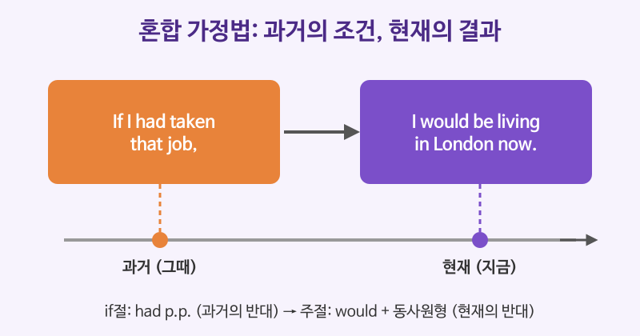

# 가정법 심화 (혼합 가정법, Had I known ...)

## 이번 강의에서 배울 것

- 과거의 조건과 현재의 결과를 섞는 **혼합 가정법**
- if를 생략하고 도치하는 격식체 가정법: Had I known, Were I, Should you
- wish / if only, as if, but for, It's time처럼 가정의 뜻을 담는 표현

## 핵심 설명

중급에서 배운 가정법 과거(현재의 반대)와 가정법 과거완료(과거의 반대)는 조건과 결과의 시점이 같았습니다. 실제 생활에서는 **"그때 ~했더라면, 지금 ~할 텐데"** 처럼 두 시점이 엇갈리는 경우가 많습니다. 이것이 **혼합 가정법**입니다.

| 종류 | 조건 (if절) | 결과 (주절) |
|---|---|---|
| 과거 조건 → 현재 결과 | If + had p.p. | would + 동사원형 (now) |
| 현재 상태 → 과거 결과 | If + 과거형 | would have p.p. |

### 혼합 가정법

| 영어 | 한국어 | 듣기 |
|---|---|---|
| If I had taken that job, I would be living in London now. | 그 일자리를 받아들였다면 지금 런던에 살고 있을 텐데. | [🔊](audio/02-advanced-conditionals-01.mp3) |
| If she hadn't missed the flight, she would be here by now. | 그녀가 비행기를 놓치지 않았다면 지금쯤 여기 와 있을 텐데. | [🔊](audio/02-advanced-conditionals-02.mp3) |
| If I were more organized, I wouldn't have lost the file. | 내가 좀 더 꼼꼼한 사람이라면 그 파일을 잃어버리지 않았을 텐데. | [🔊](audio/02-advanced-conditionals-03.mp3) |

### if를 생략한 도치 가정법

격식 있는 글이나 연설에서는 if를 빼고 **had, were, should를 주어 앞으로** 보냅니다. 뜻은 if절과 같지만 훨씬 단정하고 무게 있게 들립니다.

| 영어 | 한국어 | 듣기 |
|---|---|---|
| Had I known about the delay, I would have taken a taxi. | 지연된다는 걸 알았더라면 택시를 탔을 것이다. | [🔊](audio/02-advanced-conditionals-04.mp3) |
| Were I in your position, I would accept the offer. | 내가 당신 입장이라면 그 제안을 받아들이겠어요. | [🔊](audio/02-advanced-conditionals-05.mp3) |
| Should you have any questions, please do not hesitate to contact us. | 혹시 궁금한 점이 있으시면 언제든 연락 주십시오. | [🔊](audio/02-advanced-conditionals-06.mp3) |

> 💡 **Should you ...** 는 "혹시라도 ~하면"이라는 뜻으로, 비즈니스 이메일 끝인사에 아주 자주 나옵니다. If you have any questions보다 정중합니다.

### 가정의 뜻을 담은 표현들

| 영어 | 한국어 | 듣기 |
|---|---|---|
| I wish I had studied harder at university. | 대학 때 공부를 더 열심히 했더라면 좋았을 텐데. | [🔊](audio/02-advanced-conditionals-07.mp3) |
| If only we had more time. | 시간이 조금만 더 있다면 좋을 텐데. | [🔊](audio/02-advanced-conditionals-08.mp3) |
| He talks as if he were the boss. | 그는 마치 자기가 사장인 것처럼 말한다. | [🔊](audio/02-advanced-conditionals-09.mp3) |
| But for your help, the project would have failed. | 당신의 도움이 없었다면 그 프로젝트는 실패했을 것이다. | [🔊](audio/02-advanced-conditionals-10.mp3) |
| It's high time we made a decision. | 이제 정말 결정을 내려야 할 때다. | [🔊](audio/02-advanced-conditionals-11.mp3) |

- **wish / if only + 과거형**: 현재 사실의 반대, **+ had p.p.**: 과거 사실의 반대
- **as if + 과거형**: 실제로는 아닌데 마치 ~인 것처럼
- **but for / without**: ~이 없다면, ~이 없었다면 (주절의 시제로 판단)
- **It's (high) time + 과거형**: 벌써 했어야 할 일을 아직 안 했다는 아쉬움

### 영국식 발음으로 들어 보기

| 영어 | 한국어 | 듣기 |
|---|---|---|
| Had it not been for the rain, we would have won the match. | 비만 아니었다면 우리가 경기에서 이겼을 것이다. | [🔊](audio/02-advanced-conditionals-12-uk.mp3) |
| Were it not for his advice, I would still be lost. | 그의 조언이 없다면 나는 아직도 헤매고 있을 것이다. | [🔊](audio/02-advanced-conditionals-13-uk.mp3) |

## 자주 하는 실수

- ❌ If I would have known, I would have come. → ✅ If I had known, I would have come.
  - if절에는 would를 쓰지 않습니다. 과거 사실의 반대는 had p.p.입니다.
- ❌ If I had taken the job, I would have lived in London now. → ✅ ..., I would be living in London now.
  - now가 있으면 결과는 현재입니다. 혼합 가정법으로 would + 동사원형을 씁니다.
- ❌ Had not I known ... → ✅ Had I not known ...
  - 도치 가정법에서 not은 주어 뒤에 둡니다. 축약형(Hadn't I known)도 쓰지 않습니다.

## 연습 문제

괄호 안의 지시에 따라 문장을 바꾸세요.

1. If I had saved more money, I could buy a house now. (뜻을 우리말로 쓰기)
2. If I had known the truth, I would have told you. (if를 생략한 도치문으로)
3. If you need any further information, please call us. (Should로 시작)
4. I'm sorry I didn't listen to your advice. (I wish로 시작)
5. Without the map, we would have got lost. (But for로 시작)

## 정답과 해설

1. **그때 돈을 더 모아 두었다면 지금 집을 살 수 있을 텐데.**: 과거 조건(had saved)과 현재 결과(could buy)를 섞은 혼합 가정법입니다.
2. **Had I known the truth, I would have told you.**: if를 빼고 had를 주어 앞으로 보냅니다.
3. **Should you need any further information, please call us.**: should 뒤의 동사는 원형(need)입니다.
4. **I wish I had listened to your advice.**: 과거에 하지 않은 일에 대한 아쉬움이므로 had p.p.입니다.
5. **But for the map, we would have got lost.**: without과 but for는 바꿔 쓸 수 있습니다. 미국식으로는 gotten lost도 씁니다.

## 오늘의 단어

| 단어 | 뜻 | 예문 | 듣기 |
|---|---|---|---|
| hesitate | 주저하다, 망설이다 | Please don't hesitate to ask. | [🔊](audio/02-advanced-conditionals-w01.mp3) |
| organized | 정리를 잘하는, 체계적인 | She is very organized. | [🔊](audio/02-advanced-conditionals-w02.mp3) |
| position | 입장, 처지 | Put yourself in my position. | [🔊](audio/02-advanced-conditionals-w03.mp3) |
| delay | 지연, 지체 | We apologize for the delay. | [🔊](audio/02-advanced-conditionals-w04.mp3) |
| further | 추가의, 더 이상의 | Do you need further details? | [🔊](audio/02-advanced-conditionals-w05.mp3) |
