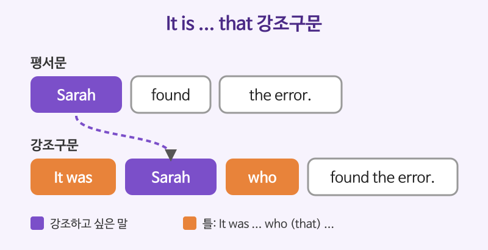

# 강조와 생략 (It is ... that, What I need is ...)

## 이번 강의에서 배울 것

- It is ... that 강조구문과 What ... is 구문으로 말하고 싶은 부분에 초점 맞추기
- do / does / did, the very, at all 같은 강조 표현
- 반복을 피하는 생략: so do I, do so, 접속사 뒤 주어와 be동사 생략

## 핵심 설명

영어는 같은 말을 되풀이하는 것을 싫어하고, 중요한 정보를 **문장의 특정 자리**에 두어 강조하는 것을 좋아합니다. 강조는 "무엇을 앞세울지", 생략은 "무엇을 뺄지"의 문제입니다.

### It is ... that 강조구문

**It is (was) + 강조할 말 + that + 나머지** 순서로 씁니다. 주어, 목적어, 부사(구)를 모두 강조할 수 있습니다.

| 영어 | 한국어 | 듣기 |
|---|---|---|
| It was Sarah who found the error. | 오류를 찾아낸 사람은 바로 사라였다. | [🔊](audio/03-emphasis-ellipsis-01.mp3) |
| It was in 2019 that we first met. | 우리가 처음 만난 것은 바로 2019년이었다. | [🔊](audio/03-emphasis-ellipsis-02.mp3) |
| It is not the price that worries me, but the quality. | 내가 걱정하는 건 가격이 아니라 품질이다. | [🔊](audio/03-emphasis-ellipsis-03.mp3) |

### What ... is 구문 (의사 분열문)

말하고 싶은 핵심을 **문장 끝**에 두어 기대감을 줍니다. 발표나 토론에서 자주 씁니다.

| 영어 | 한국어 | 듣기 |
|---|---|---|
| What we need is a clear plan. | 우리에게 필요한 것은 명확한 계획이다. | [🔊](audio/03-emphasis-ellipsis-04.mp3) |
| What surprised me most was his honesty. | 나를 가장 놀라게 한 것은 그의 솔직함이었다. | [🔊](audio/03-emphasis-ellipsis-05.mp3) |
| All I want is a quiet weekend. | 내가 바라는 건 조용한 주말뿐이다. | [🔊](audio/03-emphasis-ellipsis-06.mp3) |

### 단어 하나로 강조하기

| 영어 | 한국어 | 듣기 |
|---|---|---|
| I did send the email. Please check your spam folder. | 이메일은 분명히 보냈어요. 스팸함을 확인해 주세요. | [🔊](audio/03-emphasis-ellipsis-07.mp3) |
| This is the very book I was looking for. | 이게 바로 내가 찾던 그 책이다. | [🔊](audio/03-emphasis-ellipsis-08.mp3) |
| I'm not tired at all. | 나는 전혀 피곤하지 않다. | [🔊](audio/03-emphasis-ellipsis-09.mp3) |

- **do / does / did + 동사원형**: "정말로, 분명히". 상대의 의심을 반박할 때 씁니다.
- **the very + 명사**: "바로 그".
- **at all, whatsoever**: 부정문을 강하게 만듭니다.

### 생략: 반복을 피하기

| 영어 | 한국어 | 듣기 |
|---|---|---|
| She loves jazz, and so do I. | 그녀는 재즈를 좋아하고, 나도 그렇다. | [🔊](audio/03-emphasis-ellipsis-10.mp3) |
| I haven't read the report, and neither has my manager. | 나는 그 보고서를 안 읽었고, 우리 팀장님도 마찬가지다. | [🔊](audio/03-emphasis-ellipsis-11.mp3) |
| You can leave early if you want to. | 원하면 일찍 가도 돼요. | [🔊](audio/03-emphasis-ellipsis-12.mp3) |
| When in doubt, ask your supervisor. | 확신이 서지 않을 때는 상사에게 물어보세요. | [🔊](audio/03-emphasis-ellipsis-13.mp3) |

- **if you want to**: to 뒤의 leave early가 생략되었습니다. 이런 to를 대부정사라고 합니다.
- **When in doubt**: When (you are) in doubt. 부사절의 주어가 주절과 같으면 **주어 + be동사**를 함께 뺄 수 있습니다.

### 영국식 발음으로 들어 보기

| 영어 | 한국어 | 듣기 |
|---|---|---|
| It was only later that I understood what she meant. | 그녀가 무슨 뜻으로 말했는지 이해한 것은 한참 뒤였다. | [🔊](audio/03-emphasis-ellipsis-14-uk.mp3) |
| If necessary, we can postpone the meeting. | 필요하면 회의를 미룰 수 있습니다. | [🔊](audio/03-emphasis-ellipsis-15-uk.mp3) |

## 자주 하는 실수

- ❌ It was yesterday when I met him. → ✅ It was yesterday that I met him.
  - 강조구문에서는 시간 표현을 강조해도 that을 쓰는 것이 기본입니다. 사람이면 who도 됩니다.
- ❌ She likes coffee, and so I do. → ✅ She likes coffee, and so do I.
  - "나도 그렇다"는 so + 조동사 + 주어 어순입니다. so I do는 "정말 그렇다"는 전혀 다른 뜻입니다.
- ❌ I did sent it. → ✅ I did send it.
  - 강조의 did 뒤에는 동사원형이 옵니다.

## 연습 문제

괄호 안의 지시에 따라 문장을 바꾸세요.

1. Tom broke the window. (Tom을 강조하는 It was ... 구문으로)
2. We need more time. (What으로 시작하는 문장으로)
3. I locked the door. (상대가 의심할 때 "분명히 잠갔다"는 뜻으로)
4. He doesn't eat meat. I don't eat meat either. (neither를 써서 한 문장으로)
5. While I was walking home, I saw an accident. (while 뒤를 생략해서)

## 정답과 해설

1. **It was Tom who (that) broke the window.**: 강조할 사람을 It was와 who 사이에 둡니다.
2. **What we need is more time.**: 핵심 정보(more time)가 문장 끝으로 갑니다.
3. **I did lock the door.**: did를 쓰고 lock은 원형으로 돌아갑니다. 말할 때는 did에 힘을 줍니다.
4. **He doesn't eat meat, and neither do I.**: neither + 조동사 + 주어 어순입니다.
5. **While walking home, I saw an accident.**: 주어(I)와 be동사(was)를 함께 생략합니다.

## 오늘의 단어

| 단어 | 뜻 | 예문 | 듣기 |
|---|---|---|---|
| honesty | 정직, 솔직함 | I appreciate your honesty. | [🔊](audio/03-emphasis-ellipsis-w01.mp3) |
| supervisor | 상사, 감독자 | Talk to your supervisor first. | [🔊](audio/03-emphasis-ellipsis-w02.mp3) |
| doubt | 의심, 확신이 없음 | There is no doubt about it. | [🔊](audio/03-emphasis-ellipsis-w03.mp3) |
| postpone | 미루다, 연기하다 | They postponed the launch. | [🔊](audio/03-emphasis-ellipsis-w04.mp3) |
| whatsoever | 조금도, 전혀 | I have no idea whatsoever. | [🔊](audio/03-emphasis-ellipsis-w05.mp3) |
