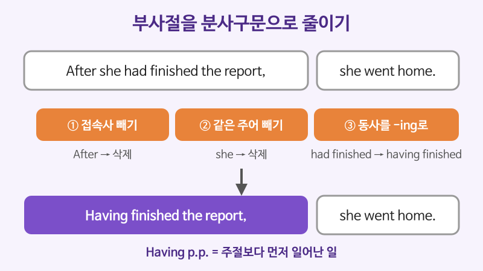

# 분사구문 심화 (Having finished ..., The weather being fine ...)

## 이번 강의에서 배울 것

- 시간 차이를 나타내는 완료 분사구문(Having p.p.)과 수동 분사구문
- 주어가 다른 독립 분사구문과 with + 명사 + 분사
- Generally speaking, Judging from처럼 굳어진 분사 표현

## 핵심 설명

분사구문은 부사절(when, because, after ...)을 짧게 줄인 것입니다. 만드는 순서는 세 단계입니다. **① 접속사를 뺀다 → ② 주절과 같은 주어를 뺀다 → ③ 동사를 -ing로 바꾼다.** 고급 단계에서는 여기에 시간 차이, 수동, 다른 주어가 더해집니다.

### 완료 분사구문: Having p.p.

주절보다 **먼저 일어난 일**임을 분명히 할 때 씁니다.

| 영어 | 한국어 | 듣기 |
|---|---|---|
| Having finished the report, she went home. | 보고서를 끝낸 뒤 그녀는 집에 갔다. | [🔊](audio/04-participle-clauses-01.mp3) |
| Having lived in Japan for years, he speaks fluent Japanese. | 일본에서 여러 해 살았기 때문에 그는 일본어가 유창하다. | [🔊](audio/04-participle-clauses-02.mp3) |
| Not having received a reply, I called the office. | 답장을 받지 못해서 나는 사무실에 전화했다. | [🔊](audio/04-participle-clauses-03.mp3) |

### 수동 분사구문

주어가 동작을 **받는** 경우에는 과거분사로 시작합니다. 앞의 Being이나 Having been은 보통 생략합니다.

| 영어 | 한국어 | 듣기 |
|---|---|---|
| Written in plain English, the guide is easy to follow. | 쉬운 영어로 쓰여 있어서 그 안내서는 따라 하기 쉽다. | [🔊](audio/04-participle-clauses-04.mp3) |
| Founded in 1950, the company has a long history. | 1950년에 세워진 그 회사는 역사가 길다. | [🔊](audio/04-participle-clauses-05.mp3) |
| Asked about the delay, the spokesperson declined to comment. | 지연에 대해 질문을 받자 대변인은 답변을 거부했다. | [🔊](audio/04-participle-clauses-06.mp3) |

### 독립 분사구문과 with + 명사 + 분사

분사구문의 주어가 주절의 주어와 **다르면** 그 주어를 남겨 둡니다.

| 영어 | 한국어 | 듣기 |
|---|---|---|
| The weather being fine, we had lunch outside. | 날씨가 좋아서 우리는 밖에서 점심을 먹었다. | [🔊](audio/04-participle-clauses-07.mp3) |
| All things considered, the event was a success. | 모든 것을 고려하면 그 행사는 성공이었다. | [🔊](audio/04-participle-clauses-08.mp3) |
| She listened with her eyes closed. | 그녀는 눈을 감은 채 귀를 기울였다. | [🔊](audio/04-participle-clauses-09.mp3) |
| He left the room with his phone ringing. | 그는 전화가 울리는 채로 방을 나갔다. | [🔊](audio/04-participle-clauses-10.mp3) |

- **with + 명사 + -ing**: 명사가 스스로 하는 동작 (전화가 울리다)
- **with + 명사 + p.p.**: 명사가 당한 상태 (눈이 감기다)

### 굳어진 분사 표현

주어와 상관없이 관용적으로 씁니다.

| 영어 | 한국어 | 듣기 |
|---|---|---|
| Generally speaking, older buildings are harder to heat. | 일반적으로 말해서 오래된 건물은 난방이 더 어렵다. | [🔊](audio/04-participle-clauses-11.mp3) |
| Judging from his accent, he must be from Scotland. | 말투로 판단하건대 그는 스코틀랜드 출신인 게 틀림없다. | [🔊](audio/04-participle-clauses-12-uk.mp3) |
| Considering the budget, the results are impressive. | 예산을 고려하면 결과는 인상적이다. | [🔊](audio/04-participle-clauses-13-uk.mp3) |

> 💡 분사구문은 **글, 뉴스, 보고서**에 잘 어울립니다. 대화에서는 "After she finished the report, she went home."처럼 접속사를 살려 말하는 편이 자연스럽습니다.

## 자주 하는 실수

- ❌ Walking down the street, the rain started. → ✅ Walking down the street, I got caught in the rain.
  - 분사구문의 숨은 주어는 주절의 주어입니다. 이 문장은 "비가 길을 걸었다"는 뜻이 되어 버립니다. 이런 오류를 dangling participle(현수 분사)이라고 합니다.
- ❌ Having been finished the work, he left. → ✅ Having finished the work, he left.
  - 그가 일을 "끝낸" 것이므로 능동입니다. been을 넣으면 수동이 됩니다.
- ❌ Not to know what to do, I asked for help. → ✅ Not knowing what to do, I asked for help.
  - 분사구문의 부정은 not을 분사 바로 앞에 둡니다.

## 연습 문제

부사절(접속사가 이끄는 부분)을 분사구문으로 바꿔 문장 전체를 다시 쓰세요.

1. After he had read the contract, he signed it.
2. Because it was built in 1900, the bridge needs repairs.
3. As the sun had set, we headed back to the hotel.
4. Because I didn't know her number, I sent an email.
5. She sat on the sofa, and her legs were crossed. (with를 써서)

## 정답과 해설

1. **Having read the contract, he signed it.**: 읽은 것이 서명보다 먼저이므로 Having p.p.입니다.
2. **(Having been) Built in 1900, the bridge needs repairs.**: 다리는 "지어진" 것이므로 수동입니다. Having been은 보통 생략합니다.
3. **The sun having set, we headed back to the hotel.**: 주어(the sun)가 주절(we)과 달라서 남겨 둡니다.
4. **Not knowing her number, I sent an email.**: not은 분사 앞에 둡니다.
5. **She sat on the sofa with her legs crossed.**: 다리는 "꼬인" 상태이므로 과거분사입니다.

## 오늘의 단어

| 단어 | 뜻 | 예문 | 듣기 |
|---|---|---|---|
| fluent | 유창한 | She is fluent in three languages. | [🔊](audio/04-participle-clauses-w01.mp3) |
| spokesperson | 대변인 | A spokesperson confirmed the news. | [🔊](audio/04-participle-clauses-w02.mp3) |
| decline | 거절하다, 사양하다 | He declined the invitation. | [🔊](audio/04-participle-clauses-w03.mp3) |
| found | 설립하다 | The school was founded in 1920. | [🔊](audio/04-participle-clauses-w04.mp3) |
| impressive | 인상적인 | Her speech was impressive. | [🔊](audio/04-participle-clauses-w05.mp3) |
