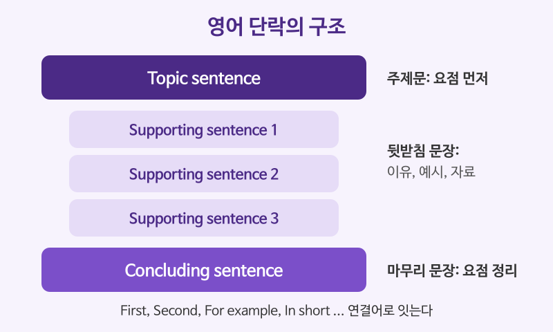

# 단락 구성 (Topic Sentence와 Supporting Sentences)

## 이번 강의에서 배울 것

- 영어 단락의 기본 틀: 주제문 → 뒷받침 문장 → 마무리 문장
- 단락을 매끄럽게 잇는 연결어(transition words)
- 한 단락에 한 가지 생각만 담는 통일성(unity)과 일관성(coherence)

## 핵심 설명

영어 글은 **결론을 먼저** 말합니다. 단락의 첫 문장(주제문, topic sentence)에서 "이 단락은 이것에 관한 이야기다"라고 밝히고, 이어지는 문장들이 그 주장을 이유, 예시, 근거로 받칩니다. 한국어 글처럼 배경부터 길게 풀다가 끝에서 결론을 내리면 영어 독자는 요점을 놓치기 쉽습니다.

| 부분 | 역할 | 분량 |
|---|---|---|
| 주제문 (topic sentence) | 단락의 요점을 한 문장으로 밝힌다 | 1문장 |
| 뒷받침 문장 (supporting sentences) | 이유, 예시, 자료로 요점을 증명한다 | 3~5문장 |
| 마무리 문장 (concluding sentence) | 요점을 다른 말로 다시 정리하거나 다음 단락으로 넘긴다 | 1문장 |

### 예시 단락: 재택근무의 장점

아래 문장들을 차례로 읽으면 하나의 단락이 됩니다. 각 문장이 어떤 역할을 하는지 살펴보세요.

| 영어 | 한국어 | 듣기 |
|---|---|---|
| Remote work can make employees more productive. | 재택근무는 직원들의 생산성을 높일 수 있다. | [🔊](audio/01-paragraphs-01.mp3) |
| First, it eliminates the daily commute, which often takes more than an hour. | 첫째, 종종 한 시간이 넘게 걸리는 출퇴근이 사라진다. | [🔊](audio/01-paragraphs-02.mp3) |
| Second, people can work in a quiet space without constant interruptions. | 둘째, 계속되는 방해 없이 조용한 곳에서 일할 수 있다. | [🔊](audio/01-paragraphs-03.mp3) |
| For example, many software developers say they write better code at home. | 예를 들어, 많은 소프트웨어 개발자는 집에서 코드를 더 잘 짠다고 말한다. | [🔊](audio/01-paragraphs-04.mp3) |
| In short, when it is managed well, remote work benefits both workers and companies. | 요컨대 잘 관리되기만 하면 재택근무는 직원과 회사 모두에게 이롭다. | [🔊](audio/01-paragraphs-05.mp3) |

- 첫 문장이 **주제문**, 마지막 문장이 **마무리 문장**입니다.
- First, Second, For example, In short 같은 **연결어**가 문장 사이의 관계를 알려 줍니다.

### 자주 쓰는 연결어

| 영어 | 한국어 | 듣기 |
|---|---|---|
| In addition, the new system reduces costs. | 게다가 새 시스템은 비용도 줄여 준다. | [🔊](audio/01-paragraphs-06.mp3) |
| However, not everyone agrees with this view. | 그러나 모두가 이 견해에 동의하는 것은 아니다. | [🔊](audio/01-paragraphs-07.mp3) |
| As a result, sales increased in the second quarter. | 그 결과 2분기에 매출이 늘었다. | [🔊](audio/01-paragraphs-08.mp3) |
| In contrast, smaller firms struggled to adapt. | 반면에 작은 회사들은 적응하는 데 어려움을 겪었다. | [🔊](audio/01-paragraphs-09.mp3) |
| Therefore, we recommend a gradual approach. | 따라서 우리는 단계적인 접근을 권한다. | [🔊](audio/01-paragraphs-10.mp3) |

| 관계 | 연결어 |
|---|---|
| 덧붙이기 | in addition, moreover, furthermore, also |
| 대조 | however, in contrast, on the other hand, nevertheless |
| 예시 | for example, for instance, such as |
| 결과 | as a result, therefore, consequently |
| 정리 | in short, in conclusion, overall |

### 영국식 발음으로 들어 보기

| 영어 | 한국어 | 듣기 |
|---|---|---|
| Moreover, the policy has had a positive effect on staff morale. | 더욱이 그 정책은 직원 사기에 긍정적인 영향을 미쳤다. | [🔊](audio/01-paragraphs-11-uk.mp3) |
| Nevertheless, several questions remain unanswered. | 그럼에도 불구하고 몇 가지 질문은 여전히 답을 찾지 못했다. | [🔊](audio/01-paragraphs-12-uk.mp3) |

> 💡 좋은 단락인지 확인하는 방법: 주제문만 모아 읽어 보세요. 주제문만 읽어도 글 전체의 흐름이 보이면 잘 쓴 글입니다.

## 자주 하는 실수

- ❌ 배경 설명으로 시작해 마지막 문장에서 요점을 밝힌다. → ✅ 첫 문장에서 요점을 밝히고 뒤에서 증명한다.
  - 영어 독자는 첫 문장을 읽고 단락 전체를 예상합니다.
- ❌ However, Moreover를 문장 중간에 쉼표 없이 쓴다. (The plan was good however it failed.) → ✅ The plan was good. However, it failed.
  - however는 접속사가 아니라 부사입니다. 두 문장을 이을 수 없으니 마침표나 세미콜론(;)으로 나누세요.
- ❌ 한 단락에 장점과 단점, 해결책을 모두 넣는다. → ✅ 한 단락에는 한 가지 생각만 담는다.
  - 생각이 바뀌면 단락도 새로 시작합니다.

## 연습 문제

다음 단락을 읽고 물음에 답하세요.

> (A) Learning a second language has clear benefits for adults. (B) It keeps the brain active and may delay memory loss. (C) It also opens doors to new careers. (D) My cousin lives in Canada. (E) In short, it is never too late to start learning a language.

1. 주제문은 (A)~(E) 중 무엇인가요?
2. 단락의 통일성을 해치는 문장은 무엇인가요?
3. (C)에서 앞 문장에 정보를 덧붙이는 연결어는 무엇인가요?
4. 빈칸에 알맞은 연결어를 고르세요: The software is powerful. ___, it is difficult to learn. (Therefore / However)
5. 다음 내용을 주제문 한 문장으로 영어로 쓰세요: "운동은 정신 건강에 좋다."

## 정답과 해설

1. **(A)**: 성인의 제2외국어 학습에 장점이 있다는 요점을 밝힙니다.
2. **(D)**: 사촌이 캐나다에 산다는 내용은 주제와 관계가 없습니다.
3. **also**: "또한"이라는 뜻으로 두 번째 장점을 덧붙입니다.
4. **However**: 강력하다는 장점과 배우기 어렵다는 단점이 대조됩니다.
5. **Regular exercise is good for your mental health.** 등: 무엇에 관한 단락인지 분명히 드러나면 됩니다.

## 오늘의 단어

| 단어 | 뜻 | 예문 | 듣기 |
|---|---|---|---|
| productive | 생산적인 | I feel more productive in the morning. | [🔊](audio/01-paragraphs-w01.mp3) |
| eliminate | 없애다, 제거하다 | We need to eliminate waste. | [🔊](audio/01-paragraphs-w02.mp3) |
| interruption | 방해, 중단 | Sorry for the interruption. | [🔊](audio/01-paragraphs-w03.mp3) |
| gradual | 점진적인, 단계적인 | There was a gradual change. | [🔊](audio/01-paragraphs-w04.mp3) |
| morale | 사기, 의욕 | Team morale is high. | [🔊](audio/01-paragraphs-w05.mp3) |
