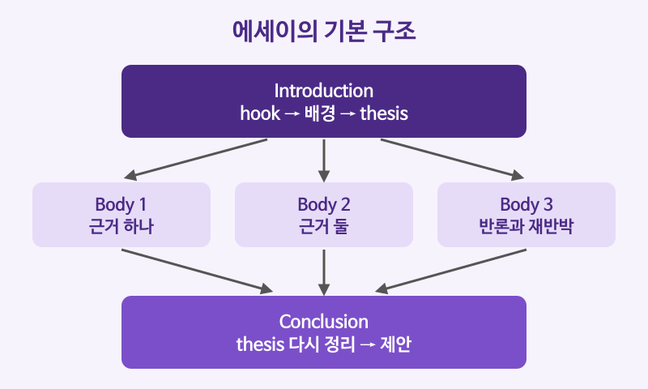

# 에세이 구조 (서론, 본론, 결론)

## 이번 강의에서 배울 것

- 영어 에세이의 기본 틀: 서론(hook, 배경, thesis) → 본론 단락 → 결론
- 글 전체의 방향을 정하는 주제 진술문(thesis statement) 쓰기
- 반론을 인정하고 다시 반박하는 논증 표현

## 핵심 설명

에세이는 2장 1강에서 배운 **단락을 여러 개 쌓은 글**입니다. 단락의 주제문이 단락을 이끌듯, 에세이에서는 서론 끝의 **주제 진술문(thesis statement)** 이 글 전체를 이끕니다. 가장 기본이 되는 틀은 서론 1개, 본론 2~3개, 결론 1개로 이루어진 다섯 단락 에세이입니다.

| 부분 | 들어갈 내용 |
|---|---|
| 서론 (introduction) | 흥미를 끄는 첫 문장(hook) → 배경 설명 → 주제 진술문 |
| 본론 (body paragraphs) | 단락마다 근거 하나. 주제문 + 설명 + 예시 |
| 결론 (conclusion) | 주제 진술문을 다른 말로 다시 쓰고, 생각할 거리나 제안으로 끝맺기 |

### 서론 쓰기

주제: "Should cities ban cars from their centers? (도심에서 자동차를 금지해야 하는가?)"

| 영어 | 한국어 | 듣기 |
|---|---|---|
| Imagine walking through a city center where the only sounds are voices and bicycle bells. | 들리는 소리라고는 사람 목소리와 자전거 벨소리뿐인 도심을 걷는다고 상상해 보라. | [🔊](audio/02-essay-01.mp3) |
| Several European cities have already closed their central streets to private cars. | 이미 여러 유럽 도시가 중심가에 개인 차량의 진입을 막았다. | [🔊](audio/02-essay-02.mp3) |
| This essay argues that car-free city centers improve public health, support local businesses, and make cities more livable. | 이 글은 차 없는 도심이 시민 건강을 개선하고, 지역 상권을 돕고, 도시를 더 살기 좋게 만든다고 주장한다. | [🔊](audio/02-essay-03.mp3) |

- 첫 문장이 **hook**, 둘째 문장이 **배경**, 셋째 문장이 **주제 진술문**입니다.
- 주제 진술문에 본론에서 다룰 근거 세 가지(health, businesses, livable)를 미리 보여 주면 독자가 글의 지도를 갖게 됩니다.

### 본론 쓰기: 근거와 반론

| 영어 | 한국어 | 듣기 |
|---|---|---|
| The most important benefit is cleaner air. | 가장 중요한 이점은 공기가 깨끗해진다는 것이다. | [🔊](audio/02-essay-04.mp3) |
| Critics argue that a ban would hurt shops that depend on drivers. | 비판하는 쪽에서는 금지 조치가 운전자 손님에게 의존하는 가게에 피해를 줄 것이라고 주장한다. | [🔊](audio/02-essay-05.mp3) |
| While this concern is understandable, pedestrians tend to visit shops more often. | 이런 우려는 이해할 만하지만, 보행자가 가게를 더 자주 찾는 경향이 있다. | [🔊](audio/02-essay-06.mp3) |

> 💡 **반론 인정 → 재반박** 구조(Critics argue that ... While ..., ...)를 넣으면 글이 한쪽 이야기만 하지 않는다는 인상을 주어 설득력이 커집니다.

### 결론 쓰기

| 영어 | 한국어 | 듣기 |
|---|---|---|
| In conclusion, the advantages of car-free centers clearly outweigh the drawbacks. | 결론적으로 차 없는 도심의 장점은 단점보다 분명히 크다. | [🔊](audio/02-essay-07.mp3) |
| City leaders should begin with small pilot zones and expand them gradually. | 시 지도자들은 작은 시범 구역에서 시작해 점차 넓혀 가야 한다. | [🔊](audio/02-essay-08.mp3) |

### 논증에 자주 쓰는 표현

| 영어 | 한국어 | 듣기 |
|---|---|---|
| There is growing evidence that the policy works. | 그 정책이 효과가 있다는 증거가 늘고 있다. | [🔊](audio/02-essay-09.mp3) |
| It could be argued that the costs are too high. | 비용이 너무 크다는 주장도 있을 수 있다. | [🔊](audio/02-essay-10.mp3) |
| This is not to say that cars have no place in cities. | 그렇다고 도시에 자동차가 설 자리가 없다는 말은 아니다. | [🔊](audio/02-essay-11-uk.mp3) |
| On balance, the benefits are worth the effort. | 이것저것 따져 보면 그만한 노력을 들일 가치가 있다. | [🔊](audio/02-essay-12-uk.mp3) |

## 자주 하는 실수

- ❌ In this essay, I will talk about cars. → ✅ This essay argues that car-free city centers improve public health.
  - 주제 진술문에는 주제만이 아니라 **나의 입장**이 들어가야 합니다.
- ❌ 결론에서 새로운 근거를 꺼낸다. → ✅ 결론에서는 이미 말한 내용을 정리하고 제안으로 끝낸다.
  - 새 근거가 있다면 본론 단락으로 옮기세요.
- ❌ I think, I think, I think ... → ✅ 근거와 자료로 말한다.
  - I think를 반복하면 주장이 약해 보입니다. 학술 에세이에서는 1인칭을 줄이고 This essay argues ..., The evidence suggests ... 같은 표현을 씁니다.

## 연습 문제

1. 서론의 세 부분을 순서대로 쓰세요.
2. 다음 중 주제 진술문으로 가장 알맞은 것은? (a) Social media is popular. (b) I will write about social media. (c) Social media does more harm than good to teenagers because it disrupts sleep and lowers self-esteem.
3. "비판하는 쪽에서는 ~라고 주장한다"를 영어 표현으로 쓰세요.
4. 결론을 시작할 때 쓰는 표현 두 가지를 쓰세요.
5. 다음 문장을 반론 인정 → 재반박 구조로 한 문장으로 이으세요: The plan is expensive. It will save money in the long run.

## 정답과 해설

1. **hook → 배경 설명 → 주제 진술문 (thesis statement)**
2. **(c)**: 입장(more harm than good)과 근거(sleep, self-esteem)가 모두 들어 있습니다. (a)는 사실일 뿐이고, (b)는 주제만 밝힙니다.
3. **Critics argue that ...**: Some people claim that ...도 됩니다.
4. **In conclusion, / On balance,** 등: To sum up, Overall도 씁니다.
5. **While the plan is expensive, it will save money in the long run.**: Although를 써도 됩니다.

## 오늘의 단어

| 단어 | 뜻 | 예문 | 듣기 |
|---|---|---|---|
| thesis | 논지, 주제 진술 | State your thesis clearly. | [🔊](audio/02-essay-w01.mp3) |
| outweigh | ~보다 더 크다 | The benefits outweigh the risks. | [🔊](audio/02-essay-w02.mp3) |
| drawback | 단점, 문제점 | The main drawback is the cost. | [🔊](audio/02-essay-w03.mp3) |
| pedestrian | 보행자 | This street is for pedestrians only. | [🔊](audio/02-essay-w04.mp3) |
| livable | 살기 좋은 | It is one of the most livable cities. | [🔊](audio/02-essay-w05.mp3) |
