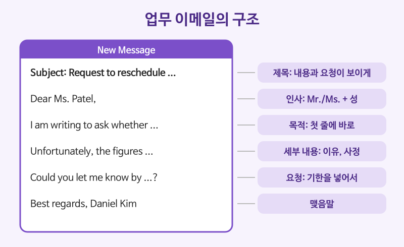

# 비즈니스 문서 (이메일, 메모, 보고서)

## 이번 강의에서 배울 것

- 업무 이메일의 구조: 제목 → 인사 → 목적 → 세부 내용 → 요청 → 맺음말
- 직설적인 말을 정중하게 바꾸는 표현
- 메모와 보고서에서 쓰는 간결한 문체

## 핵심 설명

업무 문서의 첫째 원칙은 **목적을 먼저**입니다. 받는 사람은 바쁘기 때문에 첫 두 줄 안에 "왜 이 메일을 보냈는지, 무엇을 해 주면 되는지"가 보여야 합니다. 둘째 원칙은 **정중하지만 짧게**입니다. 길게 돌려 말하는 것보다 공손한 표현 몇 개를 정확히 쓰는 편이 프로답게 보입니다.

### 예시 이메일: 회의 일정 변경

| 영어 | 한국어 | 듣기 |
|---|---|---|
| Subject: Request to reschedule Thursday's budget meeting | 제목: 목요일 예산 회의 일정 변경 요청 | [🔊](audio/03-business-writing-01.mp3) |
| Dear Ms. Patel, | 파텔 님께, | [🔊](audio/03-business-writing-02.mp3) |
| I am writing to ask whether we could move Thursday's meeting to Friday morning. | 목요일 회의를 금요일 오전으로 옮길 수 있을지 여쭙고자 메일 드립니다. | [🔊](audio/03-business-writing-03.mp3) |
| Unfortunately, the final sales figures will not be available until Thursday afternoon. | 유감스럽게도 최종 매출 자료가 목요일 오후에야 나옵니다. | [🔊](audio/03-business-writing-04.mp3) |
| Could you let me know by Wednesday if Friday at ten works for you? | 금요일 10시가 괜찮으신지 수요일까지 알려 주시겠어요? | [🔊](audio/03-business-writing-05.mp3) |
| Thank you for your understanding. | 양해해 주셔서 감사합니다. | [🔊](audio/03-business-writing-06.mp3) |
| Best regards, Daniel Kim | 김다니엘 드림 | [🔊](audio/03-business-writing-07.mp3) |

- 제목만 보고도 내용과 요청을 알 수 있게 씁니다. "Meeting"처럼 한 단어 제목은 피합니다.
- 셋째 문장(I am writing to ...)에서 바로 **목적**을 밝힙니다.
- 요청에는 **기한**(by Wednesday)을 넣어야 답장이 빨리 옵니다.

### 직설적인 말을 정중하게

| 직설적 | 정중하게 |
|---|---|
| Send me the file. | Could you send me the file? |
| You made a mistake. | There seems to be an error in the invoice. |
| I want a discount. | We would appreciate it if you could offer a discount. |
| No. | I'm afraid we are unable to accept this proposal. |

| 영어 | 한국어 | 듣기 |
|---|---|---|
| There seems to be an error in the invoice. | 청구서에 오류가 있는 것 같습니다. | [🔊](audio/03-business-writing-08.mp3) |
| We would appreciate it if you could confirm the order. | 주문을 확인해 주시면 감사하겠습니다. | [🔊](audio/03-business-writing-09.mp3) |
| I'm afraid we are unable to accept this proposal. | 죄송하지만 이 제안은 받아들이기 어렵습니다. | [🔊](audio/03-business-writing-10.mp3) |
| Please find the revised schedule attached. | 수정된 일정을 첨부했으니 확인해 주십시오. | [🔊](audio/03-business-writing-11.mp3) |

- **There seems to be ...**: 상대를 탓하지 않고 문제만 짚습니다.
- **I'm afraid ...**: 거절이나 나쁜 소식을 부드럽게 전합니다.

### 메모와 보고서의 문체

메모(memo)는 회사 안에서 돌리는 짧은 공지, 보고서(report)는 조사 결과를 정리한 문서입니다. 둘 다 **소제목, 번호 목록, 짧은 문장**을 써서 훑어 읽기 쉽게 만듭니다.

| 영어 | 한국어 | 듣기 |
|---|---|---|
| The purpose of this report is to evaluate our new delivery system. | 이 보고서의 목적은 새 배송 시스템을 평가하는 것이다. | [🔊](audio/03-business-writing-12-uk.mp3) |
| Based on these findings, we recommend extending the trial by three months. | 이 결과를 바탕으로 시범 운영을 3개월 연장할 것을 권고한다. | [🔊](audio/03-business-writing-13-uk.mp3) |

> 💡 맺음말은 상황에 맞게 고르세요. **Best regards, / Kind regards,** 는 무난하고, **Sincerely,** 는 더 격식 있는 편지에 씁니다. 동료끼리는 **Thanks,** 나 **Best,** 도 괜찮습니다.

## 자주 하는 실수

- ❌ Dear Mr. Daniel, → ✅ Dear Mr. Kim, / Dear Daniel,
  - Mr., Ms. 뒤에는 성(last name)을 씁니다. 이름(first name)을 쓸 때는 Mr.를 빼세요.
- ❌ I am writing this email because I want to ask you about the meeting which we were going to have on Thursday. → ✅ I am writing to ask whether we could move Thursday's meeting.
  - 업무 문서에서 긴 문장은 읽는 사람의 시간을 빼앗습니다.
- ❌ Please check the attached file which I attached. → ✅ Please find the file attached. / I have attached the file.
  - 같은 말을 되풀이하지 마세요. attach는 한 번이면 충분합니다.

## 연습 문제

다음 문장을 업무 이메일에 맞게 정중하게 바꾸세요.

1. Tell me the price.
2. Your report is wrong.
3. I can't come to the meeting.
4. Answer by Friday.
5. 이메일 첫 문장에 "새 프로젝트 일정을 알려 드리고자 메일 드립니다"를 영어로 쓰세요.

## 정답과 해설

1. **Could you let me know the price?**: 명령문 대신 Could you ...?를 씁니다.
2. **There seems to be an error in the report.**: 상대를 주어로 삼지 않고 문제를 주어로 삼습니다.
3. **I'm afraid I won't be able to attend the meeting.**: I'm afraid로 부드럽게 시작합니다.
4. **I would appreciate it if you could reply by Friday.**: 기한은 남기고 말투만 바꿉니다.
5. **I am writing to inform you of the new project schedule.**: I am writing to + 목적은 업무 이메일의 기본 첫 문장입니다.

## 오늘의 단어

| 단어 | 뜻 | 예문 | 듣기 |
|---|---|---|---|
| reschedule | 일정을 변경하다 | Can we reschedule the call? | [🔊](audio/03-business-writing-w01.mp3) |
| invoice | 청구서, 송장 | We sent the invoice yesterday. | [🔊](audio/03-business-writing-w02.mp3) |
| attached | 첨부된 | Please see the attached file. | [🔊](audio/03-business-writing-w03.mp3) |
| evaluate | 평가하다 | We need to evaluate the results. | [🔊](audio/03-business-writing-w04.mp3) |
| findings | (조사·연구) 결과 | The findings were surprising. | [🔊](audio/03-business-writing-w05.mp3) |
