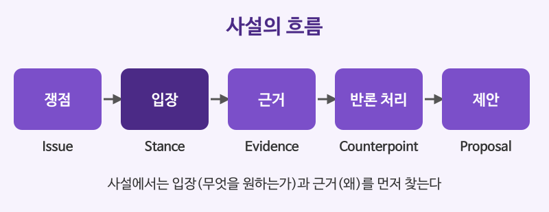

# 신문 사설·칼럼 읽기

## 이번 강의에서 배울 것

- 사설의 흐름: 쟁점 제시 → 입장 → 근거 → 반론 처리 → 제안
- 사실(fact)과 의견(opinion)을 구별하는 법
- 글쓴이의 태도를 드러내는 어휘와 수사적 장치 읽기

## 핵심 설명

사설(editorial)은 신문사의 공식 의견이고, 칼럼(column)은 필자 개인의 의견입니다. 둘 다 **독자를 설득하려는 글**이라서 정보 기사와 읽는 법이 다릅니다. "무슨 일이 있었나"보다 **"글쓴이는 무엇을 원하고, 어떤 근거를 대는가"** 를 찾으며 읽어야 합니다.

### 지문: 퇴근 후 연락받지 않을 권리

아래 사설은 이 강의를 위해 새로 쓴 글입니다.

> **Switch Off, Not Burn Out**
>
> It is ten o'clock at night, and your phone buzzes with yet another message from your manager. For millions of office workers, this is no longer the exception but the rule. Several countries have already introduced a "right to disconnect," allowing employees to ignore work messages outside their contracted hours. It is time for more governments to follow their lead.
>
> The case is simple. Rest is not a luxury; it is what allows people to do good work. Employees who are expected to answer messages at all hours are more likely to suffer from stress and poor sleep.
>
> Some business leaders warn that such laws are too rigid for a global economy that never sleeps. That concern deserves a hearing, but it is hardly a reason to do nothing. Sensible rules can make room for genuine emergencies and for teams working across time zones.
>
> Nobody is asking companies to stop working. We are asking them to let their people stop, at least for the night.

### 핵심 문장 다시 읽기

| 영어 | 한국어 | 듣기 |
|---|---|---|
| For millions of office workers, this is no longer the exception but the rule. | 수많은 직장인에게 이것은 더 이상 예외가 아니라 일상이다. | [🔊](audio/01-editorials-01.mp3) |
| Several countries have already introduced a right to disconnect. | 이미 여러 나라가 연결되지 않을 권리를 도입했다. | [🔊](audio/01-editorials-02.mp3) |
| It is time for more governments to follow their lead. | 이제 더 많은 정부가 그 뒤를 따를 때다. | [🔊](audio/01-editorials-03.mp3) |
| Rest is not a luxury; it is what allows people to do good work. | 휴식은 사치가 아니다. 사람이 일을 잘할 수 있게 해 주는 바탕이다. | [🔊](audio/01-editorials-04.mp3) |
| Some business leaders warn that such laws are too rigid. | 일부 기업인은 그런 법이 지나치게 경직되어 있다고 경고한다. | [🔊](audio/01-editorials-05.mp3) |
| That concern deserves a hearing, but it is hardly a reason to do nothing. | 그 우려는 귀 기울일 만하지만, 아무것도 하지 않을 이유는 결코 되지 못한다. | [🔊](audio/01-editorials-06.mp3) |
| Nobody is asking companies to stop working. | 기업에 일을 멈추라고 요구하는 사람은 아무도 없다. | [🔊](audio/01-editorials-07.mp3) |
| We are asking them to let their people stop, at least for the night. | 우리는 적어도 밤에는 직원들이 멈출 수 있게 해 달라고 요구하는 것이다. | [🔊](audio/01-editorials-08.mp3) |

### 구조 분석

| 단계 | 지문에서 해당하는 부분 |
|---|---|
| 쟁점 제시 | 밤 10시에 울리는 상사의 메시지 (장면으로 시작하는 hook) |
| 입장 | It is time for more governments to follow their lead. |
| 근거 | 휴식이 있어야 일을 잘한다, 상시 연락은 스트레스와 수면 부족을 부른다 |
| 반론 처리 | Some business leaders warn ... That concern deserves a hearing, but ... |
| 제안 | 비상 상황과 시차를 고려한 합리적인 규칙, 마지막 문장의 대구 |

### 사실과 의견 구별하기

- **사실**: 확인할 수 있는 내용. Several countries have already introduced ...
- **의견**: 글쓴이의 판단. 신호가 되는 말은 **should, it is time, sensible, hardly, simple** 같은 평가 어휘입니다.
- 사설의 마지막 문장은 stop working과 let their people stop을 맞세운 **대구(parallelism)** 입니다. 사설과 연설에서 주장을 기억에 남기는 대표적인 장치입니다.

### 영국식 발음으로 들어 보기

영국 신문 사설에서 자주 보이는 말투입니다.

| 영어 | 한국어 | 듣기 |
|---|---|---|
| The government would do well to listen. | 정부는 귀를 기울이는 편이 현명할 것이다. | [🔊](audio/01-editorials-09-uk.mp3) |
| This is, frankly, a missed opportunity. | 솔직히 말해 이것은 놓쳐 버린 기회다. | [🔊](audio/01-editorials-10-uk.mp3) |

## 자주 하는 실수

- ❌ 사설의 첫 장면(밤 10시의 메시지)을 글의 주제로 착각한다. → ✅ 첫 장면은 hook이고, 주장은 It is time ... 문장이다.
  - 사설의 입장은 보통 첫 단락 끝이나 둘째 단락 처음에 나옵니다.
- ❌ Some business leaders warn ... 을 글쓴이의 생각으로 읽는다. → ✅ 글쓴이가 반박하려고 소개한 반대 의견이다.
  - Some argue, Critics say, It is often claimed 뒤에는 대개 but, however가 따라옵니다.
- ❌ hardly를 "열심히"로 읽는다. → ✅ hardly는 "거의 ~아니다".
  - it is hardly a reason은 "결코 이유가 되지 못한다"는 강한 부정입니다.

## 연습 문제

지문을 읽고 답하세요.

1. 글쓴이의 입장을 한 문장으로 요약하세요.
2. 글쓴이가 소개한 반대 의견은 무엇인가요?
3. 다음 중 사실인 문장은? (a) The case is simple. (b) Several countries have already introduced a right to disconnect. (c) It is time for more governments to follow their lead.
4. no longer the exception but the rule을 우리말로 옮기세요.
5. 글쓴이는 반대 의견에 대해 어떤 해결책을 제시하나요?

## 정답과 해설

1. **더 많은 정부가 퇴근 후 연락받지 않을 권리를 법으로 보장해야 한다.**
2. **그런 법은 쉬지 않고 돌아가는 세계 경제에 비해 너무 경직되어 있다.**
3. **(b)**: 확인할 수 있는 사실입니다. (a)와 (c)는 글쓴이의 판단입니다.
4. **더 이상 예외가 아니라 일상(통례)이다.**: not A but B, "A가 아니라 B" 구문입니다.
5. **진짜 비상 상황과 여러 시간대에 걸쳐 일하는 팀을 고려한 합리적인 규칙을 만들자고 한다.**

## 오늘의 단어

| 단어 | 뜻 | 예문 | 듣기 |
|---|---|---|---|
| disconnect | 연결을 끊다, 업무에서 벗어나다 | I need to disconnect this weekend. | [🔊](audio/01-editorials-w01.mp3) |
| luxury | 사치, 사치품 | Free time feels like a luxury. | [🔊](audio/01-editorials-w02.mp3) |
| rigid | 경직된, 융통성 없는 | The rules are too rigid. | [🔊](audio/01-editorials-w03.mp3) |
| sensible | 분별 있는, 합리적인 | That sounds like a sensible plan. | [🔊](audio/01-editorials-w04.mp3) |
| genuine | 진짜의, 진정한 | This is a genuine emergency. | [🔊](audio/01-editorials-w05.mp3) |
