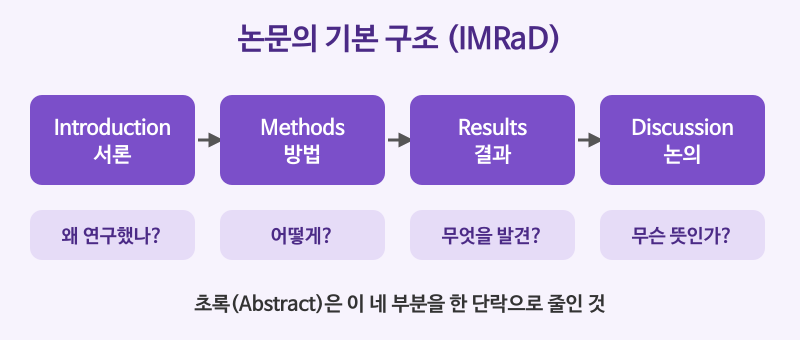

# 학술 텍스트 읽기 (논문 초록과 본문)

## 이번 강의에서 배울 것

- 논문의 기본 구조(서론, 방법, 결과, 논의)와 초록(abstract) 읽는 법
- 학술 글의 특징: 조심스러운 표현(hedging), 명사화, 수동태
- 연구 결과와 글쓴이의 해석을 구별하기

## 핵심 설명

학술 글은 **정확성**과 **신중함**을 가장 중요하게 여깁니다. 그래서 "증명했다"고 단정하기보다 "~을 시사한다(suggest)", "~일 수 있다(may)"처럼 조심스럽게 말하고, 사람보다 개념을 주어로 내세웁니다. 처음에는 딱딱하고 어렵게 느껴지지만, 틀이 정해져 있어서 구조를 알면 오히려 빨리 읽을 수 있습니다.

| 부분 | 답하는 질문 |
|---|---|
| Introduction (서론) | 왜 이 연구를 했는가? |
| Methods (방법) | 어떻게 연구했는가? |
| Results (결과) | 무엇을 발견했는가? |
| Discussion (논의) | 그 결과는 무엇을 뜻하는가? 한계는 무엇인가? |

### 지문: 가상의 연구 초록

아래 초록은 이 강의를 위해 지어낸 가상의 연구입니다. 실제 연구 결과가 아닙니다.

> **Short Naps and Afternoon Performance in Office Workers**
>
> Although the benefits of nighttime sleep are well established, less is known about the effects of short daytime naps. This study examined whether a twenty-minute nap improves attention in the afternoon. Participants were randomly assigned to either a nap group or a rest group. Attention was measured using a computer-based reaction task. The nap group responded significantly faster than the rest group. These findings suggest that brief naps may help workers stay focused. However, the sample was relatively small, and further research is needed to confirm the results.

### 핵심 문장 다시 읽기

| 영어 | 한국어 | 듣기 |
|---|---|---|
| Although the benefits of nighttime sleep are well established, less is known about the effects of short daytime naps. | 밤잠의 이점은 잘 알려져 있지만, 짧은 낮잠의 효과는 덜 알려져 있다. | [🔊](audio/02-academic-01.mp3) |
| This study examined whether a twenty-minute nap improves attention in the afternoon. | 이 연구는 20분의 낮잠이 오후의 주의력을 높이는지 조사했다. | [🔊](audio/02-academic-02.mp3) |
| Participants were randomly assigned to either a nap group or a rest group. | 참가자들은 낮잠 집단과 휴식 집단 중 하나에 무작위로 배정되었다. | [🔊](audio/02-academic-03.mp3) |
| Attention was measured using a computer-based reaction task. | 주의력은 컴퓨터로 하는 반응 과제로 측정했다. | [🔊](audio/02-academic-04.mp3) |
| The nap group responded significantly faster than the rest group. | 낮잠 집단은 휴식 집단보다 유의미하게 빨리 반응했다. | [🔊](audio/02-academic-05.mp3) |
| These findings suggest that brief naps may help workers stay focused. | 이 결과는 짧은 낮잠이 직장인의 집중 유지에 도움이 될 수 있음을 시사한다. | [🔊](audio/02-academic-06.mp3) |
| However, the sample was relatively small, and further research is needed. | 그러나 표본이 비교적 작았으므로 추가 연구가 필요하다. | [🔊](audio/02-academic-07.mp3) |

- 첫 문장은 **연구의 빈틈**(less is known about ...)을 보여 주며 연구의 필요성을 밝힙니다.
- 셋째, 넷째 문장은 **수동태**입니다. 누가 했는지보다 무엇을 했는지가 중요하기 때문입니다.
- 여섯째 문장의 suggest와 may는 결과를 지나치게 일반화하지 않으려는 **hedging**입니다.
- 마지막 문장은 연구의 **한계**(limitation)를 스스로 밝힙니다.

### 학술 글에 자주 나오는 표현

| 영어 | 한국어 | 듣기 |
|---|---|---|
| Previous studies have shown that diet affects mood. | 선행 연구들은 식단이 기분에 영향을 준다는 것을 보여 주었다. | [🔊](audio/02-academic-08.mp3) |
| The results appear to support this hypothesis. | 결과는 이 가설을 뒷받침하는 것으로 보인다. | [🔊](audio/02-academic-09.mp3) |
| There is a strong correlation between income and health. | 소득과 건강 사이에는 강한 상관관계가 있다. | [🔊](audio/02-academic-10-uk.mp3) |
| Correlation does not necessarily imply causation. | 상관관계가 반드시 인과관계를 뜻하는 것은 아니다. | [🔊](audio/02-academic-11-uk.mp3) |

> 💡 **명사화(nominalization)** 도 학술 글의 특징입니다. "We measured attention" 대신 "The measurement of attention ..."처럼 동사를 명사로 바꾸어 개념을 주어로 삼습니다. 문장이 길고 무거워지니, 읽을 때는 명사를 다시 동사로 풀어 보면 이해가 쉬워집니다.

## 자주 하는 실수

- ❌ suggest를 "제안하다"로만 읽는다. → ✅ 학술 글에서 suggest는 "시사하다, 암시하다".
  - These findings suggest that ...은 "이 결과로 볼 때 ~일 가능성이 있다"는 뜻입니다.
- ❌ significantly를 "상당히, 크게"로 읽는다. → ✅ 통계 맥락에서는 "통계적으로 유의미하게".
  - 차이가 우연이 아닐 가능성이 높다는 뜻이지, 차이가 크다는 뜻은 아닙니다.
- ❌ may, appear to를 무시하고 결과를 확정된 사실로 받아들인다. → ✅ 글쓴이가 얼마나 확신하는지까지 읽는다.
  - The results prove ...와 The results suggest ...는 확신의 정도가 전혀 다릅니다.

## 연습 문제

지문을 읽고 답하세요.

1. 이 연구가 알아보려고 한 것은 무엇인가요?
2. 참가자들은 어떻게 두 집단으로 나뉘었나요?
3. 글쓴이가 밝힌 연구의 한계는 무엇인가요?
4. 다음 문장을 hedging 표현을 써서 조심스럽게 바꾸세요: Naps improve attention.
5. 다음 수동태 문장을 능동태로 바꾸세요: Attention was measured by the researchers.

## 정답과 해설

1. **20분의 낮잠이 오후의 주의력을 높이는지 여부**: whether 절이 연구 질문입니다.
2. **무작위로 배정되었다 (randomly assigned).**
3. **표본(참가자 수)이 비교적 작았다.**
4. **Naps may improve attention.** 또는 **Naps appear to improve attention.**: may, might, appear to, tend to 등을 씁니다.
5. **The researchers measured attention.**

## 오늘의 단어

| 단어 | 뜻 | 예문 | 듣기 |
|---|---|---|---|
| participant | 참가자 | Each participant signed a form. | [🔊](audio/02-academic-w01.mp3) |
| hypothesis | 가설 | The data support the hypothesis. | [🔊](audio/02-academic-w02.mp3) |
| correlation | 상관관계 | We found a weak correlation. | [🔊](audio/02-academic-w03.mp3) |
| causation | 인과관계 | Causation is hard to prove. | [🔊](audio/02-academic-w04.mp3) |
| sample | 표본 | The sample was too small. | [🔊](audio/02-academic-w05.mp3) |
