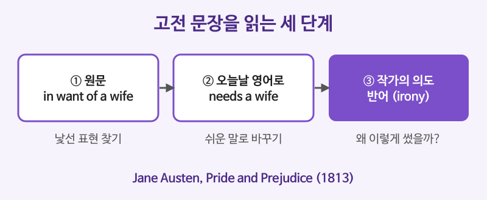

# 문학 발췌 읽기 (Austen, Dickens, Twain, O. Henry)

## 이번 강의에서 배울 것

- 영미 고전 소설의 유명한 첫 문장을 원문으로 읽기
- 옛날식 어휘, 방언, 문어체 문장 구조를 오늘날 영어로 풀어 읽는 법
- 반어(irony), 대구(parallelism) 같은 문학 장치 알아보기

## 핵심 설명

고전 문학은 지금 쓰지 않는 단어나 문장 구조가 섞여 있어 어렵게 느껴집니다. 하지만 한 문장씩 **① 낯선 표현을 찾고 → ② 오늘날 영어로 바꿔 쓰고 → ③ 작가가 왜 그렇게 썼는지 생각하는** 순서로 읽으면 생각보다 빨리 익숙해집니다. 이 강의의 발췌문은 모두 저작권이 만료된 작품에서 짧게 옮겼습니다.

| 작가 | 작품 | 발표 |
|---|---|---|
| Jane Austen | Pride and Prejudice (오만과 편견) | 1813년 |
| Charles Dickens | A Christmas Carol (크리스마스 캐럴) | 1843년 |
| Charles Dickens | A Tale of Two Cities (두 도시 이야기) | 1859년 |
| Mark Twain | Adventures of Huckleberry Finn (허클베리 핀의 모험) | 1884년 |
| O. Henry | The Gift of the Magi (크리스마스 선물) | 1905년 |

### 영국 소설: 영국식 발음으로 들어 보기

| 영어 | 한국어 | 듣기 |
|---|---|---|
| It is a truth universally acknowledged, that a single man in possession of a good fortune, must be in want of a wife. | 재산이 많은 독신 남자라면 틀림없이 아내가 필요할 것이라는 점은 누구나 인정하는 진리다. (Jane Austen, Pride and Prejudice) | [🔊](audio/03-literature-01-uk.mp3) |
| I could easily forgive his pride, if he had not mortified mine. | 그가 내 자존심을 짓밟지만 않았다면 그의 오만쯤은 지금 쉽게 용서할 수 있을 텐데. (Jane Austen, Pride and Prejudice) | [🔊](audio/03-literature-02-uk.mp3) |
| Marley was dead: to begin with. There is no doubt whatever about that. | 우선, 말리는 죽었다. 그 점에는 털끝만큼의 의심도 없다. (Charles Dickens, A Christmas Carol) | [🔊](audio/03-literature-03-uk.mp3) |
| It was the best of times, it was the worst of times. | 최고의 시절이었고, 최악의 시절이었다. (Charles Dickens, A Tale of Two Cities) | [🔊](audio/03-literature-04-uk.mp3) |

- **Austen의 첫 문장**은 반어(irony)입니다. 실제로 아내를 "원하는" 쪽은 부자 남자가 아니라 딸을 시집보내려는 이웃들이라는 것을 비꼬고 있습니다. in want of는 "~을 원하는"이 아니라 "~이 부족한, 필요한"입니다.
- **둘째 문장**은 1장 2강에서 배운 혼합 가정법입니다. 과거의 일(had not mortified)이 지금의 마음(could forgive)에 영향을 줍니다. mortify는 "굴욕감을 주다"라는 뜻입니다.
- **Dickens의 whatever**는 no doubt를 강조하는 말로, 오늘날의 whatsoever와 같습니다.
- **best와 worst**를 같은 틀에 넣은 대구(parallelism)로, 프랑스 혁명기의 모순된 분위기를 한 문장에 담았습니다.

### 미국 소설

| 영어 | 한국어 | 듣기 |
|---|---|---|
| You don't know about me without you have read a book by the name of The Adventures of Tom Sawyer; but that ain't no matter. | 『톰 소여의 모험』이라는 책을 읽지 않았다면 여러분은 나를 모를 거예요. 하지만 그건 상관없어요. (Mark Twain, Adventures of Huckleberry Finn) | [🔊](audio/03-literature-05.mp3) |
| One dollar and eighty-seven cents. That was all. And sixty cents of it was in pennies. | 1달러 87센트. 그게 전부였다. 그나마 그중 60센트는 1센트짜리 동전이었다. (O. Henry, The Gift of the Magi) | [🔊](audio/03-literature-06.mp3) |

- **Twain**은 학교를 제대로 다니지 못한 소년 허크의 말투를 그대로 살렸습니다. without은 unless(~하지 않으면)의 방언이고, ain't no는 이중 부정입니다. 표준 영어가 아니지만 인물의 목소리를 살리는 장치입니다.
- **O. Henry**는 짧은 명사구와 짧은 문장으로 시작해 가난한 주인공의 처지를 숫자 하나로 보여 줍니다. 동전까지 세어 볼 만큼 돈이 없다는 뜻입니다.

### 오늘날 영어로 바꿔 읽기

| 영어 | 한국어 | 듣기 |
|---|---|---|
| Everyone assumes that a rich single man must be looking for a wife. | 다들 돈 많은 독신 남자라면 아내감을 찾고 있을 거라고 생각한다. | [🔊](audio/03-literature-07.mp3) |
| I could easily forgive his pride if he hadn't hurt mine. | 그가 내 자존심에 상처를 주지만 않았다면 그의 오만쯤은 쉽게 용서할 수 있을 텐데. | [🔊](audio/03-literature-08.mp3) |
| First of all, you need to know that Marley was dead. | 무엇보다 먼저, 말리가 죽었다는 사실을 알아야 한다. | [🔊](audio/03-literature-09.mp3) |
| You won't know who I am unless you have read The Adventures of Tom Sawyer, but that doesn't matter. | 『톰 소여의 모험』을 읽지 않았다면 내가 누군지 모르겠지만, 그건 상관없다. | [🔊](audio/03-literature-10.mp3) |
| She had only one dollar and eighty-seven cents, and most of it was in small coins. | 그녀에게는 1달러 87센트밖에 없었고, 그나마 대부분이 잔돈이었다. | [🔊](audio/03-literature-11.mp3) |

> 💡 고전을 처음 읽을 때는 처음부터 끝까지 원문으로 읽으려 하지 말고, 쉬운 영어로 다시 쓴 판(graded reader)과 원문을 번갈아 읽는 것도 좋은 방법입니다. 원문은 Project Gutenberg 같은 곳에서 무료로 볼 수 있습니다.

## 자주 하는 실수

- ❌ in want of a wife를 "아내를 원하는"으로 읽는다. → ✅ "아내가 없어 필요한".
  - 고전에서 want는 "부족, 결핍"의 뜻으로 자주 쓰입니다. (for want of money: 돈이 없어서)
- ❌ Twain의 without을 "~없이"로 읽는다. → ✅ 여기서 without은 unless(~하지 않으면).
  - 방언과 옛 문체에서는 접속사로 쓰이기도 합니다. 오늘날 글에서는 따라 쓰지 마세요.
- ❌ ain't no matter를 "문제가 없지 않다"로 읽는다. → ✅ "상관없다".
  - 방언의 이중 부정은 부정을 강조할 뿐, 서로 지워서 긍정이 되지 않습니다.

## 연습 문제

1. Austen의 첫 문장에서 반어(irony)가 느껴지는 이유를 우리말로 설명하세요.
2. I could easily forgive his pride, if he had not mortified mine. 은 어떤 가정법인가요?
3. It was the best of times, it was the worst of times. 에 쓰인 문학 장치는 무엇인가요?
4. You don't know about me without you have read ... 를 표준 영어로 바꾸세요.
5. for want of time을 우리말로 옮기세요.

## 정답과 해설

1. **겉으로는 부자 남자가 아내를 원한다고 말하지만, 실제로는 그 남자를 사윗감으로 노리는 주변 사람들의 욕심을 비꼬고 있기 때문이다.**: "누구나 인정하는 진리"라는 거창한 말투도 반어를 키웁니다.
2. **혼합 가정법**: if절은 과거 사실(그가 내 자존심을 짓밟았다)의 반대, 주절은 현재(지금 용서할 수 있을 텐데)입니다.
3. **대구(parallelism)와 대조(antithesis)**: 같은 틀에 반대되는 말(best/worst)을 넣었습니다.
4. **You don't know about me unless you have read ...**: without을 unless로 바꿉니다.
5. **시간이 없어서, 시간이 부족해서**

## 오늘의 단어

| 단어 | 뜻 | 예문 | 듣기 |
|---|---|---|---|
| acknowledge | 인정하다 | He acknowledged his mistake. | [🔊](audio/03-literature-w01.mp3) |
| fortune | 재산, 큰돈 | She made a fortune in real estate. | [🔊](audio/03-literature-w02.mp3) |
| mortify | 굴욕감을 주다 | I was mortified by the comment. | [🔊](audio/03-literature-w03.mp3) |
| irony | 반어, 아이러니 | The irony was lost on him. | [🔊](audio/03-literature-w04.mp3) |
| dialect | 방언, 사투리 | They speak a local dialect. | [🔊](audio/03-literature-w05.mp3) |
