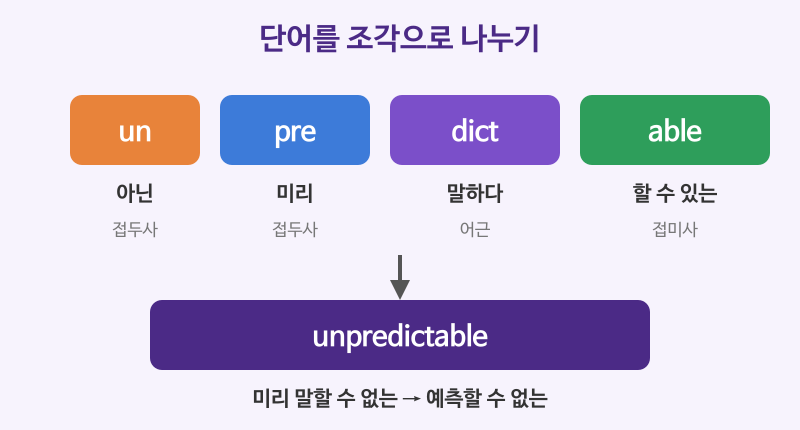

# 어근·접두사·접미사 (unpredictable = un + pre + dict + able)

## 이번 강의에서 배울 것

- 영어 단어를 **접두사 + 어근 + 접미사**로 나누어 뜻을 짐작하는 법
- 자주 나오는 라틴어·그리스어 어근 (dict, spect, port, rupt, scrib ...)
- 품사를 바꾸는 접미사 (-tion, -ment, -able, -ize, -ous ...)

## 핵심 설명

고급 어휘의 상당수는 라틴어와 그리스어에서 온 **조각**으로 이루어져 있습니다. 조각의 뜻을 알면 처음 보는 단어도 뜻을 짐작할 수 있고, 한 단어를 외울 때 여러 단어가 함께 따라옵니다.

- **접두사(prefix)**: 단어 앞에 붙어 뜻을 바꾼다 (un- 아닌, re- 다시)
- **어근(root)**: 단어의 핵심 뜻 (dict 말하다)
- **접미사(suffix)**: 단어 뒤에 붙어 주로 품사를 바꾼다 (-able ~할 수 있는)

### 자주 쓰는 접두사

| 접두사 | 뜻 | 예 |
|---|---|---|
| un-, in-, im-, dis- | 아닌, 반대 | unlikely, invisible, impossible, disagree |
| mis- | 잘못 | misunderstand, mislead |
| re- | 다시, 뒤로 | rewrite, return |
| pre-, post- | 미리, 뒤에 | preview, postpone |
| inter-, trans- | 사이에, 가로질러 | international, transport |
| sub-, super- | 아래, 위 | subway, supervise |

| 영어 | 한국어 | 듣기 |
|---|---|---|
| The weather here is completely unpredictable. | 이곳 날씨는 전혀 예측할 수 없다. | [🔊](audio/01-word-roots-01.mp3) |
| I think you misunderstood my question. | 제 질문을 오해하신 것 같아요. | [🔊](audio/01-word-roots-02.mp3) |
| We need to reconsider our options. | 우리는 선택지를 다시 생각해 봐야 한다. | [🔊](audio/01-word-roots-03.mp3) |
| She works for an international organization. | 그녀는 국제기구에서 일한다. | [🔊](audio/01-word-roots-04.mp3) |

### 자주 쓰는 어근

| 어근 | 뜻 | 예 |
|---|---|---|
| dict | 말하다 | predict, contradict, dictionary |
| spect | 보다 | inspect, perspective, spectator |
| port | 나르다 | export, portable, transport |
| rupt | 깨다 | interrupt, bankrupt, disrupt |
| scrib, script | 쓰다 | describe, prescription, manuscript |
| ject | 던지다 | reject, project, inject |

| 영어 | 한국어 | 듣기 |
|---|---|---|
| His actions contradict his words. | 그의 행동은 말과 모순된다. | [🔊](audio/01-word-roots-05.mp3) |
| Try to see it from a different perspective. | 다른 관점에서 보려고 해 보세요. | [🔊](audio/01-word-roots-06.mp3) |
| The storm disrupted flights across the region. | 폭풍으로 그 지역 전체의 항공편이 차질을 빚었다. | [🔊](audio/01-word-roots-07.mp3) |
| The doctor gave me a prescription for the pain. | 의사가 통증에 쓸 처방전을 써 주었다. | [🔊](audio/01-word-roots-08.mp3) |
| The committee rejected the proposal. | 위원회는 그 제안을 거부했다. | [🔊](audio/01-word-roots-09.mp3) |

- contra(반대로) + dict(말하다) = **반대로 말하다, 모순되다**
- per(꿰뚫어) + spect(보다) = **꿰뚫어 보는 방식, 관점**
- dis(따로) + rupt(깨다) = **흐트러뜨리다, 지장을 주다**

### 품사를 바꾸는 접미사

| 접미사 | 만드는 품사 | 예 |
|---|---|---|
| -tion, -ment, -ness, -ity | 명사 | decision, development, kindness, reality |
| -ize, -ify, -en | 동사 | modernize, simplify, strengthen |
| -able, -ous, -ive, -al | 형용사 | reliable, dangerous, creative, global |
| -ly | 부사 | quickly, carefully |

| 영어 | 한국어 | 듣기 |
|---|---|---|
| We need someone reliable for this role. | 이 일에는 믿을 수 있는 사람이 필요하다. | [🔊](audio/01-word-roots-10.mp3) |
| The company plans to modernize its factories. | 그 회사는 공장을 현대화할 계획이다. | [🔊](audio/01-word-roots-11-uk.mp3) |
| Let me simplify the explanation. | 설명을 더 간단히 해 볼게요. | [🔊](audio/01-word-roots-12-uk.mp3) |

> 💡 어근으로 뜻을 짐작하는 것은 **추측**입니다. 문맥과 함께 확인하고, 확실하지 않으면 사전을 찾아보세요. 예를 들어 inflammable은 in-이 붙어 있지만 "타지 않는"이 아니라 "불이 잘 붙는"이라는 뜻입니다.

## 자주 하는 실수

- ❌ inflammable = 불에 타지 않는 → ✅ inflammable = 불에 잘 타는 (= flammable)
  - 여기서 in-은 부정이 아니라 "안으로"의 뜻입니다. 불연성은 non-flammable입니다.
- ❌ unpossible, inpolite → ✅ impossible, impolite
  - p, b, m 앞에서는 in-이 im-으로 바뀝니다. 어떤 부정 접두사가 붙는지는 단어마다 정해져 있으니 함께 외우세요.
- ❌ The plan is very reliabe. / relyable → ✅ reliable
  - rely의 y는 i로 바뀌고 -able이 붙습니다. (rely → reliable, deny → deniable)

## 연습 문제

1. inspect를 조각으로 나누고 뜻을 짐작하세요.
2. interrupt의 뜻을 어근으로 설명하세요.
3. 빈칸에 알맞은 접두사를 넣으세요: ___agree (동의하지 않다), ___write (다시 쓰다), ___lead (잘못 이끌다)
4. 다음 단어의 명사형을 쓰세요: decide, develop, real
5. portable의 뜻은 무엇일까요?

## 정답과 해설

1. **in(안을) + spect(보다) = 안을 들여다보다, 점검하다**
2. **inter(사이에) + rupt(깨다) = 사이를 깨고 들어오다, 방해하다**
3. **dis**agree, **re**write, **mis**lead
4. **decision, development, reality**
5. **휴대할 수 있는**: port(나르다) + able(할 수 있는)

## 오늘의 단어

| 단어 | 뜻 | 예문 | 듣기 |
|---|---|---|---|
| predict | 예측하다 | Nobody can predict the future. | [🔊](audio/01-word-roots-w01.mp3) |
| perspective | 관점, 시각 | That gives me a new perspective. | [🔊](audio/01-word-roots-w02.mp3) |
| disrupt | 지장을 주다 | The strike disrupted train services. | [🔊](audio/01-word-roots-w03.mp3) |
| reliable | 믿을 수 있는 | He is a reliable colleague. | [🔊](audio/01-word-roots-w04.mp3) |
| portable | 휴대용의 | I bought a portable speaker. | [🔊](audio/01-word-roots-w05.mp3) |
