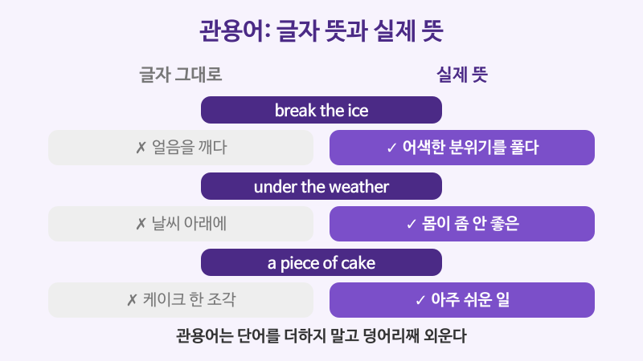

# 관용어와 숙어 (break the ice, the elephant in the room)

## 이번 강의에서 배울 것

- 글자 그대로의 뜻과 실제 뜻이 다른 관용어(idiom) 익히기
- 직장과 일상에서 자주 쓰는 관용어 15개
- 관용어가 어울리는 상황과 피해야 할 상황

## 핵심 설명

관용어는 단어 하나하나의 뜻을 더해서는 이해할 수 없는 **굳어진 표현**입니다. break the ice는 "얼음을 깨다"가 아니라 "어색한 분위기를 풀다"입니다. 한국어의 "발이 넓다", "눈코 뜰 새 없다"와 같습니다. 원어민은 대화와 칼럼에서 관용어를 아주 자주 쓰기 때문에, 모르면 말의 흐름을 놓치게 됩니다.

### 회의와 업무

| 영어 | 한국어 | 듣기 |
|---|---|---|
| Let's get the ball rolling with a quick introduction. | 간단한 소개로 시작해 봅시다. | [🔊](audio/02-idioms-01.mp3) |
| A short game is a good way to break the ice. | 짧은 게임은 어색한 분위기를 푸는 좋은 방법이다. | [🔊](audio/02-idioms-02.mp3) |
| Stop beating around the bush and tell me what happened. | 돌려 말하지 말고 무슨 일이 있었는지 말해 줘. | [🔊](audio/02-idioms-03.mp3) |
| You hit the nail on the head. | 정확히 핵심을 짚었어요. | [🔊](audio/02-idioms-04.mp3) |
| We can't afford to cut corners on safety. | 안전 문제에서 대충 넘어갈 수는 없다. | [🔊](audio/02-idioms-05.mp3) |
| Let's call it a day and continue tomorrow. | 오늘은 여기까지 하고 내일 계속합시다. | [🔊](audio/02-idioms-06.mp3) |

### 상황과 감정

| 영어 | 한국어 | 듣기 |
|---|---|---|
| Nobody wanted to mention the elephant in the room. | 아무도 모두가 알면서 모른 척하는 문제를 꺼내고 싶어 하지 않았다. | [🔊](audio/02-idioms-07.mp3) |
| Losing that job was a blessing in disguise. | 그 일자리를 잃은 것이 오히려 전화위복이었다. | [🔊](audio/02-idioms-08.mp3) |
| I think I bit off more than I can chew. | 감당할 수 있는 것보다 일을 너무 많이 벌인 것 같다. | [🔊](audio/02-idioms-09.mp3) |
| I'm still on the fence about the offer. | 그 제안에 대해서는 아직 마음을 정하지 못했다. | [🔊](audio/02-idioms-10.mp3) |
| I'm feeling a bit under the weather today. | 오늘은 몸이 좀 안 좋다. | [🔊](audio/02-idioms-11.mp3) |
| We only see each other once in a blue moon. | 우리는 아주 가끔씩만 만난다. | [🔊](audio/02-idioms-12.mp3) |

### 영국식 관용어

영국에서 특히 자주 쓰는 표현입니다.

| 영어 | 한국어 | 듣기 |
|---|---|---|
| Opera isn't really my cup of tea. | 오페라는 내 취향이 아니다. | [🔊](audio/02-idioms-13-uk.mp3) |
| Just press this button, and Bob's your uncle. | 이 버튼만 누르면 끝이에요. | [🔊](audio/02-idioms-14-uk.mp3) |
| Let's not put the cart before the horse. | 순서를 거꾸로 하지 맙시다. | [🔊](audio/02-idioms-15-uk.mp3) |

> 💡 관용어는 **대화, 이메일 본문, 칼럼**에서는 자연스럽지만 **논문, 공식 보고서, 계약서**에서는 피하는 것이 좋습니다. 또 너무 많이 쓰면 오히려 어색합니다. 한 번의 대화에서 한두 개면 충분합니다.

## 자주 하는 실수

- ❌ You hit the nail on your head. → ✅ You hit the nail on the head.
  - 관용어는 단어를 바꾸면 뜻이 통하지 않습니다. 관사 하나까지 그대로 외우세요.
- ❌ I bite off more than I chew. → ✅ I bit off more than I could chew.
  - 시제는 바꿀 수 있지만 can (could) chew 부분은 빼지 않습니다.
- ❌ (보고서에) The project was a piece of cake. → ✅ The project was completed without difficulty.
  - 공식 문서에서는 관용어 대신 뜻을 바로 쓰세요.

## 연습 문제

빈칸에 알맞은 관용어를 고르세요. (call it a day / on the fence / under the weather / a blessing in disguise / beat around the bush)

1. I've been working for ten hours. Let's ___.
2. She stayed home because she was feeling ___.
3. Don't ___. Just tell me the truth.
4. Missing the train was ___. I met my future wife on the next one.
5. I'm still ___ about moving to Busan.

## 정답과 해설

1. **call it a day**: 오늘 일을 마치자는 뜻입니다.
2. **under the weather**: 몸이 안 좋다는 뜻입니다.
3. **beat around the bush**: 돌려 말하다. Don't 뒤라서 원형을 씁니다.
4. **a blessing in disguise**: 나쁜 일인 줄 알았는데 결과적으로 좋은 일, 전화위복입니다.
5. **on the fence**: 어느 쪽으로도 결정하지 못한 상태입니다.

## 오늘의 단어

| 단어 | 뜻 | 예문 | 듣기 |
|---|---|---|---|
| idiom | 관용어 | English has many idioms about weather. | [🔊](audio/02-idioms-w01.mp3) |
| disguise | 변장, 위장 | He wore a disguise. | [🔊](audio/02-idioms-w02.mp3) |
| afford | ~할 여유가 있다 | We can't afford to wait. | [🔊](audio/02-idioms-w03.mp3) |
| mention | 언급하다 | She didn't mention the price. | [🔊](audio/02-idioms-w04.mp3) |
| literal | 글자 그대로의 | Don't take it literally. | [🔊](audio/02-idioms-w05.mp3) |
