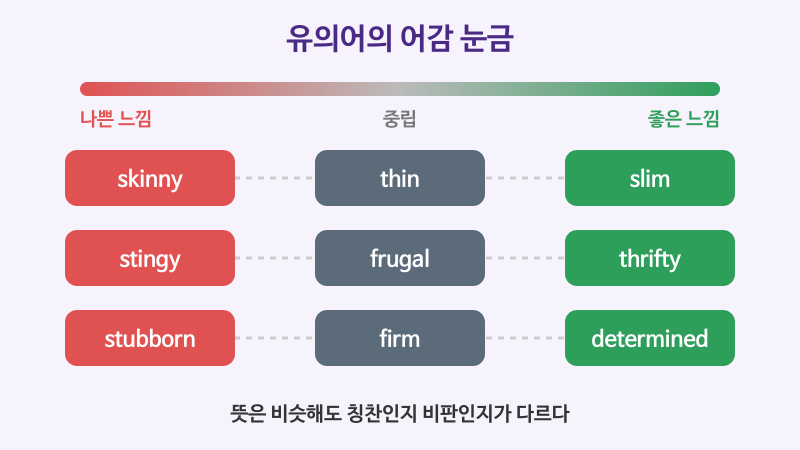

# 뉘앙스가 다른 유의어 (thin, slim, skinny)

## 이번 강의에서 배울 것

- 뜻은 비슷하지만 **좋은 느낌, 중립, 나쁜 느낌**이 다른 유의어 구별하기
- 격식의 정도가 다른 유의어 (buy와 purchase, help와 assist)
- 자주 헷갈리는 짝: economic과 economical, famous와 notorious

## 핵심 설명

사전에서 같은 뜻으로 나오는 단어라도 **느낌(connotation)** 은 다를 수 있습니다. "날씬하다"와 "말라깽이"가 다르듯, slim은 칭찬이지만 skinny는 듣기에 따라 실례가 됩니다. 고급 단계에서는 단어의 뜻뿐 아니라 그 단어가 주는 인상까지 골라 써야 합니다.

### 좋은 느낌과 나쁜 느낌

| 나쁜 느낌 | 중립 | 좋은 느낌 |
|---|---|---|
| skinny (빼빼 마른) | thin (마른) | slim (날씬한) |
| stingy (인색한) | frugal (검소한) | thrifty (알뜰한) |
| stubborn (고집 센) | firm (확고한) | determined (의지가 굳은) |
| nosy (참견하기 좋아하는) | curious (궁금해하는) | inquisitive (탐구심 있는) |

| 영어 | 한국어 | 듣기 |
|---|---|---|
| She looks slim and healthy. | 그녀는 날씬하고 건강해 보인다. | [🔊](audio/03-synonyms-01.mp3) |
| He was a skinny kid who grew into a strong man. | 그는 빼빼 마른 아이였는데 건장한 남자로 자랐다. | [🔊](audio/03-synonyms-02.mp3) |
| My grandmother was very thrifty. | 우리 할머니는 아주 알뜰하셨다. | [🔊](audio/03-synonyms-03.mp3) |
| He's too stingy to buy anyone a coffee. | 그는 너무 인색해서 누구에게도 커피 한 잔 사지 않는다. | [🔊](audio/03-synonyms-04.mp3) |
| She is determined to finish the marathon. | 그녀는 마라톤을 끝까지 완주하겠다는 의지가 굳다. | [🔊](audio/03-synonyms-05.mp3) |
| He is too stubborn to admit he was wrong. | 그는 너무 고집이 세서 자기가 틀렸다는 걸 인정하지 않는다. | [🔊](audio/03-synonyms-06.mp3) |

### 격식의 정도가 다른 유의어

| 일상어 | 격식어 |
|---|---|
| buy | purchase |
| help | assist |
| need | require |
| ask for | request |
| start | commence |

| 영어 | 한국어 | 듣기 |
|---|---|---|
| Tickets can be purchased online. | 표는 온라인으로 구매할 수 있습니다. | [🔊](audio/03-synonyms-07.mp3) |
| All visitors are required to sign in. | 모든 방문객은 출입 기록을 남겨야 합니다. | [🔊](audio/03-synonyms-08.mp3) |
| Can you help me move this table? | 이 테이블 옮기는 것 좀 도와줄래? | [🔊](audio/03-synonyms-09.mp3) |

### 자주 헷갈리는 짝

| 영어 | 한국어 | 듣기 |
|---|---|---|
| The country is facing an economic crisis. | 그 나라는 경제 위기를 맞고 있다. | [🔊](audio/03-synonyms-10.mp3) |
| A smaller car is more economical. | 작은 차가 더 경제적이다 (연료비가 덜 든다). | [🔊](audio/03-synonyms-11.mp3) |
| The town is famous for its hot springs. | 그 도시는 온천으로 유명하다. | [🔊](audio/03-synonyms-12-uk.mp3) |
| The road is notorious for traffic jams. | 그 도로는 교통 체증으로 악명 높다. | [🔊](audio/03-synonyms-13-uk.mp3) |

- **economic**: 경제의, 경제와 관련된 / **economical**: 돈이 적게 드는, 절약하는
- **famous**: 좋은 일로 유명한 / **notorious**: 나쁜 일로 유명한, 악명 높은
- 같은 짝으로 **childlike**(아이처럼 순수한)와 **childish**(유치한)도 있습니다.

> 💡 유의어를 고를 때는 사전의 뜻풀이보다 **예문**을 보세요. 어떤 단어와 함께 쓰이는지(콜로케이션), 칭찬하는 문장인지 비판하는 문장인지가 예문에 드러납니다.

## 자주 하는 실수

- ❌ (칭찬하려고) You look so skinny! → ✅ You look great! / You look slim.
  - skinny는 "너무 말랐다"는 뜻으로 들릴 수 있습니다.
- ❌ This car is very economic. → ✅ This car is very economical.
  - 연료비가 적게 든다는 뜻이면 economical입니다.
- ❌ (친구에게) I will purchase a sandwich. → ✅ I'm going to buy a sandwich.
  - purchase는 공지문이나 계약서에 어울리는 격식어입니다. 대화에서는 과장되게 들립니다.

## 연습 문제

문맥에 맞는 단어를 고르세요.

1. My boss is very (stingy / thrifty). He never pays for anything. (불만을 말하는 상황)
2. Cooking at home is more (economic / economical) than eating out.
3. The city is (famous / notorious) for its beautiful old palaces.
4. Passengers are (needed / required) to wear seat belts. (기내 안내문)
5. She is (stubborn / determined) to become a doctor. (칭찬하는 상황)

## 정답과 해설

1. **stingy**: 불만을 말하므로 나쁜 느낌의 단어를 씁니다.
2. **economical**: 돈이 덜 든다는 뜻입니다.
3. **famous**: 아름다운 궁전은 좋은 일입니다.
4. **required**: 안내문에는 격식어가 어울립니다. be required to는 "~해야 한다"는 규정 표현입니다.
5. **determined**: 같은 고집이라도 칭찬할 때는 determined를 씁니다.

## 오늘의 단어

| 단어 | 뜻 | 예문 | 듣기 |
|---|---|---|---|
| connotation | 함축된 의미, 어감 | The word has a negative connotation. | [🔊](audio/03-synonyms-w01.mp3) |
| thrifty | 알뜰한 | Thrifty shoppers compare prices. | [🔊](audio/03-synonyms-w02.mp3) |
| stubborn | 고집 센 | Don't be so stubborn. | [🔊](audio/03-synonyms-w03.mp3) |
| notorious | 악명 높은 | He is notorious for being late. | [🔊](audio/03-synonyms-w04.mp3) |
| purchase | 구매하다, 구매 | Keep the receipt after your purchase. | [🔊](audio/03-synonyms-w05.mp3) |
