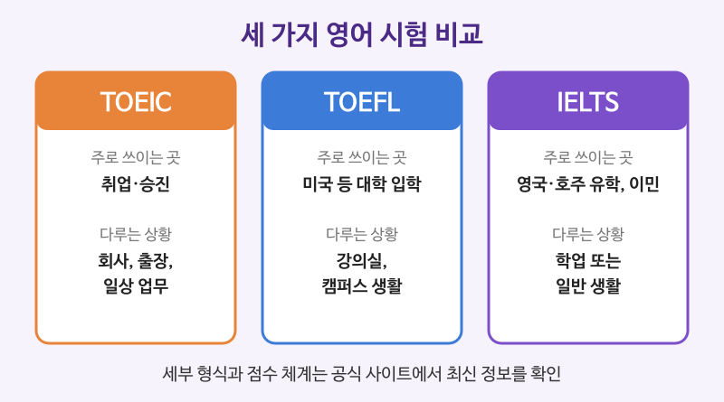

# TOEIC / TOEFL / IELTS 유형 소개

## 이번 강의에서 배울 것

- 세 시험이 각각 무엇을 평가하고 어디에 쓰이는지
- 시험별 대표 문제 유형과 자주 나오는 지시문
- 지금까지 배운 고급 문법·글쓰기·어휘를 시험에 활용하는 법

## 핵심 설명

세 시험은 모두 영어 실력을 재지만 **쓰이는 곳과 다루는 상황**이 다릅니다. 취업과 승진에는 TOEIC, 미국 대학 유학에는 TOEFL, 영국·호주·캐나다 유학과 이민에는 IELTS가 많이 쓰입니다. 다만 학교나 기관마다 요구하는 시험이 다르므로 지원할 곳의 요건을 먼저 확인하세요.

| 시험 | 주로 쓰이는 곳 | 다루는 상황 | 영역 |
|---|---|---|---|
| TOEIC | 국내외 기업 채용, 승진 | 회사, 출장, 일상 업무 | 듣기·읽기 시험과 말하기·쓰기 시험이 따로 있음 |
| TOEFL iBT | 미국 등 대학·대학원 입학 | 강의실, 캠퍼스 생활, 학술 글 | 읽기, 듣기, 말하기, 쓰기 |
| IELTS | 영국·호주·캐나다 유학, 이민 | 학업(Academic) 또는 일반 생활(General Training) | 듣기, 읽기, 쓰기, 말하기 |

> ⚠️ 시험 시간, 문항 수, 점수 체계, 응시료, 시험 방식은 자주 바뀝니다. 이 강의는 일반적인 유형만 소개하니, 접수 전에 반드시 **각 시험의 공식 사이트에서 최신 정보를 확인하세요.**

### TOEIC: 비즈니스 상황의 영어

사진 묘사, 짧은 질문에 알맞은 응답 고르기, 회사 안 대화와 안내 방송 듣기, 이메일·공지·광고 읽기, 문법과 어휘 빈칸 채우기 같은 유형이 나옵니다. 문제를 빨리 푸는 **속도**가 중요합니다.

| 영어 | 한국어 | 듣기 |
|---|---|---|
| Where most likely does the conversation take place? | 대화는 어디에서 이루어지고 있을 가능성이 가장 큰가? | [🔊](audio/01-exam-overview-01.mp3) |
| What is the purpose of the announcement? | 안내 방송의 목적은 무엇인가? | [🔊](audio/01-exam-overview-02.mp3) |
| What does the woman offer to do? | 여자는 무엇을 하겠다고 제안하는가? | [🔊](audio/01-exam-overview-03.mp3) |
| The shipment has been delayed due to bad weather. | 악천후로 배송이 지연되었습니다. | [🔊](audio/01-exam-overview-04.mp3) |

- 질문의 **most likely, purpose, offer** 같은 말이 무엇을 들어야 하는지 알려 줍니다. 음성이 나오기 전에 질문부터 읽어 두세요.
- 2장 3강의 비즈니스 문서 표현이 읽기 지문에 그대로 나옵니다.

### TOEFL: 대학 강의실의 영어

학술 지문 읽기, 강의와 캠퍼스 대화 듣기, 질문에 대한 의견 말하기, 읽고 들은 내용을 종합해 쓰기 같은 유형이 나옵니다. 여러 영역을 **통합(integrated)** 하는 문제가 특징입니다.

| 영어 | 한국어 | 듣기 |
|---|---|---|
| According to the passage, why did the population decline? | 지문에 따르면 개체 수는 왜 줄었는가? | [🔊](audio/01-exam-overview-05.mp3) |
| What is the main purpose of the lecture? | 강의의 주된 목적은 무엇인가? | [🔊](audio/01-exam-overview-06.mp3) |
| Do you agree or disagree with the following statement? | 다음 진술에 동의하는가, 반대하는가? | [🔊](audio/01-exam-overview-07.mp3) |
| Summarize the points made in the lecture and explain how they challenge the reading. | 강의의 요점을 요약하고, 그것이 읽기 지문에 어떻게 반박하는지 설명하라. | [🔊](audio/01-exam-overview-08.mp3) |

- 3장 2강의 학술 텍스트 읽기(가설, 근거, hedging)가 읽기와 듣기에 그대로 쓰입니다.
- 의견을 쓰고 말하는 문제에는 2장 2강의 에세이 구조(입장 → 근거 → 예시)를 짧게 적용합니다.

### IELTS: 영국식 영어와 면접관과의 대화

듣기에는 영국·호주 등 다양한 억양이 나오고, 말하기는 시험관과 마주 앉아 대화하는 방식이 기본입니다. 쓰기에서는 Academic이면 그래프·표 설명과 에세이, General Training이면 편지와 에세이를 씁니다.

| 영어 | 한국어 | 듣기 |
|---|---|---|
| Describe a place you have visited that you would like to return to. | 다시 가 보고 싶은 곳 중 가 본 곳을 하나 묘사하세요. | [🔊](audio/01-exam-overview-09-uk.mp3) |
| The graph below shows the number of visitors to three museums. | 아래 그래프는 세 박물관의 방문객 수를 보여 준다. | [🔊](audio/01-exam-overview-10-uk.mp3) |
| To what extent do you agree or disagree? | 어느 정도까지 동의하는가, 혹은 반대하는가? | [🔊](audio/01-exam-overview-11-uk.mp3) |
| Overall, the number of visitors rose steadily over the period. | 전반적으로 방문객 수는 그 기간 동안 꾸준히 늘었다. | [🔊](audio/01-exam-overview-12-uk.mp3) |

- 그래프 설명은 **Overall**로 전체 흐름을 먼저 말하고, 그다음 눈에 띄는 세부를 비교합니다.
- To what extent ...? 문제는 "완전히 동의 / 부분적으로 동의"처럼 **정도**를 분명히 밝혀야 합니다.

## 자주 하는 실수

- ❌ 시험 정보를 인터넷 후기나 오래된 교재만 보고 준비한다. → ✅ 공식 사이트에서 최신 시험 형식과 규정을 확인한다.
  - 문항 수, 시간, 시험 방식이 개편되는 일이 많습니다.
- ❌ 말하기·쓰기에서 외운 문장을 그대로 붙인다. → ✅ 질문에 맞게 자기 말로 답한다.
  - 채점자는 질문과 관계없는 암기 답안을 쉽게 알아챕니다.
- ❌ 쓰기에서 I think만 반복한다. → ✅ 2장에서 배운 연결어와 논증 표현을 다양하게 쓴다.
  - In addition, However, It could be argued that ... 같은 표현이 글의 짜임새를 보여 줍니다.

## 연습 문제

1. 해외 기업 취업을 준비한다면 세 시험 중 무엇이 주로 쓰이나요?
2. 영국 대학원 유학을 준비할 때 많이 쓰이는 시험과 그 시험의 두 가지 종류를 쓰세요.
3. Where most likely does the conversation take place? 라는 질문을 보고 무엇에 집중해 들어야 할까요?
4. TOEFL의 통합형(integrated) 문제란 무엇인가요?
5. 그래프 설명 문제의 첫 문장을 Overall로 시작하는 영어 문장으로 쓰세요. (내용: 판매량이 꾸준히 늘었다)

## 정답과 해설

1. **TOEIC**: 다만 회사마다 요구 시험과 기준이 다르니 채용 공고를 확인하세요.
2. **IELTS, Academic과 General Training**: 학업 목적이면 보통 Academic을 봅니다. 학교별 요건은 공식 안내에서 확인하세요.
3. **장소를 알려 주는 단서 (예: boarding pass, menu, check-in, prescription 같은 단어)**
4. **읽기, 듣기, 말하기, 쓰기 중 두 영역 이상을 함께 쓰는 문제**: 예를 들어 지문을 읽고 강의를 들은 뒤 둘의 관계를 글로 씁니다.
5. **Overall, sales increased steadily over the period.**: rose steadily도 됩니다.

## 오늘의 단어

| 단어 | 뜻 | 예문 | 듣기 |
|---|---|---|---|
| shipment | 배송, 배송품 | The shipment arrived this morning. | [🔊](audio/01-exam-overview-w01.mp3) |
| announcement | 안내, 발표 | Please listen to the following announcement. | [🔊](audio/01-exam-overview-w02.mp3) |
| summarize | 요약하다 | Summarize the main points. | [🔊](audio/01-exam-overview-w03.mp3) |
| extent | 정도, 범위 | To some extent, I agree. | [🔊](audio/01-exam-overview-w04.mp3) |
| steadily | 꾸준히 | Prices rose steadily. | [🔊](audio/01-exam-overview-w05.mp3) |
