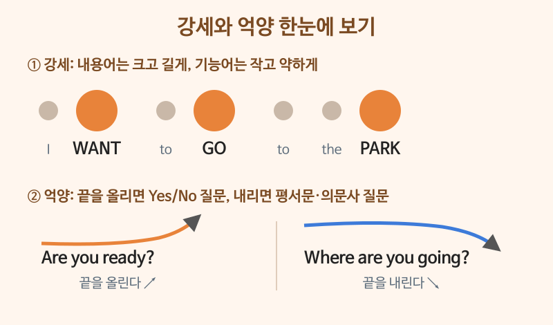
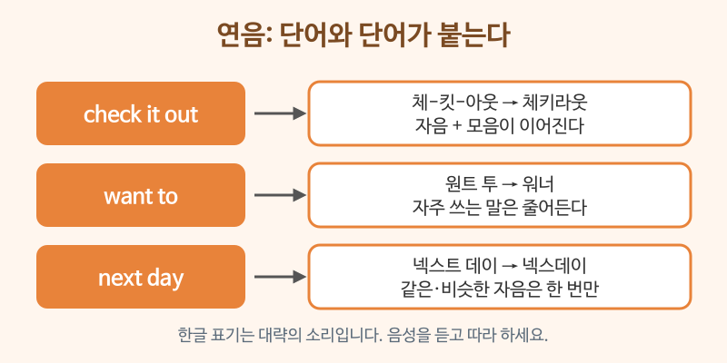

# 연음·강세·억양

> 난이도: 초급 · 상황: 모든 대화의 기본

## 이번 강의에서 배울 것

- 문장에서 **강하게 말하는 단어**와 약하게 지나가는 단어를 구별하기
- 단어와 단어가 이어지는 **연음**의 세 가지 규칙
- 끝을 올리는 억양과 내리는 억양의 차이

## 핵심 설명

원어민의 말이 빠르게 들리는 이유는 모든 단어를 똑같이 말하지 않기 때문입니다. 영어는 **중요한 단어만 크고 길게** 말하고, 나머지는 작고 빠르게 붙여 말합니다. 이 리듬을 알면 듣기도 쉬워지고, 내 말도 훨씬 자연스러워집니다.

### 강세: 내용어는 크게, 기능어는 작게

명사, 동사, 형용사, 부사처럼 **뜻을 전하는 단어(내용어)**는 강하게 말합니다. 관사, 전치사, 대명사, be동사처럼 **문법을 돕는 단어(기능어)**는 약하게 말합니다. 아래 문장을 들으며 어느 단어가 크게 들리는지 확인하고 따라 해 보세요.

| 영어 | 한국어 | 듣기 |
|---|---|---|
| I want to go to the park. | 공원에 가고 싶어요. | [🔊](audio/01-linking-stress-01.mp3) |
| She bought a new car. | 그녀는 새 차를 샀어요. | [🔊](audio/01-linking-stress-02.mp3) |
| Can you send me the file? | 그 파일 보내 줄 수 있어요? | [🔊](audio/01-linking-stress-03.mp3) |

> 💡 강세 위치: **WANT**, **GO**, **PARK** / **BOUGHT**, **NEW**, **CAR** / **SEND**, **FILE**. 약한 단어 to, the, a는 "터", "더", "어"처럼 아주 짧게 들립니다.

### 연음: 단어끼리 이어진다

| 영어 | 한국어 | 듣기 |
|---|---|---|
| Check it out. | 한번 봐 봐. | [🔊](audio/01-linking-stress-04.mp3) |
| Pick it up. | 그거 주워. | [🔊](audio/01-linking-stress-05.mp3) |
| I want to eat something. | 뭐 좀 먹고 싶어. | [🔊](audio/01-linking-stress-06.mp3) |
| See you next week. | 다음 주에 봐요. | [🔊](audio/01-linking-stress-07.mp3) |

- **자음 + 모음**: check it out은 "체킷아웃"이 아니라 "체키라웃"처럼 이어집니다.
- **자주 쓰는 말은 줄어든다**: want to는 "워너", going to는 "거너"처럼 들립니다. 말할 때는 또박또박 해도 괜찮지만, 들을 때는 알아들어야 합니다.
- **겹치는 자음은 한 번만**: next week의 t는 거의 들리지 않습니다.

### 억양: 올리면 질문, 내리면 끝맺음

| 영어 | 한국어 | 듣기 |
|---|---|---|
| Are you ready? | 준비됐어요? (끝을 올림) | [🔊](audio/01-linking-stress-08.mp3) |
| Where are you going? | 어디 가세요? (끝을 내림) | [🔊](audio/01-linking-stress-09.mp3) |
| Coffee or tea? | 커피요, 차요? (coffee는 올리고 tea는 내림) | [🔊](audio/01-linking-stress-10.mp3) |

Yes나 No로 답하는 질문은 끝을 올리고, what, where 같은 의문사로 시작하는 질문은 끝을 내립니다. 둘 중 하나를 고르는 질문은 앞을 올리고 마지막을 내립니다.

### 대화문 듣기

A와 B가 주말 계획을 이야기합니다. 강세와 연음에 귀를 기울이며 따라 해 보세요.

- **A:** What are you doing this weekend? [🔊](audio/01-linking-stress-11.mp3)
- **B:** I'm going to visit my parents. [🔊](audio/01-linking-stress-12.mp3)
- **A:** Oh, nice. Do they live far away? [🔊](audio/01-linking-stress-13.mp3)
- **B:** Not really. It's about an hour by train. [🔊](audio/01-linking-stress-14.mp3)
- **A:** Are you taking anything? [🔊](audio/01-linking-stress-15.mp3)
- **B:** Yeah, I picked up a cake for my mom. [🔊](audio/01-linking-stress-16.mp3)
- **A:** That's sweet. Have a good time! [🔊](audio/01-linking-stress-17.mp3)
- **B:** Thanks. See you on Monday. [🔊](audio/01-linking-stress-18.mp3)

| 대화 | 뜻 |
|---|---|
| What are you doing this weekend? | 이번 주말에 뭐 해요? ("와라유" 처럼 이어짐) |
| I'm going to visit my parents. | 부모님 댁에 가요. (going to → "거너") |
| Do they live far away? | 멀리 사세요? (끝을 올림) |
| It's about an hour by train. | 기차로 한 시간쯤 걸려요. (about an hour → "어바우러나워") |
| I picked up a cake. | 케이크를 하나 샀어요. (picked up a → "픽터퍼") |
| See you on Monday. | 월요일에 봐요. |

## 자주 하는 실수

- ❌ 모든 단어를 같은 크기로 또박또박 말하기 → ✅ 내용어만 강하게, 기능어는 약하게
  - "아이 원트 투 고 투 더 파크"처럼 말하면 로봇처럼 들립니다. WANT, GO, PARK에만 힘을 주세요.
- ❌ 단어 끝에 "으"를 붙이기 (체크 잇 아웃) → ✅ 자음을 다음 모음에 붙이기 (체키라웃)
  - 한국어는 받침 뒤에 모음 "으"를 넣는 습관이 있어 소리가 끊깁니다.
- ❌ Where are you going? ↗ (끝을 올림) → ✅ Where are you going? ↘
  - 의문사 질문은 끝을 내려야 자연스럽습니다. 올리면 "뭐라고요?" 하고 되묻는 느낌이 됩니다.

## 연습 문제

1. "I need to buy some milk."에서 강하게 말해야 할 단어 세 개를 고르세요.
2. "Get it out."을 연음해서 한글로 대략 적어 보세요.
3. "Is this your bag?"은 끝을 올릴까요, 내릴까요?
4. "What time is it?"은 끝을 올릴까요, 내릴까요?
5. "Do you want tea or coffee?"에서 tea와 coffee의 억양을 각각 말해 보세요.

## 정답과 해설

1. **NEED, BUY, MILK**: 동사와 명사가 뜻을 전하는 내용어입니다. I, to, some은 약하게 말합니다.
2. **게리라웃**: get의 t가 it의 모음과, it의 t가 out의 모음과 이어집니다. 미국식에서는 모음 사이의 t가 "ㄹ"처럼 부드럽게 납니다.
3. **올린다**: Yes나 No로 답하는 질문입니다.
4. **내린다**: what으로 시작하는 의문사 질문입니다.
5. **tea는 올리고, coffee는 내린다**: 둘 중 하나를 고르는 질문은 마지막 선택지에서 끝을 내립니다.

## 오늘의 단어

| 단어 | 뜻 | 예문 | 듣기 |
|---|---|---|---|
| stress | 강세 | Put the stress on the first word. | [🔊](audio/01-linking-stress-w01.mp3) |
| rhythm | 리듬 | English has a strong rhythm. | [🔊](audio/01-linking-stress-w02.mp3) |
| far away | 멀리 | My office is far away. | [🔊](audio/01-linking-stress-w03.mp3) |
| pick up | (사서) 가져오다, 줍다 | Can you pick up some bread? | [🔊](audio/01-linking-stress-w04.mp3) |
| weekend | 주말 | Have a nice weekend. | [🔊](audio/01-linking-stress-w05.mp3) |
