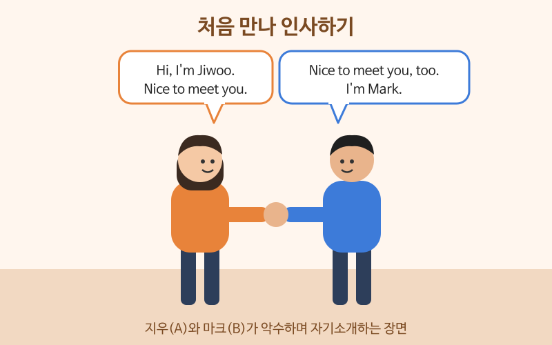

# 인사와 자기소개

> 난이도: 초급 · 상황: 처음 만난 사람, 모임, 출장지 첫인사

## 이번 강의에서 배울 것

- 처음 만났을 때와 아는 사람을 다시 만났을 때의 인사 구별하기
- 이름, 하는 일, 사는 곳을 짧게 소개하기
- 대화를 자연스럽게 끝내는 인사

## 핵심 설명

처음 만난 자리의 대화는 대부분 **인사 → 이름 → 하는 일·출신 → 마무리 인사**로 흘러갑니다. 자기소개는 길게 할 필요가 없습니다. 한두 문장으로 말하고 **상대에게 같은 질문을 되돌려 주는 것**이 핵심입니다.

### 대화문 듣기

A는 지우, B는 마크입니다. 회사 행사에서 처음 만났습니다.

- **A:** Hi, I'm Jiwoo. Nice to meet you. [🔊](audio/01-greetings-01.mp3)
- **B:** Nice to meet you, too. I'm Mark. [🔊](audio/01-greetings-02.mp3)
- **A:** So, what do you do, Mark? [🔊](audio/01-greetings-03.mp3)
- **B:** I'm a software engineer. How about you? [🔊](audio/01-greetings-04.mp3)
- **A:** I work in marketing at a travel company. [🔊](audio/01-greetings-05.mp3)
- **B:** Oh, interesting. Where are you from? [🔊](audio/01-greetings-06.mp3)
- **A:** I'm from Busan, but I live in Seoul now. [🔊](audio/01-greetings-07.mp3)
- **B:** Well, it was great talking to you. [🔊](audio/01-greetings-08.mp3)
- **A:** You too. See you around! [🔊](audio/01-greetings-09.mp3)

| 대화 | 뜻 |
|---|---|
| Nice to meet you. | 만나서 반가워요. (처음 만났을 때) |
| What do you do? | 무슨 일 하세요? |
| How about you? | 당신은요? |
| I work in marketing. | 마케팅 일을 해요. |
| Where are you from? | 어디 출신이세요? |
| It was great talking to you. | 이야기 나눠서 즐거웠어요. |
| See you around! | 또 봐요! |

### 단계별 핵심 표현

| 영어 | 한국어 | 듣기 |
|---|---|---|
| How's it going? | 잘 지내요? (아는 사람에게 가볍게) | [🔊](audio/01-greetings-10.mp3) |
| Long time no see! | 오랜만이에요! | [🔊](audio/01-greetings-11.mp3) |
| Please call me Jay. | 제이라고 불러 주세요. | [🔊](audio/01-greetings-12.mp3) |
| I've been working here for three years. | 여기서 3년째 일하고 있어요. | [🔊](audio/01-greetings-13.mp3) |
| Sorry, how do you say your name again? | 죄송한데, 성함을 어떻게 발음한다고 하셨죠? | [🔊](audio/01-greetings-14.mp3) |
| I have to get going. Take care! | 이제 가 봐야겠어요. 잘 지내요! | [🔊](audio/01-greetings-15.mp3) |

> 💡 How are you?나 How's it going?은 진짜 안부를 묻는다기보다 인사에 가깝습니다. "Good, thanks. And you?"처럼 짧게 답하고 되물으면 충분합니다. 영어 이름이 따로 있다면 "Please call me ..."로 알려 주세요.

## 자주 하는 실수

- ❌ Nice to meet you. (두 번째 만났을 때) → ✅ Nice to see you again.
  - meet은 처음 만났을 때만 씁니다. 다시 만나면 see를 씁니다.
- ❌ What is your job? → ✅ What do you do?
  - What is your job?은 서류 질문처럼 딱딱하게 들립니다.
- ❌ My name is Kim Jiwoo. I am 35 years old. → ✅ I'm Jiwoo. I work in marketing.
  - 처음 만난 자리에서 나이를 먼저 말하거나 묻는 것은 영어권에서 어색합니다. 하는 일이나 관심사를 말하세요.

## 연습 문제

상황에 맞는 말을 영어로 해 보세요.

1. 처음 만난 사람에게 "만나서 반가워요"라고 말하기
2. 상대가 무슨 일을 하는지 묻기
3. 오랜만에 만난 친구에게 인사하기
4. "저는 대구 출신인데 지금은 인천에 살아요"라고 말하기
5. 대화를 마치며 "이야기 나눠서 즐거웠어요"라고 말하기

## 정답과 해설

1. **Nice to meet you.** 또는 **It's nice to meet you.**
2. **What do you do?** 회사 이름까지 묻고 싶으면 **Where do you work?**
3. **Long time no see!** 또는 **It's good to see you again!**
4. **I'm from Daegu, but I live in Incheon now.**
5. **It was great talking to you.** 또는 **Nice talking to you.**

## 오늘의 단어

| 단어 | 뜻 | 예문 | 듣기 |
|---|---|---|---|
| introduce | 소개하다 | Let me introduce myself. | [🔊](audio/01-greetings-w01.mp3) |
| engineer | 엔지니어, 기술자 | My brother is an engineer. | [🔊](audio/01-greetings-w02.mp3) |
| company | 회사 | I work for a small company. | [🔊](audio/01-greetings-w03.mp3) |
| interesting | 흥미로운 | That sounds interesting. | [🔊](audio/01-greetings-w04.mp3) |
| take care | 잘 지내, 몸조심해 | Take care and see you soon. | [🔊](audio/01-greetings-w05.mp3) |
