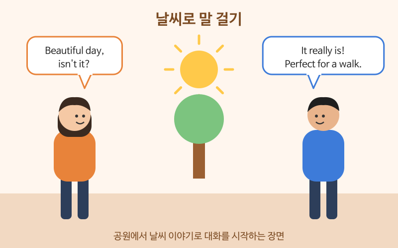

# 날씨·취미 스몰토크

> 난이도: 초급 · 상황: 엘리베이터, 회의 시작 전, 이웃과의 짧은 대화

## 이번 강의에서 배울 것

- 날씨로 가볍게 말을 거는 표현
- 취미와 주말 이야기를 묻고 답하기
- 짧은 대답 뒤에 한마디를 덧붙여 대화를 이어 가는 방법

## 핵심 설명

스몰토크(small talk)는 깊은 이야기가 아니라 **분위기를 부드럽게 만드는 짧은 대화**입니다. 영어권에서는 엘리베이터나 회의 시작 전에 날씨, 주말, 취미 이야기를 자주 나눕니다. 비결은 간단합니다. **Yes나 No로 끝내지 말고 한 문장을 더 붙이세요.**

### 대화문 듣기

A와 B는 같은 건물에 사는 이웃입니다. 공원에서 마주쳤습니다.

- **A:** Beautiful day, isn't it? [🔊](audio/02-small-talk-01.mp3)
- **B:** It really is! Perfect for a walk. [🔊](audio/02-small-talk-02.mp3)
- **A:** Finally, some sunshine. It rained all last week. [🔊](audio/02-small-talk-03.mp3)
- **B:** I know. So, any plans for the weekend? [🔊](audio/02-small-talk-04.mp3)
- **A:** I'm going hiking with some friends. Do you like hiking? [🔊](audio/02-small-talk-05.mp3)
- **B:** Not really. I'm more into cooking. [🔊](audio/02-small-talk-06.mp3)
- **A:** Oh, nice! What do you usually make? [🔊](audio/02-small-talk-07.mp3)
- **B:** Mostly pasta. I'm trying to learn Korean food, too. [🔊](audio/02-small-talk-08.mp3)
- **A:** You should try kimchi stew. It's easy! [🔊](audio/02-small-talk-09.mp3)

| 대화 | 뜻 |
|---|---|
| Beautiful day, isn't it? | 날씨 좋네요, 그렇죠? |
| Perfect for a walk. | 산책하기 딱 좋아요. |
| Finally, some sunshine. | 드디어 해가 났네요. |
| Any plans for the weekend? | 주말에 계획 있어요? |
| I'm more into cooking. | 저는 요리를 더 좋아해요. |
| What do you usually make? | 주로 뭘 만들어요? |
| You should try kimchi stew. | 김치찌개 한번 해 보세요. |

### 단계별 핵심 표현

| 영어 | 한국어 | 듣기 |
|---|---|---|
| It's freezing today. | 오늘 엄청 춥네요. | [🔊](audio/02-small-talk-10.mp3) |
| It's so humid. | 너무 습하네요. | [🔊](audio/02-small-talk-11.mp3) |
| What do you do for fun? | 쉴 때 뭐 하면서 놀아요? | [🔊](audio/02-small-talk-12.mp3) |
| How was your weekend? | 주말 잘 보냈어요? | [🔊](audio/02-small-talk-13.mp3) |
| I've been really into tennis lately. | 요즘 테니스에 푹 빠져 있어요. | [🔊](audio/02-small-talk-14.mp3) |
| How long have you been doing that? | 그거 한 지 얼마나 됐어요? | [🔊](audio/02-small-talk-15.mp3) |

> 💡 스몰토크에서는 나이, 결혼, 월급, 몸무게처럼 사적인 질문은 피합니다. 날씨, 주말, 음식, 여행, 취미가 무난한 주제입니다.

## 자주 하는 실수

- ❌ A: Do you like movies? B: Yes. (끝) → ✅ Yes, I love them. I watched a great one last night.
  - 한 단어로 끝내면 대화가 끊깁니다. 이유나 경험을 한 문장 덧붙이세요.
- ❌ My hobby is watching Netflix. → ✅ I like watching shows on Netflix.
  - My hobby is ...는 틀리지 않지만 딱딱합니다. 일상 대화에서는 I like ... / I'm into ...를 더 많이 씁니다.
- ❌ Today weather is very cold. → ✅ It's really cold today.
  - 날씨를 말할 때는 It을 주어로 씁니다.

## 연습 문제

상황에 맞는 말을 영어로 해 보세요.

1. 아침에 동료에게 "오늘 엄청 덥네요, 그렇죠?"라고 말 걸기
2. 월요일에 동료에게 주말 잘 보냈는지 묻기
3. 쉴 때 뭘 하는지 묻기
4. "요즘 요가에 빠져 있어요"라고 말하기
5. "Do you like coffee?"에 Yes로 답하고 한 문장을 덧붙이기

## 정답과 해설

1. **It's really hot today, isn't it?** 문장 끝의 isn't it?이 "그렇죠?" 역할을 합니다.
2. **How was your weekend?**
3. **What do you do for fun?** 또는 **What do you like to do in your free time?**
4. **I've been really into yoga lately.** 또는 **I'm into yoga these days.**
5. **Yes, I drink it every morning.** 처럼 자유롭게 덧붙이면 됩니다.

## 오늘의 단어

| 단어 | 뜻 | 예문 | 듣기 |
|---|---|---|---|
| sunshine | 햇빛 | I love the morning sunshine. | [🔊](audio/02-small-talk-w01.mp3) |
| humid | 습한 | Summer in Seoul is very humid. | [🔊](audio/02-small-talk-w02.mp3) |
| hiking | 등산 | We went hiking on Saturday. | [🔊](audio/02-small-talk-w03.mp3) |
| be into | ~에 빠져 있다 | She's into jazz music. | [🔊](audio/02-small-talk-w04.mp3) |
| lately | 요즘, 최근에 | I've been busy lately. | [🔊](audio/02-small-talk-w05.mp3) |
