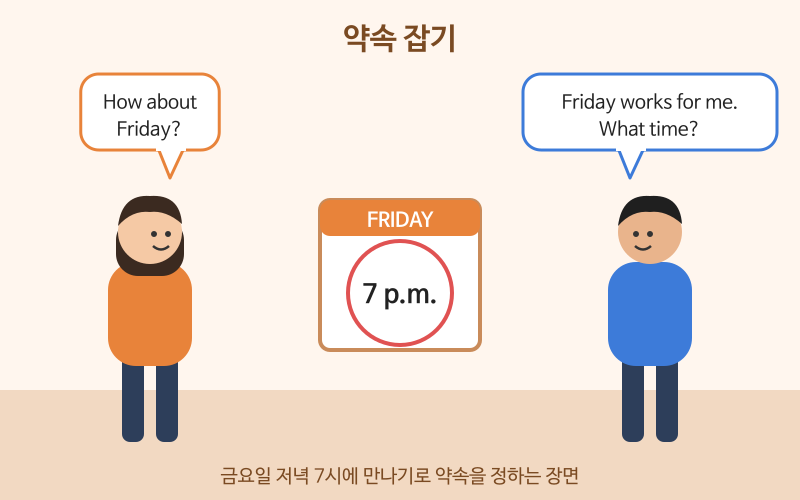

# 약속 잡기

> 난이도: 초급 · 상황: 친구·동료와 만날 날짜와 장소 정하기

## 이번 강의에서 배울 것

- 상대가 시간이 되는지 묻고 제안하기
- 제안을 받아들이거나 정중하게 거절하기
- 약속을 바꾸거나 미루는 표현

## 핵심 설명

약속 잡기는 **제안 → 날짜·시간 조정 → 장소 정하기 → 확인**의 순서로 진행됩니다. 거절할 때는 No만 말하지 말고 **이유 + 다른 날 제안**을 붙이면 부드럽게 들립니다.

### 대화문 듣기

A와 B는 친구 사이입니다. 오랜만에 저녁을 먹기로 합니다.

- **A:** Hey, are you free on Thursday? Let's grab dinner. [🔊](audio/03-making-plans-01.mp3)
- **B:** I'd love to, but I have a meeting that night. [🔊](audio/03-making-plans-02.mp3)
- **A:** Oh, too bad. How about Friday? [🔊](audio/03-making-plans-03.mp3)
- **B:** Friday works for me. What time? [🔊](audio/03-making-plans-04.mp3)
- **A:** Is seven okay? [🔊](audio/03-making-plans-05.mp3)
- **B:** Seven is perfect. Where should we meet? [🔊](audio/03-making-plans-06.mp3)
- **A:** Let's meet in front of Gangnam Station, exit 11. [🔊](audio/03-making-plans-07.mp3)
- **B:** Sounds good. I'll text you when I get there. [🔊](audio/03-making-plans-08.mp3)
- **A:** Great. See you Friday! [🔊](audio/03-making-plans-09.mp3)

| 대화 | 뜻 |
|---|---|
| Are you free on Thursday? | 목요일에 시간 돼? |
| Let's grab dinner. | 저녁 같이 먹자. |
| I'd love to, but ... | 정말 그러고 싶은데, ~ |
| How about Friday? | 금요일은 어때? |
| Friday works for me. | 금요일 좋아. |
| Where should we meet? | 어디서 만날까? |
| I'll text you when I get there. | 도착하면 문자할게. |

### 단계별 핵심 표현

| 영어 | 한국어 | 듣기 |
|---|---|---|
| Do you want to get coffee sometime? | 언제 커피 한잔할래요? | [🔊](audio/03-making-plans-10.mp3) |
| What day is good for you? | 무슨 요일이 좋아요? | [🔊](audio/03-making-plans-11.mp3) |
| I'm busy that day. | 그날은 바빠요. | [🔊](audio/03-making-plans-12.mp3) |
| Can we push it back to next week? | 다음 주로 미룰 수 있을까요? | [🔊](audio/03-making-plans-13.mp3) |
| I'm running ten minutes late. | 10분 정도 늦을 것 같아요. | [🔊](audio/03-making-plans-14.mp3) |
| Let's do it another time. | 다음에 해요. | [🔊](audio/03-making-plans-15.mp3) |

> 💡 요일 앞에는 on, 시각 앞에는 at을 씁니다. on Friday, at seven, on Friday at seven.

## 자주 하는 실수

- ❌ I'll text you when I will get there. → ✅ I'll text you when I get there.
  - when 뒤에서는 미래의 일도 현재형으로 씁니다.
- ❌ No, I can't. → ✅ I'd love to, but I can't. How about next week?
  - 바로 No라고 하면 차갑게 들립니다. 아쉬움과 다른 제안을 함께 말하세요.
- ❌ Let's meet at Friday. → ✅ Let's meet on Friday.
  - 요일과 날짜 앞에는 on입니다.

## 연습 문제

상황에 맞는 말을 영어로 해 보세요.

1. 친구에게 토요일에 시간 되는지 묻기
2. "토요일 좋아요"라고 답하기
3. "가고 싶은데, 그날은 일해야 해요"라고 정중하게 거절하기
4. 약속을 다음 주로 미룰 수 있는지 묻기
5. "5분 정도 늦을 것 같아요"라고 문자 보내기

## 정답과 해설

1. **Are you free on Saturday?**
2. **Saturday works for me.** 또는 **Saturday is good.**
3. **I'd love to, but I have to work that day.**
4. **Can we push it back to next week?** 더 정중하게는 **Could we move it to next week?**
5. **I'm running five minutes late.** 또는 **I'll be about five minutes late.**

## 오늘의 단어

| 단어 | 뜻 | 예문 | 듣기 |
|---|---|---|---|
| grab | (가볍게) 먹다, 잡다 | Let's grab a bite after work. | [🔊](audio/03-making-plans-w01.mp3) |
| exit | 출구 | Take exit 3. | [🔊](audio/03-making-plans-w02.mp3) |
| text | 문자를 보내다 | Text me your address. | [🔊](audio/03-making-plans-w03.mp3) |
| push back | (일정을) 미루다 | They pushed back the meeting. | [🔊](audio/03-making-plans-w04.mp3) |
| sometime | 언젠가 | Let's have lunch sometime. | [🔊](audio/03-making-plans-w05.mp3) |
