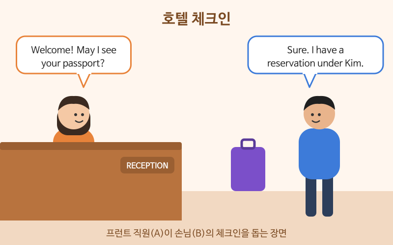

# 공항과 호텔에서

> 난이도: 초급 · 상황: 해외 여행, 출장 중 공항과 호텔

## 이번 강의에서 배울 것

- 탑승 수속, 입국 심사에서 자주 듣는 질문과 대답
- 호텔 체크인과 체크아웃 표현
- 방에 문제가 있을 때 요청하는 말

## 핵심 설명

공항과 호텔에서는 **직원이 묻는 질문이 거의 정해져 있습니다.** 질문을 미리 알아 두면 짧게 대답하기만 하면 됩니다. 대답은 완전한 문장이 아니어도 괜찮습니다. "Two weeks.", "For business." 처럼 핵심만 분명하게 말하세요.

### 대화문 듣기

A는 호텔 프런트 직원, B는 손님입니다.

- **A:** Good evening. Welcome to the Harbor Hotel. [🔊](audio/01-airport-hotel-01.mp3)
- **B:** Hi. I have a reservation under Kim. [🔊](audio/01-airport-hotel-02.mp3)
- **A:** Let me check. May I see your passport, please? [🔊](audio/01-airport-hotel-03.mp3)
- **B:** Sure. Here you go. [🔊](audio/01-airport-hotel-04.mp3)
- **A:** Thank you. You're staying for three nights, right? [🔊](audio/01-airport-hotel-05.mp3)
- **B:** That's right. What time is breakfast? [🔊](audio/01-airport-hotel-06.mp3)
- **A:** It's from seven to ten on the second floor. [🔊](audio/01-airport-hotel-07.mp3)
- **B:** Great. And what's the Wi-Fi password? [🔊](audio/01-airport-hotel-08.mp3)
- **A:** It's on your key card holder. Enjoy your stay! [🔊](audio/01-airport-hotel-09.mp3)

| 대화 | 뜻 |
|---|---|
| I have a reservation under Kim. | 김이라는 이름으로 예약했어요. |
| Let me check. | 확인해 볼게요. |
| May I see your passport? | 여권 좀 보여 주시겠어요? |
| Here you go. | 여기 있어요. |
| You're staying for three nights, right? | 3박 묵으시는 거 맞죠? |
| What time is breakfast? | 아침 식사는 몇 시예요? |
| Enjoy your stay! | 즐거운 시간 보내세요! |

### 단계별 핵심 표현

**공항**

| 영어 | 한국어 | 듣기 |
|---|---|---|
| Can I have a window seat? | 창가 자리로 주시겠어요? | [🔊](audio/01-airport-hotel-10.mp3) |
| I'd like to check this bag. | 이 가방을 부치고 싶어요. | [🔊](audio/01-airport-hotel-11.mp3) |
| I'm here on business. | 출장으로 왔어요. (입국 심사) | [🔊](audio/01-airport-hotel-12.mp3) |
| I'm staying for a week. | 일주일 머물러요. (입국 심사) | [🔊](audio/01-airport-hotel-13.mp3) |

**호텔**

| 영어 | 한국어 | 듣기 |
|---|---|---|
| Can I check in early? | 일찍 체크인할 수 있나요? | [🔊](audio/01-airport-hotel-14.mp3) |
| The air conditioner isn't working. | 에어컨이 안 돼요. | [🔊](audio/01-airport-hotel-15.mp3) |
| Could you keep my luggage until three? | 3시까지 짐을 맡아 주시겠어요? | [🔊](audio/01-airport-hotel-16.mp3) |
| I'd like to check out, please. | 체크아웃할게요. | [🔊](audio/01-airport-hotel-17.mp3) |

> 💡 입국 심사에서 자주 듣는 질문은 세 가지입니다. What's the purpose of your visit?(방문 목적), How long are you staying?(체류 기간), Where are you staying?(숙소). 답은 "Sightseeing.", "Five days.", "At the Harbor Hotel." 처럼 짧게 해도 됩니다.

## 자주 하는 실수

- ❌ I reserved. My name is Kim. → ✅ I have a reservation under Kim.
  - "~ 이름으로 예약했다"는 under를 써서 한 문장으로 말합니다.
- ❌ The air conditioner is broken. Change the room. → ✅ The air conditioner isn't working. Could I change rooms?
  - 문제를 말한 뒤 명령문 대신 Could I ...?로 부탁하세요. "방을 바꾸다"는 rooms로 복수형입니다.
- ❌ I'm here for trip. → ✅ I'm here on vacation. / I'm here for sightseeing.
  - trip을 쓰려면 관사가 필요하고(for a trip), 보통은 on vacation이나 for sightseeing을 씁니다.

## 연습 문제

상황에 맞는 말을 영어로 해 보세요.

1. 탑승 수속에서 통로 자리를 부탁하기
2. 입국 심사에서 "관광하러 왔어요"라고 답하기
3. 호텔에서 "박이라는 이름으로 예약했어요"라고 말하기
4. 방에 뜨거운 물이 안 나온다고 말하기
5. 체크아웃 후 짐을 맡아 줄 수 있는지 묻기

## 정답과 해설

1. **Can I have an aisle seat?** aisle의 s는 소리 나지 않아 "아일"로 읽습니다.
2. **I'm here for sightseeing.** 또는 **Sightseeing.**
3. **I have a reservation under Park.**
4. **There's no hot water in my room.** 또는 **The hot water isn't working.**
5. **Could you keep my luggage after I check out?** 또는 **Can I leave my bags here?**

## 오늘의 단어

| 단어 | 뜻 | 예문 | 듣기 |
|---|---|---|---|
| reservation | 예약 | I made a reservation online. | [🔊](audio/01-airport-hotel-w01.mp3) |
| passport | 여권 | Don't forget your passport. | [🔊](audio/01-airport-hotel-w02.mp3) |
| aisle seat | 통로 쪽 자리 | I prefer an aisle seat. | [🔊](audio/01-airport-hotel-w03.mp3) |
| luggage | 짐, 수하물 | My luggage didn't arrive. | [🔊](audio/01-airport-hotel-w04.mp3) |
| purpose | 목적 | What's the purpose of your trip? | [🔊](audio/01-airport-hotel-w05.mp3) |
