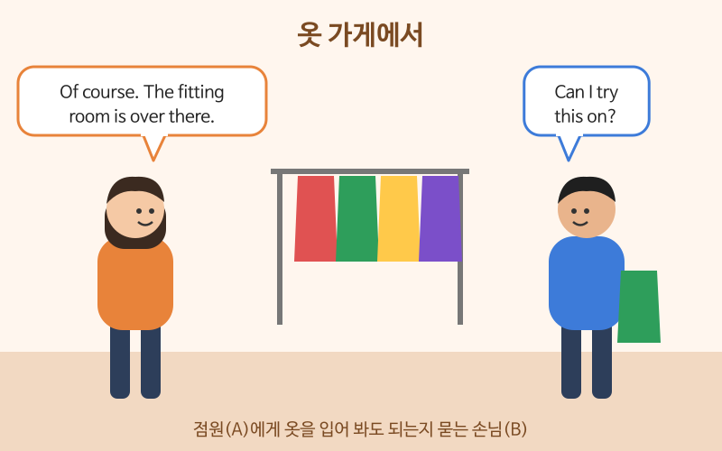

# 쇼핑하고 길 묻기

> 난이도: 초급 · 상황: 여행지의 옷 가게, 거리에서 길 찾기

## 이번 강의에서 배울 것

- 옷 가게에서 사이즈를 묻고 입어 보는 표현
- 가격을 묻고 계산하는 표현
- 길을 묻고, 들은 길 안내를 알아듣기

## 핵심 설명

가게에서는 직원이 먼저 "Can I help you?"라고 묻는 경우가 많습니다. 그냥 둘러보는 중이라면 "I'm just looking, thanks."라고 답하면 됩니다. 길을 물을 때는 **Excuse me로 말을 걸고, 가고 싶은 곳을 분명히 말한 뒤**, 들은 안내를 한 번 되풀이해 확인하세요.

### 대화문 듣기

A는 옷 가게 점원, B는 손님입니다.

- **A:** Hi, can I help you find anything? [🔊](audio/03-shopping-directions-01.mp3)
- **B:** Yes, do you have this shirt in a medium? [🔊](audio/03-shopping-directions-02.mp3)
- **A:** Let me see. Here's a medium in blue. [🔊](audio/03-shopping-directions-03.mp3)
- **B:** Can I try this on? [🔊](audio/03-shopping-directions-04.mp3)
- **A:** Of course. The fitting room is over there. [🔊](audio/03-shopping-directions-05.mp3)
- **B:** It fits well. How much is it? [🔊](audio/03-shopping-directions-06.mp3)
- **A:** It's forty dollars, but it's twenty percent off today. [🔊](audio/03-shopping-directions-07.mp3)
- **B:** Great, I'll take it. Oh, how do I get to the subway station from here? [🔊](audio/03-shopping-directions-08.mp3)
- **A:** Go straight for two blocks and turn left. It's across from the bank. [🔊](audio/03-shopping-directions-09.mp3)
- **B:** Two blocks and then left. Thanks a lot! [🔊](audio/03-shopping-directions-10.mp3)

| 대화 | 뜻 |
|---|---|
| Can I help you find anything? | 찾으시는 거 있으세요? |
| Do you have this in a medium? | 이거 M 사이즈 있나요? |
| Can I try this on? | 이거 입어 봐도 돼요? |
| The fitting room is over there. | 탈의실은 저쪽이에요. |
| It fits well. | 잘 맞아요. |
| It's twenty percent off. | 20% 할인이에요. |
| I'll take it. | 이걸로 살게요. |
| How do I get to ...? | ~에 어떻게 가요? |
| It's across from the bank. | 은행 맞은편에 있어요. |

### 단계별 핵심 표현

**쇼핑**

| 영어 | 한국어 | 듣기 |
|---|---|---|
| I'm just looking, thanks. | 그냥 둘러보는 중이에요. | [🔊](audio/03-shopping-directions-11.mp3) |
| Do you have this in a smaller size? | 이거 더 작은 사이즈 있나요? | [🔊](audio/03-shopping-directions-12.mp3) |
| Can I get a refund? | 환불받을 수 있나요? | [🔊](audio/03-shopping-directions-13.mp3) |

**길 묻기**

| 영어 | 한국어 | 듣기 |
|---|---|---|
| Excuse me, is there a pharmacy near here? | 실례지만, 근처에 약국이 있나요? | [🔊](audio/03-shopping-directions-14.mp3) |
| Is it within walking distance? | 걸어갈 수 있는 거리인가요? | [🔊](audio/03-shopping-directions-15.mp3) |
| It's on your right. | 오른쪽에 있어요. | [🔊](audio/03-shopping-directions-16.mp3) |
| Sorry, I'm not from around here. | 죄송해요, 저도 여기 사람이 아니라서요. | [🔊](audio/03-shopping-directions-17.mp3) |

> 💡 길 안내에서 자주 듣는 말: go straight(직진), turn left/right(왼쪽/오른쪽으로 돌기), at the corner(모퉁이에서), next to(바로 옆), across from(맞은편), two blocks(두 블록).

## 자주 하는 실수

- ❌ Can I wear this? (가게에서) → ✅ Can I try this on?
  - 사기 전에 입어 보는 것은 try on입니다. wear는 "평소에 입고 있다"는 뜻입니다.
- ❌ How much is this? Too expensive. Discount please. → ✅ Is there any discount on this?
  - 명령문으로 깎아 달라고 하면 무례하게 들립니다. 할인이 있는지 묻는 정도가 좋습니다.
- ❌ Where is subway? → ✅ Where's the subway station?
  - 장소 앞에는 the를 붙이고, subway보다 subway station이 분명합니다.

## 연습 문제

상황에 맞는 말을 영어로 해 보세요.

1. 점원에게 "그냥 둘러보는 중이에요"라고 말하기
2. 이 바지를 입어 봐도 되는지 묻기
3. 이 신발이 더 큰 사이즈로 있는지 묻기
4. 지나가는 사람에게 버스 정류장에 어떻게 가는지 묻기
5. "직진해서 오른쪽으로 도세요"라는 안내를 영어로 말하기

## 정답과 해설

1. **I'm just looking, thanks.**
2. **Can I try these pants on?** pants는 복수형이라 this가 아니라 these를 씁니다.
3. **Do you have these shoes in a bigger size?** 또는 **Do you have these in a larger size?**
4. **Excuse me, how do I get to the bus stop?**
5. **Go straight and turn right.**

## 오늘의 단어

| 단어 | 뜻 | 예문 | 듣기 |
|---|---|---|---|
| try on | 입어 보다, 신어 보다 | Can I try these shoes on? | [🔊](audio/03-shopping-directions-w01.mp3) |
| fitting room | 탈의실 | Where's the fitting room? | [🔊](audio/03-shopping-directions-w02.mp3) |
| refund | 환불 | I'd like a refund, please. | [🔊](audio/03-shopping-directions-w03.mp3) |
| block | 블록, 구역 | It's three blocks away. | [🔊](audio/03-shopping-directions-w04.mp3) |
| across from | ~의 맞은편에 | The hotel is across from the park. | [🔊](audio/03-shopping-directions-w05.mp3) |
