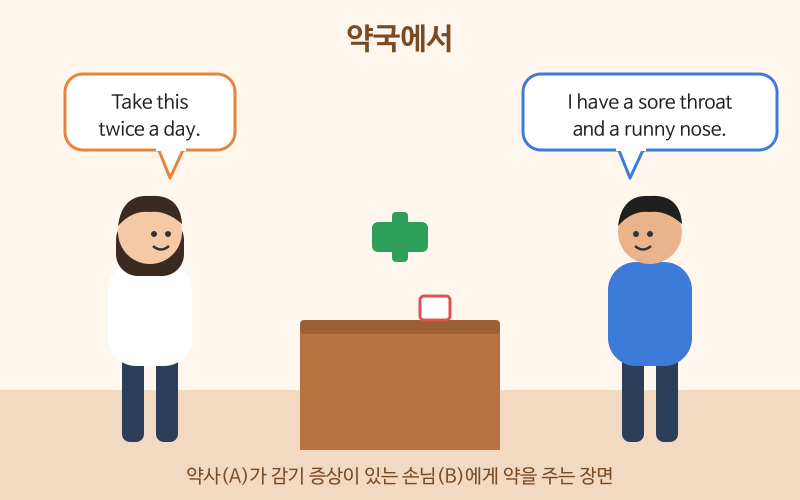

# 병원과 약국에서

> 난이도: 중급 · 상황: 여행이나 출장 중 몸이 아플 때

## 이번 강의에서 배울 것

- 증상과 아픈 정도, 아픈 기간을 설명하기
- 병원 접수와 진료에서 듣는 질문 알아듣기
- 약국에서 약을 사고 복용법 확인하기

## 핵심 설명

아플 때는 **무엇이(증상) → 언제부터(기간) → 얼마나(정도)** 순서로 말하면 의사나 약사가 빨리 이해합니다. 증상은 "I have a + 증상"과 "My + 신체 부위 + hurts" 두 가지 틀만 알아도 대부분 말할 수 있습니다.

### 대화문 듣기

A는 약사, B는 손님입니다.

- **A:** Hi, what can I do for you? [🔊](audio/04-hospital-pharmacy-01.mp3)
- **B:** I have a sore throat and a runny nose. [🔊](audio/04-hospital-pharmacy-02.mp3)
- **A:** How long have you had these symptoms? [🔊](audio/04-hospital-pharmacy-03.mp3)
- **B:** Since yesterday morning. I think I caught a cold on the plane. [🔊](audio/04-hospital-pharmacy-04.mp3)
- **A:** Do you have a fever? [🔊](audio/04-hospital-pharmacy-05.mp3)
- **B:** A slight one, I think. Do I need a prescription? [🔊](audio/04-hospital-pharmacy-06.mp3)
- **A:** No, you don't. Take this twice a day after meals. [🔊](audio/04-hospital-pharmacy-07.mp3)
- **B:** Will it make me sleepy? I have a meeting tomorrow. [🔊](audio/04-hospital-pharmacy-08.mp3)
- **A:** It might. If you don't feel better in three days, please see a doctor. [🔊](audio/04-hospital-pharmacy-09.mp3)

| 대화 | 뜻 |
|---|---|
| What can I do for you? | 무엇을 도와드릴까요? |
| I have a sore throat. | 목이 아파요. |
| a runny nose | 콧물 |
| How long have you had these symptoms? | 이런 증상이 얼마나 됐어요? |
| I think I caught a cold. | 감기에 걸린 것 같아요. |
| Do I need a prescription? | 처방전이 필요한가요? |
| Take this twice a day after meals. | 하루 두 번 식후에 드세요. |
| Will it make me sleepy? | 먹으면 졸린가요? |
| please see a doctor | 병원에 가 보세요 |

### 단계별 핵심 표현

**병원 접수와 진료**

| 영어 | 한국어 | 듣기 |
|---|---|---|
| I'd like to make an appointment. | 진료 예약을 하고 싶어요. | [🔊](audio/04-hospital-pharmacy-10.mp3) |
| I have travel insurance. | 여행자 보험이 있어요. | [🔊](audio/04-hospital-pharmacy-11.mp3) |
| My stomach hurts when I eat. | 먹으면 배가 아파요. | [🔊](audio/04-hospital-pharmacy-12.mp3) |
| It's a sharp pain, not a dull one. | 묵직한 게 아니라 찌르는 듯이 아파요. | [🔊](audio/04-hospital-pharmacy-13.mp3) |
| I'm allergic to penicillin. | 저는 페니실린 알레르기가 있어요. | [🔊](audio/04-hospital-pharmacy-14.mp3) |

**약국**

| 영어 | 한국어 | 듣기 |
|---|---|---|
| Do you have something for a headache? | 두통약 있나요? | [🔊](audio/04-hospital-pharmacy-15.mp3) |
| How many should I take? | 몇 알씩 먹어야 하나요? | [🔊](audio/04-hospital-pharmacy-16.mp3) |
| Are there any side effects? | 부작용이 있나요? | [🔊](audio/04-hospital-pharmacy-17.mp3) |

> 💡 미국에서는 가벼운 감기약, 진통제는 처방전 없이 약국이나 마트에서 살 수 있습니다(over-the-counter). 응급 상황이면 911에 전화하거나 emergency room(응급실)으로 가세요.

## 자주 하는 실수

- ❌ My head is sick. → ✅ I have a headache. / My head hurts.
  - sick은 "몸이 아프다"는 전체 상태에 씁니다. 특정 부위는 hurt나 -ache로 말합니다.
- ❌ I have a cold since yesterday. → ✅ I've had a cold since yesterday.
  - since와 함께 "그때부터 지금까지"를 말할 때는 현재완료를 씁니다.
- ❌ Give me cold medicine. → ✅ Do you have something for a cold?
  - 약 이름을 몰라도 "something for + 증상"으로 물으면 약사가 골라 줍니다.

## 연습 문제

상황에 맞는 말을 영어로 해 보세요.

1. 약국에서 "열이 나고 기침을 해요"라고 말하기
2. "이틀 전부터 그랬어요"라고 기간 말하기
3. 병원에 전화해서 진료 예약을 하고 싶다고 말하기
4. 약사에게 이 약을 하루에 몇 번 먹어야 하는지 묻기
5. 아스피린 알레르기가 있다고 말하기

## 정답과 해설

1. **I have a fever and a cough.**
2. **It started two days ago.** 또는 **I've had it for two days.**
3. **I'd like to make an appointment, please.**
4. **How many times a day should I take this?**
5. **I'm allergic to aspirin.**

## 오늘의 단어

| 단어 | 뜻 | 예문 | 듣기 |
|---|---|---|---|
| symptom | 증상 | What are your symptoms? | [🔊](audio/04-hospital-pharmacy-w01.mp3) |
| prescription | 처방전 | You need a prescription for this. | [🔊](audio/04-hospital-pharmacy-w02.mp3) |
| fever | 열 | The baby has a high fever. | [🔊](audio/04-hospital-pharmacy-w03.mp3) |
| side effect | 부작용 | This medicine has few side effects. | [🔊](audio/04-hospital-pharmacy-w04.mp3) |
| appointment | (진료·업무) 예약, 약속 | I have a dentist appointment at two. | [🔊](audio/04-hospital-pharmacy-w05.mp3) |
