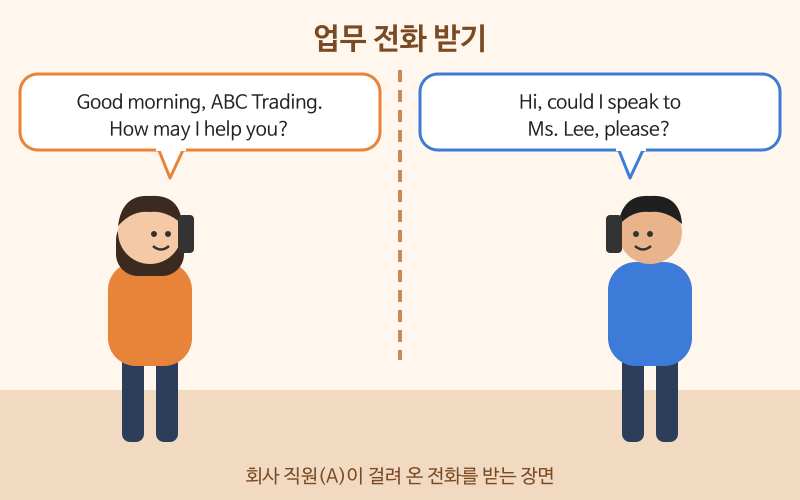

# 전화와 이메일 표현

> 난이도: 중급 · 상황: 거래처와의 업무 전화, 업무 이메일

## 이번 강의에서 배울 것

- 업무 전화를 걸고 받는 기본 순서
- 담당자가 없을 때 메시지를 남기고 받는 표현
- 업무 이메일의 시작, 본론, 마무리 문장

## 핵심 설명

업무 전화는 얼굴이 보이지 않아 더 어렵게 느껴집니다. 하지만 흐름은 거의 같습니다. **인사와 소속 밝히기 → 용건 또는 담당자 찾기 → 메시지·확인 → 마무리.** 잘 못 들었을 때 다시 묻는 표현을 꼭 익혀 두세요. 다시 묻는 것은 실례가 아닙니다.

### 대화문 듣기

A는 ABC 무역 직원, B는 거래처 직원입니다.

- **A:** Good morning, ABC Trading. How may I help you? [🔊](audio/01-phone-email-01.mp3)
- **B:** Hi, this is David Park from Sunrise Foods. Could I speak to Ms. Lee, please? [🔊](audio/01-phone-email-02.mp3)
- **A:** I'm afraid she's in a meeting right now. Can I take a message? [🔊](audio/01-phone-email-03.mp3)
- **B:** Yes, please. Could you ask her to call me back this afternoon? [🔊](audio/01-phone-email-04.mp3)
- **A:** Sure. Could I have your number? [🔊](audio/01-phone-email-05.mp3)
- **B:** It's zero one zero, two three four five, six seven eight nine. [🔊](audio/01-phone-email-06.mp3)
- **A:** Let me read that back. Zero one zero, two three four five, six seven eight nine. [🔊](audio/01-phone-email-07.mp3)
- **B:** That's correct. It's about next month's order. [🔊](audio/01-phone-email-08.mp3)
- **A:** Got it. I'll make sure she gets the message. [🔊](audio/01-phone-email-09.mp3)
- **B:** Thank you. Have a good day. [🔊](audio/01-phone-email-10.mp3)

| 대화 | 뜻 |
|---|---|
| How may I help you? | 무엇을 도와드릴까요? |
| This is David Park from Sunrise Foods. | 선라이즈 푸드의 데이비드 박입니다. |
| Could I speak to Ms. Lee? | 이 팀장님과 통화할 수 있을까요? |
| I'm afraid she's in a meeting. | 죄송하지만 지금 회의 중이세요. |
| Can I take a message? | 메시지 남기시겠어요? |
| Could you ask her to call me back? | 다시 전화해 달라고 전해 주시겠어요? |
| Let me read that back. | 다시 한번 불러 드릴게요. (확인) |
| zero one zero, two three four five ... | 010-2345-... (전화번호는 숫자를 하나씩 끊어 읽는다) |
| I'll make sure she gets the message. | 꼭 전해 드릴게요. |

> 💡 전화로 자기를 소개할 때는 I am이 아니라 **This is ...** 를 씁니다. 상대를 찾을 때도 "Is this Ms. Lee?"처럼 this를 씁니다.

### 단계별 핵심 표현

**전화**

| 영어 | 한국어 | 듣기 |
|---|---|---|
| Sorry, could you say that again? | 죄송한데 다시 한번 말씀해 주시겠어요? | [🔊](audio/01-phone-email-11.mp3) |
| Could you speak a little more slowly? | 조금만 천천히 말씀해 주시겠어요? | [🔊](audio/01-phone-email-12.mp3) |
| I'll transfer you to the sales team. | 영업팀으로 연결해 드릴게요. | [🔊](audio/01-phone-email-13.mp3) |
| Sorry, I think you have the wrong number. | 죄송하지만 전화 잘못 거신 것 같아요. | [🔊](audio/01-phone-email-14.mp3) |

**이메일**

| 영어 | 한국어 | 듣기 |
|---|---|---|
| I'm writing to ask about your new price list. | 새 가격표에 대해 문의드리고자 메일 드립니다. | [🔊](audio/01-phone-email-15.mp3) |
| Please find the file attached. | 첨부 파일을 확인해 주세요. | [🔊](audio/01-phone-email-16.mp3) |
| Could you get back to me by Friday? | 금요일까지 회신 주시겠어요? | [🔊](audio/01-phone-email-17.mp3) |
| Please let me know if you have any questions. | 궁금한 점이 있으면 알려 주세요. | [🔊](audio/01-phone-email-18.mp3) |

업무 이메일은 보통 다음 틀을 따릅니다.

| 부분 | 쓰는 말 |
|---|---|
| 인사 | Dear Ms. Lee, / Hi David, |
| 목적 | I'm writing to ... / I'm following up on ... |
| 본론 | Please find ... attached. / Could you ...? |
| 마무리 | Please let me know if ... / I look forward to hearing from you. |
| 끝인사 | Best regards, / Thanks, |

## 자주 하는 실수

- ❌ I am David Park. (전화로) → ✅ This is David Park.
  - 전화에서는 자기를 this로 소개합니다.
- ❌ What? / Pardon? (반복해서) → ✅ Sorry, could you say that again?
  - What?만 말하면 퉁명스럽게 들립니다. Sorry를 붙여 문장으로 말하세요.
- ❌ I send you the file. → ✅ I'm sending you the file. / Please find the file attached.
  - 지금 보내는 일은 현재진행형으로, 이메일에서는 attached 표현을 많이 씁니다.

## 연습 문제

상황에 맞는 말을 영어로 해 보세요.

1. 전화로 "그린 테크의 김민수입니다"라고 자기소개하기
2. "죄송하지만 지금 자리에 안 계세요. 메시지 남기시겠어요?"
3. 상대에게 오후에 다시 전화해 달라고 부탁하기
4. 이메일에서 "회의 일정에 관해 연락드립니다"라고 목적 밝히기
5. 이메일 마지막에 "답장 기다리겠습니다"라고 쓰기

## 정답과 해설

1. **This is Minsu Kim from Green Tech.**
2. **I'm afraid he's not at his desk right now. Can I take a message?** 담당자가 여성이면 she's, her로 바꿉니다.
3. **Could you call me back this afternoon?**
4. **I'm writing about the meeting schedule.** 또는 **I'm writing to ask about the meeting schedule.**
5. **I look forward to hearing from you.** to 뒤에 동사의 -ing 형을 씁니다.

## 오늘의 단어

| 단어 | 뜻 | 예문 | 듣기 |
|---|---|---|---|
| call back | 다시 전화하다 | I'll call you back in ten minutes. | [🔊](audio/01-phone-email-w01.mp3) |
| transfer | (전화를) 돌려주다 | Let me transfer you. | [🔊](audio/01-phone-email-w02.mp3) |
| attach | 첨부하다 | I attached the report. | [🔊](audio/01-phone-email-w03.mp3) |
| order | 주문 | We received your order. | [🔊](audio/01-phone-email-w04.mp3) |
| follow up | 후속 연락을 하다 | I'm following up on my last email. | [🔊](audio/01-phone-email-w05.mp3) |
