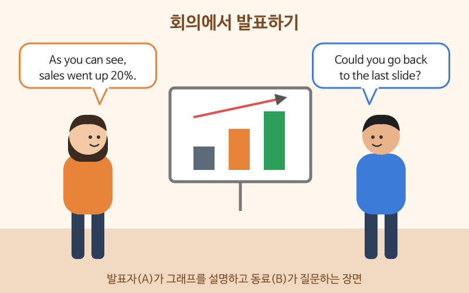

# 회의와 발표

> 난이도: 중급 · 상황: 팀 회의, 거래처 앞 발표

## 이번 강의에서 배울 것

- 발표를 시작하고, 다음 내용으로 넘어가고, 마무리하는 표현
- 그래프와 숫자를 설명하는 표현
- 회의에서 의견을 말하고, 끼어들고, 반대하는 방법

## 핵심 설명

영어 발표가 어려운 이유는 내용보다 **연결하는 말**이 떠오르지 않기 때문인 경우가 많습니다. "먼저", "다음으로", "보시다시피", "정리하면" 같은 신호 표현을 외워 두면 발표의 뼈대가 생깁니다. 회의에서는 바로 반대하기보다 **상대 의견을 인정한 뒤 내 의견을 말하는 것**이 자연스럽습니다.

### 대화문 듣기

A는 발표자, B는 같은 팀 동료입니다. 분기 실적 회의 중입니다.

- **A:** Let's get started. Today I'll talk about our third-quarter sales. [🔊](audio/02-meetings-01.mp3)
- **A:** As you can see on this graph, sales went up twenty percent. [🔊](audio/02-meetings-02.mp3)
- **B:** Sorry to interrupt, but could you go back to the last slide? [🔊](audio/02-meetings-03.mp3)
- **A:** Sure. Is there something you'd like to check? [🔊](audio/02-meetings-04.mp3)
- **B:** Yes. Does this number include online sales? [🔊](audio/02-meetings-05.mp3)
- **A:** Good question. No, online sales are on the next slide. [🔊](audio/02-meetings-06.mp3)
- **B:** I see. I think we should show them together next time. [🔊](audio/02-meetings-07.mp3)
- **A:** That's a good point. I'll combine them in the next report. [🔊](audio/02-meetings-08.mp3)
- **A:** Moving on, let's look at our plans for next quarter. [🔊](audio/02-meetings-09.mp3)

| 대화 | 뜻 |
|---|---|
| Let's get started. | 시작하겠습니다. |
| Today I'll talk about ... | 오늘은 ~에 대해 말씀드리겠습니다. |
| As you can see on this graph, ... | 이 그래프에서 보시다시피, ~ |
| Sales went up twenty percent. | 매출이 20% 올랐습니다. |
| Sorry to interrupt, but ... | 말씀 중에 죄송하지만, ~ |
| Good question. | 좋은 질문입니다. |
| That's a good point. | 좋은 지적이에요. |
| Moving on, ... | 다음으로 넘어가서, ~ |

### 단계별 핵심 표현

**발표 흐름**

| 영어 | 한국어 | 듣기 |
|---|---|---|
| First, I'll give you a quick overview. | 먼저 간단히 개요를 말씀드리겠습니다. | [🔊](audio/02-meetings-10.mp3) |
| Sales dropped slightly in August. | 8월에 매출이 조금 떨어졌습니다. | [🔊](audio/02-meetings-11.mp3) |
| To sum up, we need a bigger online budget. | 정리하면, 온라인 예산을 늘려야 합니다. | [🔊](audio/02-meetings-12.mp3) |
| Are there any questions? | 질문 있으신가요? | [🔊](audio/02-meetings-13.mp3) |

**회의 참여**

| 영어 | 한국어 | 듣기 |
|---|---|---|
| In my opinion, we should wait until next month. | 제 생각에는 다음 달까지 기다리는 게 좋겠습니다. | [🔊](audio/02-meetings-14.mp3) |
| I see your point, but I'm not sure that will work. | 무슨 말씀인지 알겠지만, 그게 잘될지 모르겠어요. | [🔊](audio/02-meetings-15.mp3) |
| Could you clarify what you mean? | 무슨 뜻인지 좀 더 설명해 주시겠어요? | [🔊](audio/02-meetings-16.mp3) |
| Let's continue this next week. | 이건 다음 주에 이어서 하죠. | [🔊](audio/02-meetings-17.mp3) |

> 💡 숫자의 변화는 동사로 말합니다. 오르다: go up, increase, rise / 내리다: go down, decrease, drop / 그대로다: stay the same. 정도는 slightly(조금), sharply(급격히)로 덧붙입니다.

## 자주 하는 실수

- ❌ I will start presentation. → ✅ Let's get started. / I'd like to begin my presentation.
  - presentation 앞에 my나 the가 필요하고, Let's get started.가 가장 자연스럽습니다.
- ❌ I disagree. (바로) → ✅ I see your point, but ...
  - 직장에서는 상대 의견을 먼저 인정하고 반대하는 것이 일반적입니다.
- ❌ Sales increased 20 percents. → ✅ Sales increased by 20 percent.
  - percent는 복수형 -s를 붙이지 않고, 변화의 크기는 by로 나타냅니다.

## 연습 문제

상황에 맞는 말을 영어로 해 보세요.

1. 발표를 시작하며 "오늘은 신제품에 대해 말씀드리겠습니다"
2. "이 표에서 보시다시피, 비용이 10% 줄었습니다"
3. 말하는 사람에게 정중하게 끼어들기
4. 동료 의견에 "무슨 말씀인지 알겠지만, 시간이 더 필요할 것 같아요"라고 답하기
5. 발표를 마치며 질문이 있는지 묻기

## 정답과 해설

1. **Today I'll talk about our new product.**
2. **As you can see in this table, costs went down by ten percent.** 그래프는 on this graph, 표는 in this table을 주로 씁니다.
3. **Sorry to interrupt, but ...** 또는 **Can I just add something?**
4. **I see your point, but I think we need more time.**
5. **Are there any questions?** 또는 **Does anyone have any questions?**

## 오늘의 단어

| 단어 | 뜻 | 예문 | 듣기 |
|---|---|---|---|
| quarter | 분기 | Our profits rose in the second quarter. | [🔊](audio/02-meetings-w01.mp3) |
| interrupt | (말을) 끊다, 방해하다 | Sorry to interrupt you. | [🔊](audio/02-meetings-w02.mp3) |
| overview | 개요 | Here's a brief overview. | [🔊](audio/02-meetings-w03.mp3) |
| budget | 예산 | We're over budget this month. | [🔊](audio/02-meetings-w04.mp3) |
| clarify | 분명히 설명하다 | Let me clarify that point. | [🔊](audio/02-meetings-w05.mp3) |
