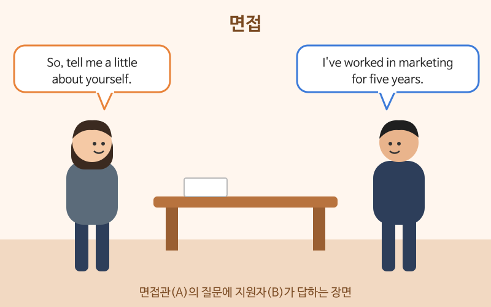

# 영어 면접

> 난이도: 중급 · 상황: 외국계 회사, 해외 기업 면접

## 이번 강의에서 배울 것

- 면접에서 꼭 나오는 질문과 답의 틀
- 경력과 강점을 구체적인 예로 말하기
- 면접 끝에 질문하고 인사하기

## 핵심 설명

영어 면접 질문은 대부분 정해져 있습니다. "자기소개", "왜 지원했는지", "강점과 약점", "어려웠던 경험", "질문 있나요?"입니다. 답할 때는 **결론 먼저 → 구체적인 예 → 회사와 연결** 순서로 말하면 짧아도 설득력이 있습니다. 경험을 말할 때는 숫자를 넣으세요.

### 대화문 듣기

A는 면접관, B는 지원자입니다.

- **A:** Thank you for coming in today. So, tell me a little about yourself. [🔊](audio/03-interview-01.mp3)
- **B:** Sure. I've worked in marketing for five years, mainly in online advertising. [🔊](audio/03-interview-02.mp3)
- **A:** Why are you interested in this position? [🔊](audio/03-interview-03.mp3)
- **B:** I've always admired your brand, and I want to work on global campaigns. [🔊](audio/03-interview-04.mp3)
- **A:** What would you say is your greatest strength? [🔊](audio/03-interview-05.mp3)
- **B:** I'm good with data. In my last job, I raised our click rate by thirty percent. [🔊](audio/03-interview-06.mp3)
- **A:** Impressive. And what about a weakness? [🔊](audio/03-interview-07.mp3)
- **B:** I used to take on too much work, so now I plan my tasks every Monday. [🔊](audio/03-interview-08.mp3)
- **A:** Great. Do you have any questions for us? [🔊](audio/03-interview-09.mp3)
- **B:** Yes. What does a typical day look like for this team? [🔊](audio/03-interview-10.mp3)

| 대화 | 뜻 |
|---|---|
| Thank you for coming in today. | 오늘 와 주셔서 감사합니다. |
| Tell me a little about yourself. | 자기소개를 간단히 해 주세요. |
| I've worked in marketing for five years. | 마케팅 분야에서 5년간 일했습니다. |
| Why are you interested in this position? | 이 직무에 왜 관심을 갖게 되었나요? |
| What would you say is your greatest strength? | 가장 큰 강점이 무엇이라고 생각하나요? |
| I raised our click rate by thirty percent. | 클릭률을 30% 올렸습니다. |
| I used to take on too much work. | 예전에는 일을 너무 많이 떠맡곤 했습니다. |
| What does a typical day look like? | 보통 하루 일과는 어떤가요? |

### 단계별 핵심 표현

| 영어 | 한국어 | 듣기 |
|---|---|---|
| I'm currently working as a project manager. | 현재 프로젝트 매니저로 일하고 있습니다. | [🔊](audio/03-interview-11.mp3) |
| I'm looking for a new challenge. | 새로운 도전을 찾고 있습니다. | [🔊](audio/03-interview-12.mp3) |
| I led a team of six people. | 6명으로 된 팀을 이끌었습니다. | [🔊](audio/03-interview-13.mp3) |
| One time, we had a very tight deadline. | 한번은 마감이 아주 빠듯했던 적이 있습니다. | [🔊](audio/03-interview-14.mp3) |
| That's a good question. Let me think for a moment. | 좋은 질문이네요. 잠시 생각해 보겠습니다. | [🔊](audio/03-interview-15.mp3) |
| What are the next steps in the process? | 다음 전형 절차는 어떻게 되나요? | [🔊](audio/03-interview-16.mp3) |
| Thank you for your time. I look forward to hearing from you. | 시간 내 주셔서 감사합니다. 연락 기다리겠습니다. | [🔊](audio/03-interview-17.mp3) |

> 💡 약점 질문에는 진짜 약점 하나와 **그것을 고치려고 하는 행동**을 함께 말하세요. "I'm a perfectionist."처럼 흔한 답은 피하는 것이 좋습니다. 마지막 질문 시간에 "No."라고만 하면 관심이 없어 보이니, 질문 한두 개를 준비해 가세요.

## 자주 하는 실수

- ❌ I worked in marketing for five years. (지금도 하고 있는데) → ✅ I've worked in marketing for five years.
  - 과거부터 지금까지 이어지는 경력은 현재완료로 말합니다. 과거형은 이미 그만둔 일처럼 들립니다.
- ❌ I am very passionate and hardworking person. → ✅ I'm a hardworking person. For example, ...
  - 관사 a를 빠뜨리지 말고, 형용사만 늘어놓기보다 예를 들어 보여 주세요.
- ❌ How much is the salary? (첫 질문으로) → ✅ What does a typical day look like for this team?
  - 연봉은 보통 회사에서 먼저 이야기를 꺼내거나, 다음 단계에서 묻는 것이 무난합니다.

## 연습 문제

상황에 맞는 말을 영어로 해 보세요.

1. "저는 3년째 회계 업무를 하고 있습니다"라고 말하기
2. "새로운 도전을 찾고 있습니다"라고 지원 이유 말하기
3. "저는 일정 관리를 잘합니다"라고 강점 말하기
4. 바로 대답이 떠오르지 않을 때 시간을 버는 말 하기
5. 면접을 마치며 감사 인사하기

## 정답과 해설

1. **I've worked in accounting for three years.** 또는 **I've been working in accounting for three years.**
2. **I'm looking for a new challenge.**
3. **I'm good at managing schedules.** be good at 뒤에는 명사나 -ing 형이 옵니다.
4. **That's a good question. Let me think for a moment.**
5. **Thank you for your time.** 또는 **Thank you for having me today.**

## 오늘의 단어

| 단어 | 뜻 | 예문 | 듣기 |
|---|---|---|---|
| position | 직무, 자리 | I'm applying for the sales position. | [🔊](audio/03-interview-w01.mp3) |
| strength | 강점 | Teamwork is one of my strengths. | [🔊](audio/03-interview-w02.mp3) |
| weakness | 약점 | Everyone has a weakness. | [🔊](audio/03-interview-w03.mp3) |
| deadline | 마감 기한 | The deadline is next Friday. | [🔊](audio/03-interview-w04.mp3) |
| typical | 일반적인, 전형적인 | It was a typical Monday. | [🔊](audio/03-interview-w05.mp3) |
