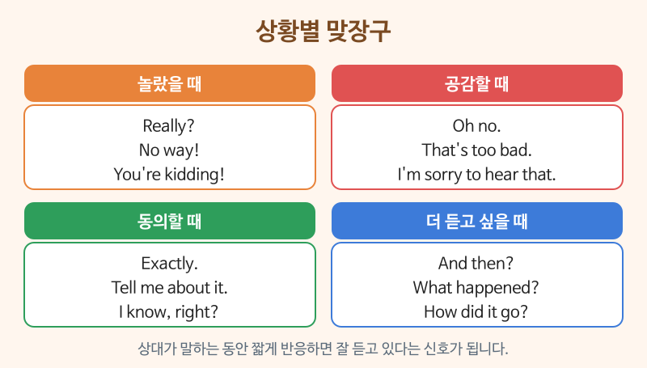

# 맞장구와 리액션

> 난이도: 중급 · 상황: 친구·동료의 이야기를 들을 때

## 이번 강의에서 배울 것

- 놀람, 공감, 동의, 관심을 나타내는 짧은 반응
- 좋은 소식과 나쁜 소식에 맞게 반응하기
- 짧은 질문으로 상대가 이야기를 계속하게 만드는 방법

## 핵심 설명

한국어에서 "아, 진짜?", "헐", "그렇구나"로 맞장구치듯, 영어에도 상대 말에 반응하는 짧은 표현이 많습니다. 영어권 사람들은 듣는 사람이 아무 반응 없이 가만히 있으면 **"내 이야기가 지루한가?"** 하고 느끼기 쉽습니다. 짧은 한마디가 대화를 훨씬 따뜻하게 만듭니다.

### 대화문 듣기

A와 B는 회사 동료입니다. 점심시간에 이야기를 나눕니다.

- **A:** Guess what? I got a promotion! [🔊](audio/01-reactions-01.mp3)
- **B:** No way! That's amazing. Congratulations! [🔊](audio/01-reactions-02.mp3)
- **A:** Thanks! But I have to move to the Busan office. [🔊](audio/01-reactions-03.mp3)
- **B:** Oh, really? How do you feel about that? [🔊](audio/01-reactions-04.mp3)
- **A:** A little nervous. I don't know anyone there. [🔊](audio/01-reactions-05.mp3)
- **B:** I can imagine. Moving is always stressful. [🔊](audio/01-reactions-06.mp3)
- **A:** Tell me about it. I have to find an apartment, too. [🔊](audio/01-reactions-07.mp3)
- **B:** That sounds like a lot. When do you start? [🔊](audio/01-reactions-08.mp3)
- **A:** Next month. I'm going to miss you guys. [🔊](audio/01-reactions-09.mp3)
- **B:** Aw, we'll miss you, too. Let's have a farewell dinner! [🔊](audio/01-reactions-10.mp3)

| 대화 | 뜻 |
|---|---|
| Guess what? | 있잖아, 그거 알아? (소식을 꺼낼 때) |
| No way! | 말도 안 돼! 진짜? (좋은 의미의 놀람) |
| That's amazing. | 정말 대단하다. |
| How do you feel about that? | 그건 어떻게 생각해? |
| I can imagine. | 그럴 만하다. 이해가 돼. |
| Tell me about it. | 내 말이. 그러니까 말이야. |
| That sounds like a lot. | 할 일이 많겠다. |
| a farewell dinner | 송별 저녁 식사 |

### 단계별 핵심 표현

| 영어 | 한국어 | 듣기 |
|---|---|---|
| You're kidding! | 농담이지? 설마! | [🔊](audio/01-reactions-11.mp3) |
| Good for you! | 잘됐다! (상대의 좋은 일에) | [🔊](audio/01-reactions-12.mp3) |
| I'm sorry to hear that. | 그 말을 들으니 안타깝다. | [🔊](audio/01-reactions-13.mp3) |
| That must be hard. | 많이 힘들겠다. | [🔊](audio/01-reactions-14.mp3) |
| Exactly. That's what I was thinking. | 바로 그거야. 나도 그 생각 했어. | [🔊](audio/01-reactions-15.mp3) |
| And then what happened? | 그래서 어떻게 됐어? | [🔊](audio/01-reactions-16.mp3) |

> 💡 "Tell me about it."은 글자 그대로 "그것에 대해 말해 줘"가 아니라 **"내 말이!"** 라는 강한 동의로 자주 씁니다. 말투가 내려가면 동의, 올라가며 궁금해하면 진짜로 "자세히 말해 줘"라는 뜻입니다.

## 자주 하는 실수

- ❌ A: My dog died. B: Oh, really? → ✅ Oh no, I'm so sorry to hear that.
  - Really?는 놀람이나 의심으로 들릴 수 있습니다. 슬픈 소식에는 공감 표현을 쓰세요.
- ❌ A: I passed the exam! B: Okay. → ✅ That's great! Good for you!
  - Okay는 "알았어" 정도로 들려 무관심해 보입니다. 좋은 소식에는 감정을 담아 반응하세요.
- ❌ Me too. (부정문에 동의하며: A: I don't like horror movies.) → ✅ Me neither.
  - 부정문에 동의할 때는 Me neither.를 씁니다.

## 연습 문제

다음 말에 어울리는 반응을 영어로 해 보세요.

1. "I'm getting married next year!"
2. "I lost my wallet on the subway."
3. "This weather is driving me crazy." (같은 생각일 때)
4. "So I opened the door, and guess who was there?"
5. "I don't eat spicy food." (나도 안 먹을 때)

## 정답과 해설

1. **Congratulations! That's wonderful news.** 축하할 일에는 Congratulations!
2. **Oh no! I'm sorry to hear that.** 또는 **That's terrible. Did you report it?**
3. **Tell me about it.** 또는 **I know, right?**
4. **Who? Tell me!** 또는 **And then what happened?** 상대가 이야기를 계속하게 만드는 질문입니다.
5. **Me neither.**

## 오늘의 단어

| 단어 | 뜻 | 예문 | 듣기 |
|---|---|---|---|
| promotion | 승진 | She got a promotion last year. | [🔊](audio/01-reactions-w01.mp3) |
| nervous | 긴장한, 불안한 | I'm nervous about the test. | [🔊](audio/01-reactions-w02.mp3) |
| stressful | 스트레스가 많은 | My job is very stressful. | [🔊](audio/01-reactions-w03.mp3) |
| imagine | 상상하다 | I can't imagine living abroad. | [🔊](audio/01-reactions-w04.mp3) |
| farewell | 작별, 송별 | We had a farewell party for him. | [🔊](audio/01-reactions-w05.mp3) |
