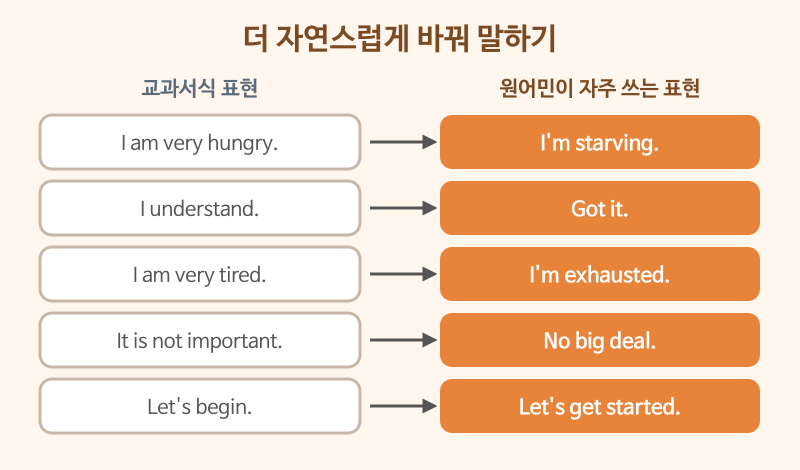

# 원어민이 자주 쓰는 표현

> 난이도: 중급 · 상황: 친구·동료와의 편한 대화

## 이번 강의에서 배울 것

- 교과서식 문장을 일상 회화체로 바꾸기
- 원어민이 하루에도 몇 번씩 쓰는 짧은 표현
- 같은 표현이 상황에 따라 다르게 쓰이는 경우

## 핵심 설명

"I am very hungry."는 문법적으로 완벽하지만, 친구 사이에서는 "I'm starving."이 훨씬 자연스럽습니다. 원어민의 일상 대화는 **줄임말, 짧은 덩어리 표현, 구동사**가 많습니다. 이런 표현은 하나씩 단어로 분석하기보다 **덩어리째 외우는 것**이 좋습니다.

### 대화문 듣기

A와 B는 친한 회사 동료입니다. 퇴근 무렵 이야기를 나눕니다.

- **A:** Hey, are you heading out? [🔊](audio/02-native-expressions-01.mp3)
- **B:** Yeah, I'm exhausted. It's been a long day. [🔊](audio/02-native-expressions-02.mp3)
- **A:** Same here. I'm starving, too. Want to grab a bite? [🔊](audio/02-native-expressions-03.mp3)
- **B:** Sure, why not? But I need to finish this email first. [🔊](audio/02-native-expressions-04.mp3)
- **A:** No rush. Take your time. [🔊](audio/02-native-expressions-05.mp3)
- **B:** Oh, sorry, I forgot to send you that report. [🔊](audio/02-native-expressions-06.mp3)
- **A:** No big deal. You can send it tomorrow. [🔊](audio/02-native-expressions-07.mp3)
- **B:** Got it. Okay, I'm done. Let's get going. [🔊](audio/02-native-expressions-08.mp3)
- **A:** Sounds good. My treat today! [🔊](audio/02-native-expressions-09.mp3)

| 대화 | 뜻 |
|---|---|
| Are you heading out? | 이제 가요? 퇴근해요? |
| I'm exhausted. | 완전 지쳤어요. |
| It's been a long day. | 힘든 하루였어요. |
| Same here. | 저도요. |
| Want to grab a bite? | 간단히 뭐 좀 먹을래요? |
| Sure, why not? | 좋아요, 그러죠. |
| No rush. Take your time. | 급할 거 없어요. 천천히 해요. |
| No big deal. | 별일 아니에요. |
| Let's get going. | 이제 가요. |
| My treat. | 제가 살게요. |

### 단계별 핵심 표현

| 영어 | 한국어 | 듣기 |
|---|---|---|
| I'm good, thanks. | 괜찮아요, 됐어요. (권유를 사양할 때) | [🔊](audio/02-native-expressions-10.mp3) |
| It's up to you. | 당신이 정해요. | [🔊](audio/02-native-expressions-11.mp3) |
| I'll figure it out. | 제가 알아서 해결해 볼게요. | [🔊](audio/02-native-expressions-12.mp3) |
| That makes sense. | 이해가 되네요. 일리가 있네요. | [🔊](audio/02-native-expressions-13.mp3) |
| I'm on my way. | 지금 가는 중이에요. | [🔊](audio/02-native-expressions-14.mp3) |
| It slipped my mind. | 깜빡했어요. | [🔊](audio/02-native-expressions-15.mp3) |

> 💡 "I'm good."은 "저는 좋아요"라는 뜻도 있지만, 무엇을 권할 때 "No, I'm good."이라고 하면 **"괜찮아요, 됐어요"**라는 사양의 뜻입니다. 상대가 더 먹을지 물을 때 자주 들립니다.

## 자주 하는 실수

- ❌ I'm full of tired. → ✅ I'm exhausted. / I'm worn out.
  - "피곤으로 가득하다"는 영어로 그대로 옮기면 어색합니다. 덩어리 표현을 쓰세요.
- ❌ A: Do you want more coffee? B: I'm good. (더 마시고 싶다는 뜻으로) → ✅ Yes, please.
  - I'm good.은 사양의 뜻으로 받아들여집니다. 원하면 Yes, please.라고 하세요.
- ❌ I will pay for you. → ✅ It's on me. / My treat.
  - 틀린 말은 아니지만 딱딱합니다. "내가 살게"는 It's on me.가 자연스럽습니다.

## 연습 문제

다음 교과서식 문장을 자연스러운 표현으로 바꿔 보세요.

1. I understand what you said.
2. I am going there now.
3. I forgot about it.
4. You can decide.
5. I will pay today.

## 정답과 해설

1. **Got it.** 또는 **That makes sense.**
2. **I'm on my way.**
3. **It slipped my mind.**
4. **It's up to you.**
5. **It's on me today.** 또는 **My treat today.**

## 오늘의 단어

| 단어 | 뜻 | 예문 | 듣기 |
|---|---|---|---|
| exhausted | 기진맥진한 | I'm exhausted after the trip. | [🔊](audio/02-native-expressions-w01.mp3) |
| starving | 몹시 배고픈 | Let's eat. I'm starving. | [🔊](audio/02-native-expressions-w02.mp3) |
| head out | 나가다, 출발하다 | I'm heading out now. | [🔊](audio/02-native-expressions-w03.mp3) |
| figure out | 알아내다, 해결하다 | I can't figure out this problem. | [🔊](audio/02-native-expressions-w04.mp3) |
| treat | 대접, 한턱 | Dinner is my treat. | [🔊](audio/02-native-expressions-w05.mp3) |
