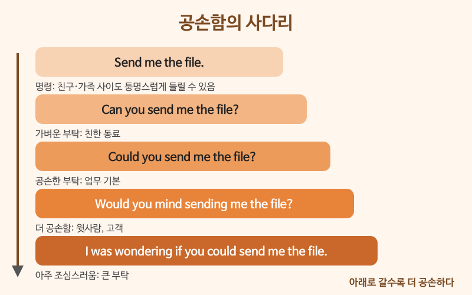

# 상황별 공손함의 정도

> 난이도: 고급 · 상황: 친구, 동료, 윗사람, 고객에게 부탁하고 거절할 때

## 이번 강의에서 배울 것

- 같은 부탁을 공손함의 단계별로 다르게 말하기
- 과거형, 조건문, 완충 표현으로 말을 부드럽게 만드는 원리
- 너무 공손해서 오히려 어색한 경우 피하기

## 핵심 설명

영어에는 한국어 같은 존댓말 어미가 없지만, **문장의 길이와 형태로 공손함을 조절**합니다. 원리는 세 가지입니다.

1. **조동사를 과거형으로**: can → could, will → would. 과거형은 거리를 두어 부드럽게 들립니다.
2. **질문이나 조건으로 바꾸기**: Send it. → Could you send it? → Would you mind sending it?
3. **완충 표현 넣기**: I was wondering if ..., Sorry to bother you, but ..., if possible

### 대화문 듣기

A는 팀장, B는 신입 사원입니다. 두 사람 모두 상황에 맞게 공손함을 조절합니다.

- **B:** Sorry to bother you, but do you have a minute? [🔊](audio/03-politeness-01.mp3)
- **A:** Sure. What's up? [🔊](audio/03-politeness-02.mp3)
- **B:** I was wondering if I could take Friday off. [🔊](audio/03-politeness-03.mp3)
- **A:** Friday? Hmm, we have the client meeting that day. [🔊](audio/03-politeness-04.mp3)
- **B:** I understand. Would it be possible to take Monday off instead? [🔊](audio/03-politeness-05.mp3)
- **A:** That should be fine. Could you send me a quick email about it? [🔊](audio/03-politeness-06.mp3)
- **B:** Of course. Would you mind if I left a bit early today, too? [🔊](audio/03-politeness-07.mp3)
- **A:** Not at all. Just make sure the report is done. [🔊](audio/03-politeness-08.mp3)
- **B:** Will do. Thank you so much for understanding. [🔊](audio/03-politeness-09.mp3)

| 대화 | 뜻 |
|---|---|
| Sorry to bother you, but ... | 바쁘신데 죄송하지만, ~ |
| Do you have a minute? | 잠깐 시간 괜찮으세요? |
| I was wondering if I could take Friday off. | 혹시 금요일에 쉴 수 있을까 해서요. |
| Would it be possible to ...? | ~하는 것이 가능할까요? |
| That should be fine. | 괜찮을 거예요. |
| Would you mind if I left early? | 일찍 가도 괜찮을까요? |
| Not at all. | 전혀요. (= 괜찮아요) |
| Will do. | 그렇게 할게요. |
| Thank you for understanding. | 이해해 주셔서 감사합니다. |

> 💡 대화에서 신입 사원(B)은 완충 표현과 과거형을 많이 쓰지만, 팀장(A)은 Could you ...? 정도로 짧게 말합니다. 공손함은 **상대와의 관계, 부탁의 크기**에 따라 달라집니다.

### 단계별 핵심 표현

**부탁의 단계** (아래로 갈수록 공손함)

| 영어 | 한국어 | 듣기 |
|---|---|---|
| Pass me the salt. | 소금 줘. (가족 사이, 명령) | [🔊](audio/03-politeness-10.mp3) |
| Can you pass me the salt? | 소금 좀 줄래? (친구 사이) | [🔊](audio/03-politeness-11.mp3) |
| Could you pass me the salt, please? | 소금 좀 건네주시겠어요? (처음 만난 사람) | [🔊](audio/03-politeness-12.mp3) |

**정중하게 거절하기**

| 영어 | 한국어 | 듣기 |
|---|---|---|
| I'm afraid I can't make it. | 죄송하지만 못 갈 것 같아요. | [🔊](audio/03-politeness-13.mp3) |
| I'd love to help, but I'm swamped this week. | 돕고 싶은데, 이번 주는 일이 너무 많아요. | [🔊](audio/03-politeness-14.mp3) |
| Unfortunately, that won't be possible. | 아쉽게도 그건 어렵겠습니다. (고객에게) | [🔊](audio/03-politeness-15.mp3) |

**반대 의견을 부드럽게**

| 영어 | 한국어 | 듣기 |
|---|---|---|
| I'm not sure that's the best idea. | 그게 최선인지는 잘 모르겠어요. | [🔊](audio/03-politeness-16.mp3) |
| Wouldn't it be better to wait? | 기다리는 게 더 낫지 않을까요? | [🔊](audio/03-politeness-17.mp3) |

> 💡 공손함이 지나쳐도 문제입니다. 친한 동료에게 소금을 건네 달라며 "I was wondering if you could possibly pass me the salt."라고 하면 비꼬거나 화가 난 것처럼 들릴 수 있습니다. 부탁이 작고 사이가 가까우면 Can you ...?면 충분합니다.

## 자주 하는 실수

- ❌ Would you mind sending the file? — Yes. (보내 주겠다는 뜻으로) → ✅ Not at all. / Sure, no problem.
  - Would you mind ...?는 "~하면 꺼려지나요?"라는 질문이라, Yes는 "네, 싫어요"가 됩니다. 들어줄 때는 Not at all.이라고 답합니다.
- ❌ Please send me the report. (윗사람에게) → ✅ Could you send me the report when you have a chance?
  - please를 붙여도 명령문은 명령입니다. 윗사람이나 고객에게는 질문형이 안전합니다.
- ❌ I want to leave early today. → ✅ Would it be okay if I left early today?
  - I want ...는 요구처럼 들립니다. 허락을 구할 때는 조건문으로 묻습니다. if 뒤의 과거형 left가 말을 부드럽게 만듭니다.

## 연습 문제

다음 말을 괄호 안의 상대에게 맞게 공손하게 바꿔 보세요.

1. Help me with this. (친한 동료)
2. Help me with this. (다른 부서 팀장)
3. I want to change the meeting time. (고객)
4. No, I can't come to the party. (직장 동료의 초대)
5. Your plan is wrong. (회의에서 동료에게)

## 정답과 해설

1. **Can you help me with this?** 가까운 사이에는 이 정도가 자연스럽습니다.
2. **Sorry to bother you, but could you help me with this?** 또는 **I was wondering if you could help me with this.**
3. **Would it be possible to change the meeting time?** 또는 **Would you mind if we changed the meeting time?**
4. **I'd love to, but I'm afraid I can't make it.** 아쉬움을 먼저 말하고 거절합니다.
5. **I'm not sure that plan will work.** 또는 **I see your point, but wouldn't it be better to ...?** 상대의 생각을 틀렸다고 단정하지 않습니다.

## 오늘의 단어

| 단어 | 뜻 | 예문 | 듣기 |
|---|---|---|---|
| bother | 귀찮게 하다, 방해하다 | Sorry to bother you so late. | [🔊](audio/03-politeness-w01.mp3) |
| take a day off | 하루 쉬다 | I'm taking a day off next week. | [🔊](audio/03-politeness-w02.mp3) |
| swamped | 몹시 바쁜 | I'm swamped with work today. | [🔊](audio/03-politeness-w03.mp3) |
| unfortunately | 유감스럽게도 | Unfortunately, the item is sold out. | [🔊](audio/03-politeness-w04.mp3) |
| make it | (모임에) 가다, 시간 맞춰 가다 | Can you make it to the meeting? | [🔊](audio/03-politeness-w05.mp3) |
