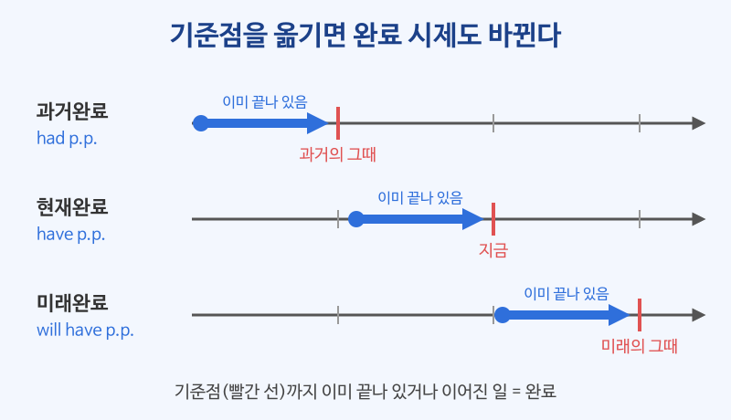

# 과거완료·미래완료 (had p.p. / will have p.p.)

## 이번 강의에서 배울 것

- 과거완료가 "과거의 어느 시점보다 더 먼저" 일어난 일을 나타낸다는 것
- 미래완료가 "미래의 어느 시점까지" 끝나 있을 일을 나타낸다는 것
- by the time, before, when과 함께 두 시제를 자연스럽게 쓰는 법

## 핵심 설명

현재완료가 **지금**을 기준점으로 삼았다면, 과거완료는 **과거의 한 시점**을, 미래완료는 **미래의 한 시점**을 기준점으로 삼습니다. 기준점만 옮겨 갈 뿐 "그 시점까지 이어지거나 끝나 있다"는 생각은 똑같습니다.

| 시제 | 형태 | 기준점 | 예 |
|---|---|---|---|
| 과거완료 | had + p.p. | 과거의 한 시점 | The train had left. |
| 현재완료 | have/has + p.p. | 지금 | The train has left. |
| 미래완료 | will have + p.p. | 미래의 한 시점 | The train will have left. |

### 1) 과거완료: (그때보다) 이미 ~했었다

과거에 일어난 두 일 가운데 **더 먼저 일어난 일**을 had p.p.로 씁니다. 나중 일은 그냥 과거형입니다.

| 영어 | 한국어 | 듣기 |
|---|---|---|
| When I got to the station, the train had already left. | 내가 역에 도착했을 때 기차는 이미 떠나 있었다. | [🔊](audio/02-past-future-perfect-01.mp3) |
| She had never seen snow before she moved to Canada. | 그녀는 캐나다로 이사하기 전에는 눈을 본 적이 없었다. | [🔊](audio/02-past-future-perfect-02.mp3) |
| I realized that I had left my phone in the taxi. | 택시에 휴대폰을 두고 내렸다는 걸 깨달았다. | [🔊](audio/02-past-future-perfect-03.mp3) |
| By the time we arrived, the meeting had started. | 우리가 도착했을 무렵 회의는 이미 시작되어 있었다. | [🔊](audio/02-past-future-perfect-04.mp3) |
| He had worked at the bank for ten years before he quit. | 그는 그만두기 전까지 은행에서 10년 동안 일했었다. | [🔊](audio/02-past-future-perfect-05.mp3) |

> 💡 before, after처럼 순서가 분명한 접속사가 있으면 과거완료 대신 과거형을 써도 됩니다. She left before I arrived. (O) 하지만 순서를 또렷하게 보여 주고 싶을 때는 과거완료가 좋습니다.

### 2) 과거완료의 부정문과 의문문

| 영어 | 한국어 | 듣기 |
|---|---|---|
| I hadn't eaten anything since breakfast. | 아침 이후로 아무것도 먹지 못한 상태였다. | [🔊](audio/02-past-future-perfect-06.mp3) |
| Had you met him before the interview? | 면접 전에 그 사람을 만난 적이 있었어요? | [🔊](audio/02-past-future-perfect-07.mp3) |

### 3) 미래완료: (그때까지는) ~해 있을 것이다

미래의 기준점은 보통 **by + 시간**, **by the time + 현재형** 으로 나타냅니다.

| 영어 | 한국어 | 듣기 |
|---|---|---|
| I will have finished the report by Friday. | 금요일까지는 보고서를 다 끝내 놓을 것이다. | [🔊](audio/02-past-future-perfect-08.mp3) |
| By the time you get here, we'll have eaten. | 네가 여기 올 때쯤이면 우리는 밥을 다 먹었을 거야. | [🔊](audio/02-past-future-perfect-09.mp3) |
| Next month, I'll have lived in Busan for five years. | 다음 달이면 부산에 산 지 5년이 된다. | [🔊](audio/02-past-future-perfect-10.mp3) |
| The store will have closed by nine. | 9시면 가게가 이미 문을 닫았을 것이다. | [🔊](audio/02-past-future-perfect-11.mp3) |
| Will you have finished by tomorrow morning? | 내일 아침까지 끝내 놓을 수 있겠어요? | [🔊](audio/02-past-future-perfect-12.mp3) |

> 💡 by the time 뒤의 절은 미래 일이라도 **현재형**으로 씁니다. By the time you **get** here (O) / By the time you will get here (X)

### 세 가지 완료 시제 한눈에 보기

| 기준점 | 문장 | 뜻 |
|---|---|---|
| 과거 (내가 도착했을 때) | The movie **had started**. | 영화는 이미 시작되어 있었다. |
| 지금 | The movie **has started**. | 영화가 (지금) 막 시작했다. |
| 미래 (네가 도착할 때) | The movie **will have started**. | 영화는 이미 시작되어 있을 것이다. |

## 자주 하는 실수

- ❌ When I arrived, the train already left. → ✅ When I arrived, the train had already left.
  - 도착한 순간보다 기차가 떠난 일이 더 먼저입니다. 더 먼저 일어난 일은 had p.p.로 씁니다.
- ❌ By the time you will arrive, I'll have left. → ✅ By the time you arrive, I'll have left.
  - 시간을 나타내는 절(by the time, when, before) 안에서는 미래 일도 현재형으로 씁니다.
- ❌ I had finished it yesterday. (다른 기준 없이) → ✅ I finished it yesterday.
  - 비교할 과거 시점이 없으면 과거완료를 쓸 이유가 없습니다. 단순한 과거 사실은 과거형입니다.

## 연습 문제

괄호 안의 동사를 과거완료(had p.p.) 또는 미래완료(will have p.p.)로 바꾸세요.

1. When I opened the fridge, someone ___ (eat) my cake.
2. By 2030, the city ___ (build) a new airport.
3. She was nervous because she ___ (never, give) a speech before.
4. By the time the guests arrive, I ___ (clean) the house.
5. We couldn't get in because they ___ (lock) the door.

## 정답과 해설

1. **had eaten**: 냉장고를 연 것(과거)보다 케이크를 먹은 일이 먼저입니다.
2. **will have built**: by 2030이라는 미래 기준점까지 끝나 있을 일입니다.
3. **had never given**: 긴장했던 과거 시점 이전까지의 경험을 말합니다.
4. **will have cleaned**: 손님이 도착할 미래 시점에는 청소가 끝나 있을 것입니다.
5. **had locked**: 들어가지 못한 것(과거)보다 문을 잠근 일이 먼저입니다.

## 오늘의 단어

| 단어 | 뜻 | 예문 | 듣기 |
|---|---|---|---|
| realize | 깨닫다 | I realized I was wrong. | [🔊](audio/02-past-future-perfect-w01.mp3) |
| quit | 그만두다 | He quit his job last year. | [🔊](audio/02-past-future-perfect-w02.mp3) |
| by the time | ~할 무렵에는 | By the time I woke up, it was noon. | [🔊](audio/02-past-future-perfect-w03.mp3) |
| nervous | 긴장한, 초조한 | I always get nervous before interviews. | [🔊](audio/02-past-future-perfect-w04.mp3) |
| lock | 잠그다 | Don't forget to lock the door. | [🔊](audio/02-past-future-perfect-w05.mp3) |
