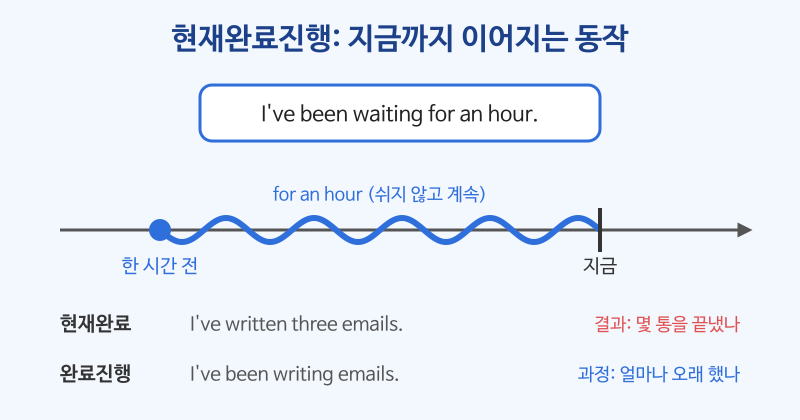

# 완료진행형 (have been + -ing)

## 이번 강의에서 배울 것

- 현재완료진행형이 "과거부터 지금까지 계속 하고 있는 동작"을 강조한다는 것
- 현재완료와 현재완료진행형의 차이 (결과 vs. 과정)
- 과거완료진행형과, 진행형으로 쓰지 않는 동사

## 핵심 설명

현재완료진행형은 **have/has been + 동사-ing** 로 만듭니다. 현재완료의 "계속" 용법과 비슷하지만, 그 일을 **얼마나 오래, 쉬지 않고 해 왔는지** 동작 자체에 초점을 둡니다. 대개 지금도 하고 있거나 방금 멈춘 일입니다.

| 형태 | 예 |
|---|---|
| I / You / We / They + have been -ing | I've been studying. |
| He / She / It + has been -ing | It's been raining. |
| 부정문 | I haven't been sleeping well. |
| 의문문 | How long have you been waiting? |

### 1) 지금까지 계속 ~하고 있다

for(기간), since(시작점), How long ...? 과 잘 어울립니다.

| 영어 | 한국어 | 듣기 |
|---|---|---|
| I've been waiting for you for an hour. | 한 시간째 너를 기다리고 있어. | [🔊](audio/03-perfect-continuous-01.mp3) |
| It's been raining since this morning. | 아침부터 계속 비가 오고 있다. | [🔊](audio/03-perfect-continuous-02.mp3) |
| How long have you been learning English? | 영어 공부한 지 얼마나 됐어요? | [🔊](audio/03-perfect-continuous-03.mp3) |
| We've been working on this project since March. | 우리는 3월부터 이 프로젝트를 하고 있다. | [🔊](audio/03-perfect-continuous-04.mp3) |
| He hasn't been feeling well lately. | 그는 요즘 계속 몸이 좋지 않다. | [🔊](audio/03-perfect-continuous-05.mp3) |

### 2) 방금까지 ~하고 있었다 (그 흔적이 보인다)

동작은 막 끝났지만, 그 결과가 지금 눈에 보일 때도 씁니다.

| 영어 | 한국어 | 듣기 |
|---|---|---|
| Your eyes are red. Have you been crying? | 눈이 빨개요. 울었어요? | [🔊](audio/03-perfect-continuous-06.mp3) |
| I'm sweating because I've been running. | 계속 뛰어서 땀이 난다. | [🔊](audio/03-perfect-continuous-07.mp3) |

### 3) 현재완료 vs. 현재완료진행형

| 현재완료 (결과, 몇 개) | 현재완료진행형 (과정, 얼마나 오래) |
|---|---|
| I've written three emails. | I've been writing emails all morning. |
| 이메일 세 통을 다 썼다. | 아침 내내 이메일을 쓰고 있다. |
| She has read the book. | She has been reading the book. |
| 그 책을 다 읽었다. | 그 책을 (아직) 읽는 중이다. |

| 영어 | 한국어 | 듣기 |
|---|---|---|
| I've painted the kitchen. | 부엌 페인트칠을 다 했다. | [🔊](audio/03-perfect-continuous-08.mp3) |
| I've been painting the kitchen all day. | 하루 종일 부엌 페인트칠을 하고 있다. | [🔊](audio/03-perfect-continuous-09.mp3) |

### 4) 과거완료진행형: (그때까지) 계속 ~하고 있었다

기준점이 과거로 옮겨 가면 **had been -ing** 가 됩니다.

| 영어 | 한국어 | 듣기 |
|---|---|---|
| She had been working there for two years when she got promoted. | 그녀는 승진했을 때 그곳에서 2년째 일하고 있었다. | [🔊](audio/03-perfect-continuous-10.mp3) |
| The roads were wet because it had been raining. | 계속 비가 내렸던 터라 길이 젖어 있었다. | [🔊](audio/03-perfect-continuous-11.mp3) |
| We had been driving for hours before we found a hotel. | 우리는 몇 시간을 운전한 끝에 호텔을 찾았다. | [🔊](audio/03-perfect-continuous-12.mp3) |

> 💡 know, like, want, belong, own처럼 **상태**를 나타내는 동사는 진행형으로 쓰지 않습니다. 이때는 그냥 현재완료를 씁니다. I've known her for years. (O) / I've been knowing her for years. (X)

## 자주 하는 실수

- ❌ I am waiting here for two hours. → ✅ I've been waiting here for two hours.
  - "두 시간째 ~하고 있다"는 과거에서 지금까지 이어진 일이므로 현재진행형이 아니라 현재완료진행형입니다.
- ❌ I've been knowing him since college. → ✅ I've known him since college.
  - know는 상태 동사라서 진행형을 만들지 않습니다.
- ❌ I've been drinking three cups of coffee today. → ✅ I've drunk three cups of coffee today.
  - 개수나 양처럼 "끝난 결과"를 셀 때는 현재완료를 씁니다.

## 연습 문제

괄호 안의 동사를 현재완료(have p.p.) 또는 현재완료진행형(have been -ing)으로 바꾸세요.

1. She ___ (study) for the exam since 8 a.m.
2. I ___ (lose) my wallet. Can you lend me some money?
3. How long ___ you ___ (live) in this apartment?
4. They ___ (have) this car for ten years.
5. My legs hurt. I ___ (walk) all day.

## 정답과 해설

1. **has been studying**: 오전 8시부터 지금까지 쉬지 않고 이어지는 동작입니다.
2. **have lost**: 지갑을 잃어버린 결과(지금 없음)가 중요하므로 현재완료입니다.
3. **have / been living**: 기간을 묻는 How long과 잘 어울립니다. How long have you lived ...?도 맞습니다. live는 두 형태 모두 자연스럽습니다.
4. **have had**: have(가지고 있다)는 상태 동사라 진행형으로 쓰지 않습니다.
5. **have been walking**: 하루 종일 걸은 과정 때문에 지금 다리가 아픕니다.

## 오늘의 단어

| 단어 | 뜻 | 예문 | 듣기 |
|---|---|---|---|
| lately | 요즘, 최근에 | I've been busy lately. | [🔊](audio/03-perfect-continuous-w01.mp3) |
| sweat | 땀을 흘리다 | I sweat a lot in summer. | [🔊](audio/03-perfect-continuous-w02.mp3) |
| promote | 승진시키다 | She got promoted last year. | [🔊](audio/03-perfect-continuous-w03.mp3) |
| lend | 빌려주다 | Can you lend me your pen? | [🔊](audio/03-perfect-continuous-w04.mp3) |
| hurt | 아프다 | My back hurts. | [🔊](audio/03-perfect-continuous-w05.mp3) |
