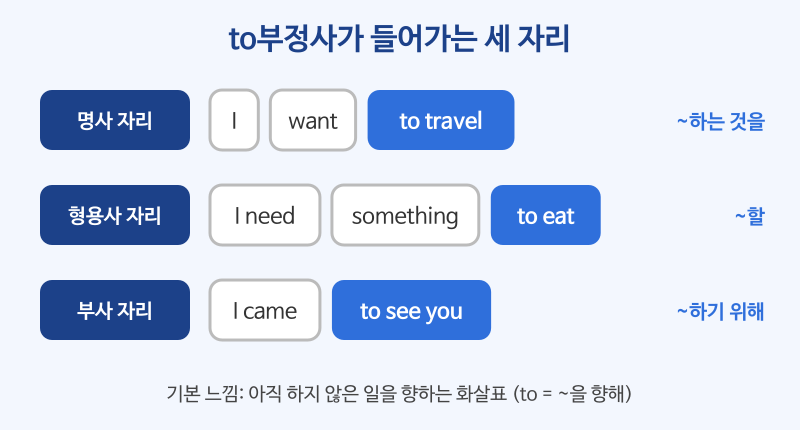

# to부정사 (to + 동사원형)

## 이번 강의에서 배울 것

- to부정사가 문장 안에서 명사, 형용사, 부사처럼 쓰인다는 것
- want, decide, plan처럼 to부정사를 목적어로 쓰는 동사
- "~하기 위해"(목적)와 It is ... to ... 구문

## 핵심 설명

to부정사는 **to + 동사원형** 입니다. 동사를 문장 속의 "부품"으로 바꾸어, 명사 자리·명사 뒤·문장 끝 어디에든 끼워 넣을 수 있게 해 줍니다. 기본 느낌은 **"앞으로 ~할 것"**, 즉 아직 하지 않은 일을 향하는 화살표입니다.

| 쓰임 | 뜻 | 예 |
|---|---|---|
| 명사처럼 | ~하는 것 | I want **to travel**. |
| 형용사처럼 (명사 뒤) | ~할 | I need something **to eat**. |
| 부사처럼 (목적) | ~하기 위해 | I came **to see** you. |

### 1) 명사처럼: ~하는 것을, ~하는 것은

want, hope, plan, decide, need, try, promise 같은 동사는 뒤에 to부정사를 목적어로 씁니다.

| 영어 | 한국어 | 듣기 |
|---|---|---|
| I want to change my job. | 나는 이직하고 싶다. | [🔊](audio/01-to-infinitive-01.mp3) |
| We decided to take the early flight. | 우리는 이른 비행기를 타기로 했다. | [🔊](audio/01-to-infinitive-02.mp3) |
| She's planning to study abroad next year. | 그녀는 내년에 유학을 갈 계획이다. | [🔊](audio/01-to-infinitive-03.mp3) |
| He promised not to be late again. | 그는 다시는 늦지 않겠다고 약속했다. | [🔊](audio/01-to-infinitive-04.mp3) |
| My goal is to run a marathon. | 내 목표는 마라톤을 완주하는 것이다. | [🔊](audio/01-to-infinitive-05.mp3) |

> 💡 부정은 to 바로 앞에 not을 둡니다. promised **not to** be late (O) / promised to not be late (구어에서는 듣지만 시험에서는 피하세요)

### 2) It is ... to ...: ~하는 것은 ...하다

to부정사가 주어일 때는 보통 It을 앞에 두고 to부정사를 뒤로 보냅니다. 누가 하는지는 **for + 사람** 으로 넣습니다.

| 영어 | 한국어 | 듣기 |
|---|---|---|
| It's important to sleep well. | 잠을 잘 자는 것이 중요하다. | [🔊](audio/01-to-infinitive-06.mp3) |
| It's hard for me to wake up early. | 나는 일찍 일어나는 게 힘들다. | [🔊](audio/01-to-infinitive-07.mp3) |

### 3) 형용사처럼: ~할 (명사를 뒤에서 꾸밈)

| 영어 | 한국어 | 듣기 |
|---|---|---|
| I have a lot of work to do today. | 오늘 할 일이 많다. | [🔊](audio/01-to-infinitive-08.mp3) |
| Is there anything to drink? | 마실 것 있어요? | [🔊](audio/01-to-infinitive-09.mp3) |
| This is a good place to relax. | 여기는 쉬기 좋은 곳이다. | [🔊](audio/01-to-infinitive-10.mp3) |

### 4) 부사처럼: ~하기 위해, ~해서

| 영어 | 한국어 | 듣기 |
|---|---|---|
| I went to the bank to open an account. | 계좌를 만들려고 은행에 갔다. | [🔊](audio/01-to-infinitive-11.mp3) |
| She saves money to buy a house. | 그녀는 집을 사려고 돈을 모은다. | [🔊](audio/01-to-infinitive-12.mp3) |
| I'm glad to hear that. | 그 말을 들으니 기쁘네요. | [🔊](audio/01-to-infinitive-13.mp3) |

### 5) 동사 + 사람 + to부정사: (사람)에게 ~하라고

| 영어 | 한국어 | 듣기 |
|---|---|---|
| My boss asked me to send the file. | 상사가 나에게 파일을 보내 달라고 했다. | [🔊](audio/01-to-infinitive-14.mp3) |
| The doctor told him to stop smoking. | 의사가 그에게 담배를 끊으라고 했다. | [🔊](audio/01-to-infinitive-15.mp3) |

## 자주 하는 실수

- ❌ I want go home. → ✅ I want to go home.
  - want 뒤에 동사가 오면 반드시 to를 붙입니다.
- ❌ I went to the store for buy milk. → ✅ I went to the store to buy milk.
  - "~하려고"는 for가 아니라 to부정사입니다. for 뒤에는 명사가 옵니다. (for some milk)
- ❌ She told me don't worry. → ✅ She told me not to worry.
  - 남에게 하지 말라고 한 말을 옮길 때는 tell + 사람 + not to 동사원형입니다.

## 연습 문제

괄호 안의 단어를 알맞게 배열하거나 빈칸을 채우세요.

1. I hope ___ (see) you again soon.
2. It's not easy ___ (learn) a new language.
3. I need a pen ___ (write) with.
4. (to / I / pick up / came / my car) → 차를 찾으러 왔어요.
5. She asked me ___ (not, tell) anyone.

## 정답과 해설

1. **to see**: hope는 to부정사를 목적어로 씁니다.
2. **to learn**: It is ... to ... 구문입니다. It은 to learn a new language를 대신합니다.
3. **to write**: a pen을 뒤에서 꾸미는 형용사적 쓰임. "~을 가지고 쓸" 펜이라 with가 남습니다.
4. **I came to pick up my car.**: "~하려고"를 나타내는 목적의 to부정사입니다.
5. **not to tell**: ask + 사람 + not to + 동사원형.

## 오늘의 단어

| 단어 | 뜻 | 예문 | 듣기 |
|---|---|---|---|
| abroad | 해외에, 해외로 | I want to work abroad. | [🔊](audio/01-to-infinitive-w01.mp3) |
| promise | 약속하다 | I promise to call you tonight. | [🔊](audio/01-to-infinitive-w02.mp3) |
| account | 계좌 | I'd like to open an account. | [🔊](audio/01-to-infinitive-w03.mp3) |
| save | (돈을) 모으다 | We're saving for a new car. | [🔊](audio/01-to-infinitive-w04.mp3) |
| goal | 목표 | What's your goal this year? | [🔊](audio/01-to-infinitive-w05.mp3) |
