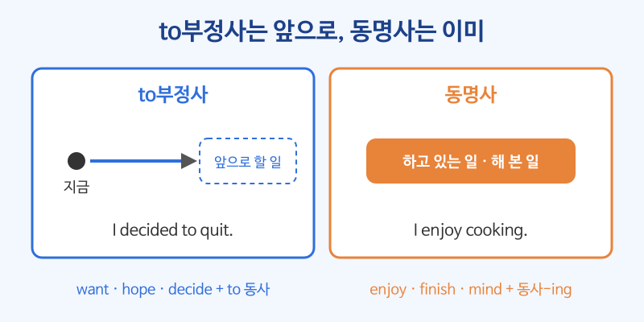

# 동명사 (동사 + -ing)

## 이번 강의에서 배울 것

- 동명사가 "~하는 것"이라는 뜻으로 명사 자리에 들어간다는 것
- 동명사만 쓰는 동사(enjoy, finish, mind)와 to부정사만 쓰는 동사의 구별
- 전치사 뒤의 동명사, 그리고 뜻이 달라지는 remember, stop, try

## 핵심 설명

동명사는 **동사원형 + -ing** 로, 동사를 명사처럼 쓰는 방법입니다. to부정사도 "~하는 것"이 될 수 있지만 느낌이 다릅니다. to부정사가 **앞으로 할 일**을 향한다면, 동명사는 **이미 하고 있거나 해 본 일, 일반적인 행동**을 가리킵니다.

| 자리 | 예 |
|---|---|
| 주어 | **Swimming** is good exercise. |
| 동사의 목적어 | I enjoy **cooking**. |
| 전치사의 목적어 | Thank you for **coming**. |
| 보어 | My hobby is **taking** photos. |

### 1) 주어와 보어

| 영어 | 한국어 | 듣기 |
|---|---|---|
| Walking every day keeps me healthy. | 매일 걷는 것이 나를 건강하게 해 준다. | [🔊](audio/02-gerund-01.mp3) |
| Learning a language takes time. | 언어를 배우는 데는 시간이 걸린다. | [🔊](audio/02-gerund-02.mp3) |
| My job is managing the online store. | 내 일은 온라인 상점을 관리하는 것이다. | [🔊](audio/02-gerund-03.mp3) |

### 2) 동명사만 목적어로 쓰는 동사

enjoy, finish, mind, avoid, keep, suggest, give up, practice 뒤에는 동명사만 씁니다.

| 영어 | 한국어 | 듣기 |
|---|---|---|
| I enjoy hiking on weekends. | 나는 주말에 등산하는 것을 즐긴다. | [🔊](audio/02-gerund-04.mp3) |
| Have you finished writing the report? | 보고서 다 썼어요? | [🔊](audio/02-gerund-05.mp3) |
| Would you mind closing the window? | 창문 좀 닫아 주시겠어요? | [🔊](audio/02-gerund-06.mp3) |
| He gave up smoking last year. | 그는 작년에 담배를 끊었다. | [🔊](audio/02-gerund-07.mp3) |
| She suggested meeting on Monday. | 그녀는 월요일에 만나자고 제안했다. | [🔊](audio/02-gerund-08.mp3) |

| 동명사만 | to부정사만 | 둘 다 (뜻 거의 같음) |
|---|---|---|
| enjoy, finish, mind, avoid, keep, suggest, give up | want, hope, decide, plan, promise, need | like, love, hate, start, begin |

### 3) 전치사 뒤에는 동명사

전치사(about, for, in, of, at, without) 뒤에 동사를 넣으려면 반드시 -ing로 바꿉니다.

| 영어 | 한국어 | 듣기 |
|---|---|---|
| I'm interested in starting my own business. | 나는 내 사업을 시작하는 데 관심이 있다. | [🔊](audio/02-gerund-09.mp3) |
| Thank you for helping me. | 도와줘서 고마워요. | [🔊](audio/02-gerund-10.mp3) |
| She left without saying goodbye. | 그녀는 작별 인사도 없이 떠났다. | [🔊](audio/02-gerund-11.mp3) |
| I'm looking forward to seeing you. | 만나기를 고대하고 있어요. | [🔊](audio/02-gerund-12.mp3) |

> 💡 look forward **to**, be used **to** 의 to는 전치사입니다. 그래서 뒤에 동사원형이 아니라 동명사가 옵니다.

### 4) 뜻이 달라지는 동사: remember, forget, stop, try

| 영어 | 한국어 | 듣기 |
|---|---|---|
| I remember locking the door. | 문을 잠근 기억이 난다. (이미 한 일) | [🔊](audio/02-gerund-13.mp3) |
| Remember to lock the door. | 문 잠그는 것 잊지 마. (앞으로 할 일) | [🔊](audio/02-gerund-14.mp3) |
| He stopped drinking coffee. | 그는 커피를 끊었다. | [🔊](audio/02-gerund-15.mp3) |
| He stopped to drink some coffee. | 그는 커피를 마시려고 (하던 일을) 멈췄다. | [🔊](audio/02-gerund-16.mp3) |

## 자주 하는 실수

- ❌ I enjoy to read. → ✅ I enjoy reading.
  - enjoy 뒤에는 동명사만 씁니다.
- ❌ I'm looking forward to see you. → ✅ I'm looking forward to seeing you.
  - 여기서 to는 전치사라서 뒤에 동명사가 옵니다. 이메일 끝에서 정말 자주 틀리는 문장입니다.
- ❌ Do you mind to wait? → ✅ Do you mind waiting?
  - mind 뒤에도 동명사입니다. 대답할 때 "괜찮아요"는 No, not at all.(전혀 꺼리지 않아요)입니다.

## 연습 문제

괄호 안의 동사를 동명사 또는 to부정사로 바꾸세요.

1. I'll keep ___ (try) until I succeed.
2. We decided ___ (sell) the old car.
3. She's good at ___ (solve) problems.
4. I forgot ___ (buy) milk. Can you get some?
5. Please avoid ___ (use) your phone during the meeting.

## 정답과 해설

1. **trying**: keep(계속하다) 뒤에는 동명사입니다.
2. **to sell**: decide는 to부정사를 목적어로 씁니다.
3. **solving**: 전치사 at 뒤이므로 동명사입니다.
4. **to buy**: 사기로 해 놓고 잊은 것, 즉 앞으로 할 일을 잊었습니다. forgot buying이면 "산 것을 잊었다"는 뜻이 됩니다.
5. **using**: avoid 뒤에는 동명사입니다.

## 오늘의 단어

| 단어 | 뜻 | 예문 | 듣기 |
|---|---|---|---|
| avoid | 피하다 | Try to avoid rush hour. | [🔊](audio/02-gerund-w01.mp3) |
| suggest | 제안하다 | I suggest taking a taxi. | [🔊](audio/02-gerund-w02.mp3) |
| manage | 관리하다, 운영하다 | She manages a small team. | [🔊](audio/02-gerund-w03.mp3) |
| look forward to | ~을 고대하다 | I look forward to hearing from you. | [🔊](audio/02-gerund-w04.mp3) |
| give up | 그만두다, 포기하다 | Don't give up now. | [🔊](audio/02-gerund-w05.mp3) |
