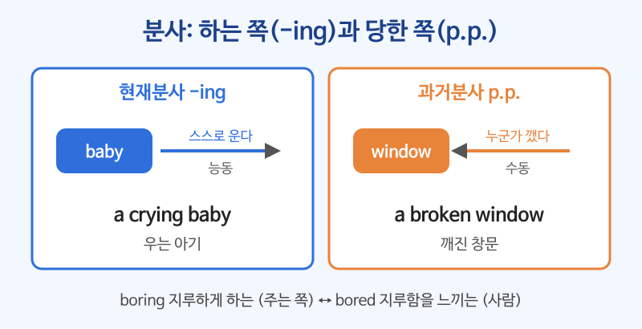

# 분사 (현재분사 -ing, 과거분사 p.p.)

## 이번 강의에서 배울 것

- 현재분사(-ing)는 "~하는", 과거분사(p.p.)는 "~된, ~당한"이라는 뜻으로 명사를 꾸민다는 것
- boring과 bored처럼 감정을 나타내는 분사의 구별
- 분사가 여러 단어와 함께 명사를 뒤에서 꾸미는 방법과 간단한 분사구문

## 핵심 설명

분사는 동사를 **형용사처럼** 쓰는 방법입니다. 두 종류가 있고, 꾸밈을 받는 명사가 **스스로 하는지(능동)**, **당하는지(수동)** 만 따지면 됩니다.

| 종류 | 형태 | 뜻 | 예 |
|---|---|---|---|
| 현재분사 | 동사 + -ing | ~하는, ~하고 있는 (능동·진행) | a **sleeping** cat |
| 과거분사 | p.p. | ~된, ~당한 (수동·완료) | a **used** car |

### 1) 한 단어 분사: 명사 앞에서 꾸밈

| 영어 | 한국어 | 듣기 |
|---|---|---|
| Don't wake the sleeping baby. | 자고 있는 아기를 깨우지 마. | [🔊](audio/03-participles-01.mp3) |
| We need to replace the broken window. | 깨진 창문을 갈아야 한다. | [🔊](audio/03-participles-02.mp3) |
| I bought a used car. | 나는 중고차를 샀다. | [🔊](audio/03-participles-03.mp3) |
| There's a growing demand for electric cars. | 전기차에 대한 수요가 늘고 있다. | [🔊](audio/03-participles-04.mp3) |

### 2) 여러 단어 분사: 명사 뒤에서 꾸밈

분사에 다른 말이 붙어 길어지면 명사 **뒤**로 갑니다.

| 영어 | 한국어 | 듣기 |
|---|---|---|
| Who is the man talking to Jenny? | 제니와 이야기하고 있는 남자는 누구예요? | [🔊](audio/03-participles-05.mp3) |
| The people waiting in line looked tired. | 줄 서서 기다리는 사람들은 지쳐 보였다. | [🔊](audio/03-participles-06.mp3) |
| This is a phone made in Korea. | 이것은 한국에서 만든 휴대폰이다. | [🔊](audio/03-participles-07.mp3) |
| I read the report written by the new manager. | 새 매니저가 쓴 보고서를 읽었다. | [🔊](audio/03-participles-08.mp3) |

### 3) 감정 분사: boring vs. bored

감정을 **일으키는 쪽**은 -ing, 감정을 **느끼는 사람**은 p.p.입니다.

| 영어 | 한국어 | 듣기 |
|---|---|---|
| The movie was boring. | 그 영화는 지루했다. (영화가 지루함을 줌) | [🔊](audio/03-participles-09.mp3) |
| I was bored during the movie. | 나는 영화 보는 동안 지루했다. (내가 느낌) | [🔊](audio/03-participles-10.mp3) |
| The news is really surprising. | 그 소식은 정말 놀랍다. | [🔊](audio/03-participles-11.mp3) |
| Everyone was surprised by the news. | 모두가 그 소식에 놀랐다. | [🔊](audio/03-participles-12.mp3) |

| 감정을 주는 쪽 (-ing) | 감정을 느끼는 사람 (p.p.) |
|---|---|
| interesting 흥미로운 | interested 흥미를 느끼는 |
| exciting 신나는 | excited 신이 난 |
| tiring 피곤하게 하는 | tired 피곤한 |
| confusing 헷갈리게 하는 | confused 헷갈리는 |
| disappointing 실망스러운 | disappointed 실망한 |

### 4) 분사구문 맛보기: ~하면서, ~해서

접속사와 주어를 빼고 분사로 시작해 문장을 짧게 만들 수 있습니다. 주로 글에서 씁니다.

| 영어 | 한국어 | 듣기 |
|---|---|---|
| Walking down the street, I met an old friend. | 길을 걷다가 옛 친구를 만났다. | [🔊](audio/03-participles-13.mp3) |
| Feeling sick, she went home early. | 몸이 안 좋아서 그녀는 일찍 집에 갔다. | [🔊](audio/03-participles-14.mp3) |

> 💡 분사구문의 숨은 주어는 뒤 문장의 주어와 같아야 합니다. Walking down the street, **I** met ... 에서 걸은 사람은 I입니다.

## 자주 하는 실수

- ❌ I'm very boring. (지루하다고 말하려다) → ✅ I'm very bored.
  - I'm boring은 "나는 지루한 사람이다"라는 뜻이 됩니다. 내가 느끼는 감정은 p.p.입니다.
- ❌ a car making in Germany → ✅ a car made in Germany
  - 차는 만들어지는 쪽(수동)이므로 과거분사를 씁니다.
- ❌ The talking to Jenny man → ✅ The man talking to Jenny
  - 분사에 말이 붙어 길어지면 명사 뒤로 보냅니다.

## 연습 문제

괄호 안에서 알맞은 것을 고르세요.

1. The lecture was very (interesting / interested).
2. Look at the (falling / fallen) leaves on the ground.
3. I was (exciting / excited) about the trip.
4. The woman (sitting / sat) next to me was a doctor.
5. Most of the products (selling / sold) here are handmade.

## 정답과 해설

1. **interesting**: 강의가 흥미를 주는 쪽입니다.
2. **fallen**: 이미 떨어져 땅에 있는 잎(완료)이므로 과거분사. falling leaves는 "떨어지고 있는 잎"입니다.
3. **excited**: 내가 신이 난 감정을 느낍니다.
4. **sitting**: 여자가 스스로 앉아 있는 것(능동·진행)입니다.
5. **sold**: 물건은 팔리는 쪽(수동)입니다.

## 오늘의 단어

| 단어 | 뜻 | 예문 | 듣기 |
|---|---|---|---|
| replace | 교체하다 | We need to replace the battery. | [🔊](audio/03-participles-w01.mp3) |
| demand | 수요 | Demand for the product is high. | [🔊](audio/03-participles-w02.mp3) |
| disappointed | 실망한 | I was disappointed with the result. | [🔊](audio/03-participles-w03.mp3) |
| confusing | 헷갈리게 하는 | The instructions are confusing. | [🔊](audio/03-participles-w04.mp3) |
| handmade | 손으로 만든 | This bag is handmade. | [🔊](audio/03-participles-w05.mp3) |
