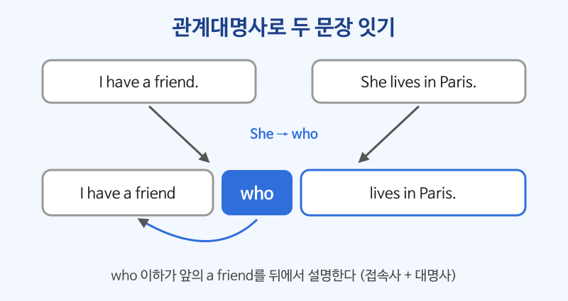

# 관계대명사·관계부사 (who, which, that, where, when)

## 이번 강의에서 배울 것

- 관계대명사로 두 문장을 하나로 합쳐 명사를 뒤에서 자세히 설명하는 법
- who, which, that, whose를 고르는 기준과 생략할 수 있는 경우
- 장소·시간·이유를 설명하는 관계부사 where, when, why

## 핵심 설명

관계대명사는 **접속사 + 대명사** 역할을 동시에 합니다. 명사 바로 뒤에 붙어서 "어떤 명사인지"를 문장으로 설명합니다. 한국어는 "어제 만난 **사람**"처럼 설명이 앞에 오지만, 영어는 "**the person** I met yesterday"처럼 설명이 뒤에 옵니다.

| 꾸밈 받는 말 | 주격 (뒤에 동사) | 목적격 (뒤에 주어 + 동사) | 소유격 |
|---|---|---|---|
| 사람 | who / that | who(m) / that (생략 가능) | whose |
| 사물·동물 | which / that | which / that (생략 가능) | whose |

### 1) 주격: who / which / that + 동사

| 영어 | 한국어 | 듣기 |
|---|---|---|
| I have a friend who lives in Paris. | 나에게는 파리에 사는 친구가 있다. | [🔊](audio/04-relative-clauses-01.mp3) |
| The woman who called you is my manager. | 너한테 전화한 여자분이 우리 팀장님이야. | [🔊](audio/04-relative-clauses-02.mp3) |
| This is the bus that goes to the airport. | 이것이 공항으로 가는 버스다. | [🔊](audio/04-relative-clauses-03.mp3) |
| I lost the umbrella which was in my car. | 차에 있던 우산을 잃어버렸다. | [🔊](audio/04-relative-clauses-04.mp3) |

### 2) 목적격: (who / which / that) + 주어 + 동사

목적격 관계대명사는 말할 때 거의 생략합니다.

| 영어 | 한국어 | 듣기 |
|---|---|---|
| The book I'm reading is really good. | 내가 읽고 있는 책은 정말 재미있다. | [🔊](audio/04-relative-clauses-05.mp3) |
| Is this the jacket you bought yesterday? | 이게 어제 산 재킷이에요? | [🔊](audio/04-relative-clauses-06.mp3) |
| The people we met in Rome were very kind. | 로마에서 만난 사람들은 아주 친절했다. | [🔊](audio/04-relative-clauses-07.mp3) |

### 3) 소유격: whose + 명사

| 영어 | 한국어 | 듣기 |
|---|---|---|
| I know a man whose son is a pilot. | 나는 아들이 조종사인 남자를 안다. | [🔊](audio/04-relative-clauses-08.mp3) |
| She's the designer whose work won the award. | 그녀가 바로 작품이 상을 받은 디자이너다. | [🔊](audio/04-relative-clauses-09.mp3) |

### 4) 관계부사: where(장소), when(시간), why(이유)

| 영어 | 한국어 | 듣기 |
|---|---|---|
| This is the restaurant where we first met. | 여기가 우리가 처음 만난 식당이다. | [🔊](audio/04-relative-clauses-10.mp3) |
| I remember the day when I started this job. | 이 일을 시작한 날을 기억한다. | [🔊](audio/04-relative-clauses-11.mp3) |
| That's the reason why I called you. | 그게 내가 너한테 전화한 이유야. | [🔊](audio/04-relative-clauses-12.mp3) |

> 💡 the reason why는 둘 중 하나를 빼고 That's **why** I called you. 처럼 더 자주 말합니다.

### 5) 쉼표가 있는 관계절: 덧붙이는 정보

쉼표 뒤의 관계절은 "그런데 그 사람은/그것은 ~"처럼 정보를 덧붙입니다. 이때는 **that을 쓸 수 없고**, 생략도 안 됩니다.

| 영어 | 한국어 | 듣기 |
|---|---|---|
| My sister, who is a nurse, works at night. | 우리 언니는 간호사인데, 밤에 일한다. | [🔊](audio/04-relative-clauses-13.mp3) |
| We stayed at the Grand Hotel, which was near the beach. | 우리는 그랜드 호텔에 묵었는데, 해변 근처였다. | [🔊](audio/04-relative-clauses-14.mp3) |

## 자주 하는 실수

- ❌ I have a friend who she lives in Paris. → ✅ I have a friend who lives in Paris.
  - who가 이미 주어(she) 역할을 하므로 주어를 또 쓰지 않습니다.
- ❌ This is the house where I was born in. → ✅ This is the house where I was born.
  - where 안에 이미 "그곳에서(in which)"라는 뜻이 들어 있습니다. in을 남기려면 the house (that) I was born in.
- ❌ My father, that is a teacher, ... → ✅ My father, who is a teacher, ...
  - 쉼표가 있는 관계절에는 that을 쓰지 않습니다.

## 연습 문제

두 문장을 관계대명사나 관계부사로 합치세요.

1. I met a woman. She speaks five languages.
2. This is the phone. I bought it last week. (관계대명사 생략)
3. That's the café. We had our first date there.
4. I have a colleague. His wife is a famous singer.
5. Do you remember the year? We moved to Seoul then.

## 정답과 해설

1. **I met a woman who speaks five languages.** She가 주어이므로 주격 who(또는 that).
2. **This is the phone I bought last week.** it이 목적어이므로 목적격이고, 생략할 수 있습니다.
3. **That's the café where we had our first date.** there(장소)를 where로 바꿉니다.
4. **I have a colleague whose wife is a famous singer.** His(소유)를 whose로 바꿉니다.
5. **Do you remember the year when we moved to Seoul?** then(시간)을 when으로 바꿉니다.

## 오늘의 단어

| 단어 | 뜻 | 예문 | 듣기 |
|---|---|---|---|
| colleague | 직장 동료 | She's a colleague from work. | [🔊](audio/04-relative-clauses-w01.mp3) |
| pilot | 조종사 | My uncle is a pilot. | [🔊](audio/04-relative-clauses-w02.mp3) |
| award | 상 | The film won an award. | [🔊](audio/04-relative-clauses-w03.mp3) |
| reason | 이유 | Is there a reason for the delay? | [🔊](audio/04-relative-clauses-w04.mp3) |
| first date | 첫 데이트 | Where did you go on your first date? | [🔊](audio/04-relative-clauses-w05.mp3) |
