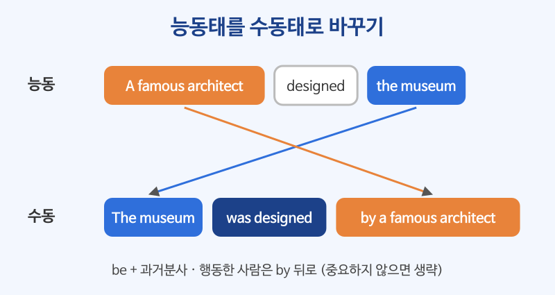

# 수동태 (be + 과거분사)

## 이번 강의에서 배울 것

- 능동태 문장을 수동태로 바꾸는 방법
- 시제별 수동태 (현재, 과거, 완료, 진행, 조동사)
- 수동태를 쓰는 때: 행동한 사람이 중요하지 않거나 알 수 없을 때

## 핵심 설명

능동태는 "누가 무엇을 했다"에, 수동태는 "**무엇이 어떻게 되었다**"에 초점을 둡니다. 형태는 **be + 과거분사(p.p.)** 이고, 행동한 사람을 꼭 말하고 싶으면 **by + 행위자** 를 붙입니다.

| 시제 | 형태 | 예 |
|---|---|---|
| 현재 | am/is/are + p.p. | English **is spoken** here. |
| 과거 | was/were + p.p. | The bridge **was built** in 1990. |
| 현재완료 | have/has been + p.p. | The order **has been shipped**. |
| 진행 | be being + p.p. | The room **is being cleaned**. |
| 조동사 | will/can/must be + p.p. | It **will be finished** soon. |

### 1) 현재·과거 수동태

| 영어 | 한국어 | 듣기 |
|---|---|---|
| English is spoken all over the world. | 영어는 전 세계에서 쓰인다. | [🔊](audio/01-passive-01.mp3) |
| This shirt is made of cotton. | 이 셔츠는 면으로 만들어졌다. | [🔊](audio/01-passive-02.mp3) |
| The museum was designed by a famous architect. | 그 박물관은 유명한 건축가가 설계했다. | [🔊](audio/01-passive-03.mp3) |
| My bike was stolen last night. | 어젯밤에 자전거를 도둑맞았다. | [🔊](audio/01-passive-04.mp3) |
| Were you invited to the party? | 그 파티에 초대받았어요? | [🔊](audio/01-passive-05.mp3) |

### 2) 완료·진행 수동태

| 영어 | 한국어 | 듣기 |
|---|---|---|
| Your order has been shipped. | 주문하신 상품이 발송되었습니다. | [🔊](audio/01-passive-06.mp3) |
| The meeting has been canceled. | 회의가 취소되었다. | [🔊](audio/01-passive-07.mp3) |
| The road is being repaired this week. | 이번 주에 그 도로를 보수하고 있다. | [🔊](audio/01-passive-08.mp3) |

### 3) 조동사 수동태

| 영어 | 한국어 | 듣기 |
|---|---|---|
| The results will be announced tomorrow. | 결과는 내일 발표될 것이다. | [🔊](audio/01-passive-09.mp3) |
| This form must be signed by a parent. | 이 서류는 반드시 부모님의 서명을 받아야 한다. | [🔊](audio/01-passive-10.mp3) |
| Can this be done by Friday? | 이거 금요일까지 될까요? | [🔊](audio/01-passive-11.mp3) |

### 4) 언제 수동태를 쓸까?

| 상황 | 영어 | 한국어 | 듣기 |
|---|---|---|---|
| 누가 했는지 모를 때 | My car was damaged. | 내 차가 망가졌다. | [🔊](audio/01-passive-12.mp3) |
| 누가 했는지 중요하지 않을 때 | Breakfast is served from seven. | 아침 식사는 7시부터 제공된다. | [🔊](audio/01-passive-13.mp3) |
| 공지, 안내문 | Smoking is not allowed here. | 이곳은 금연입니다. | [🔊](audio/01-passive-14.mp3) |

> 💡 by 뒤에 people, someone, they처럼 뻔한 말이 올 때는 by 이하를 빼는 것이 자연스럽습니다. My bike was stolen (by someone). → by someone 생략

### 5) get + p.p.: 일상 회화의 수동태

| 영어 | 한국어 | 듣기 |
|---|---|---|
| He got fired last month. | 그는 지난달에 해고당했다. | [🔊](audio/01-passive-15.mp3) |
| We got stuck in traffic. | 우리는 차가 막혀 꼼짝 못 했다. | [🔊](audio/01-passive-16.mp3) |

## 자주 하는 실수

- ❌ The package was arrive yesterday. → ✅ The package arrived yesterday.
  - arrive, happen, die처럼 목적어가 없는 동사는 수동태가 되지 않습니다.
- ❌ The window was broke. → ✅ The window was broken.
  - be 뒤에는 과거형(broke)이 아니라 과거분사(broken)가 옵니다.
- ❌ This book was written from Hemingway. → ✅ This book was written by Hemingway.
  - 행위자는 by로 나타냅니다.

## 연습 문제

다음 문장을 수동태로 바꾸세요.

1. They grow coffee in Brazil.
2. Someone cleaned the office last night.
3. The company has hired three new engineers.
4. We will send the invoice tomorrow.
5. They are building a new school.

## 정답과 해설

1. **Coffee is grown in Brazil.** 행위자 They는 뻔하므로 생략합니다.
2. **The office was cleaned last night.** 과거 수동태. by someone은 뺍니다.
3. **Three new engineers have been hired (by the company).** 현재완료 수동태는 have been p.p.
4. **The invoice will be sent tomorrow.** 조동사 수동태는 will be p.p.
5. **A new school is being built.** 진행 수동태는 be being p.p.

## 오늘의 단어

| 단어 | 뜻 | 예문 | 듣기 |
|---|---|---|---|
| architect | 건축가 | She wants to be an architect. | [🔊](audio/01-passive-w01.mp3) |
| ship | 발송하다 | We ship orders within two days. | [🔊](audio/01-passive-w02.mp3) |
| announce | 발표하다 | They announced the winner. | [🔊](audio/01-passive-w03.mp3) |
| invoice | 청구서, 송장 | Please check the attached invoice. | [🔊](audio/01-passive-w04.mp3) |
| fire | 해고하다 | He was fired for being late. | [🔊](audio/01-passive-w05.mp3) |
