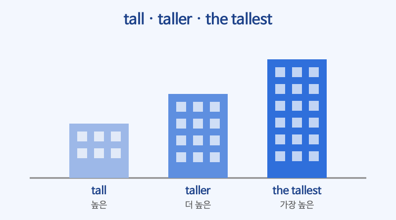

# 비교급·최상급 (-er than, the -est)

## 이번 강의에서 배울 것

- 형용사·부사의 비교급과 최상급을 만드는 규칙과 불규칙 변화
- than, the ... in/of, as ... as를 써서 비교하기
- much bigger, the second largest, the more ..., the more ... 같은 응용 표현

## 핵심 설명

둘을 비교할 때는 **비교급 + than**, 셋 이상 가운데 가장 ~할 때는 **the + 최상급**, 똑같을 때는 **as + 원급 + as** 를 씁니다.

| 원급 | 비교급 | 최상급 | 규칙 |
|---|---|---|---|
| cheap | cheaper | the cheapest | 짧은 단어: -er, -est |
| big | bigger | the biggest | 단모음 + 단자음: 자음 하나 더 |
| busy | busier | the busiest | -y → -ier, -iest |
| expensive | more expensive | the most expensive | 긴 단어: more, most |
| good / well | better | the best | 불규칙 |
| bad | worse | the worst | 불규칙 |
| far | farther / further | the farthest / furthest | 불규칙 |

### 1) 비교급 + than: ~보다 더

| 영어 | 한국어 | 듣기 |
|---|---|---|
| The subway is faster than the bus. | 지하철이 버스보다 빠르다. | [🔊](audio/02-comparison-01.mp3) |
| This hotel is more expensive than I expected. | 이 호텔은 생각보다 비싸다. | [🔊](audio/02-comparison-02.mp3) |
| I feel much better today. | 오늘은 몸이 훨씬 나아졌다. | [🔊](audio/02-comparison-03.mp3) |
| Could you speak a little more slowly? | 조금 더 천천히 말씀해 주시겠어요? | [🔊](audio/02-comparison-04.mp3) |

> 💡 비교급을 강조할 때는 very가 아니라 **much, a lot, far, even** 을 씁니다. much bigger (O) / very bigger (X)

### 2) the + 최상급: 가장 ~한

범위는 장소·집단이면 **in**, 숫자나 같은 종류의 무리면 **of** 를 씁니다.

| 영어 | 한국어 | 듣기 |
|---|---|---|
| This is the tallest building in the city. | 이것이 그 도시에서 가장 높은 건물이다. | [🔊](audio/02-comparison-05.mp3) |
| She's the most experienced person on our team. | 그녀는 우리 팀에서 가장 경험이 많은 사람이다. | [🔊](audio/02-comparison-06.mp3) |
| It was the best day of my life. | 내 인생 최고의 날이었다. | [🔊](audio/02-comparison-07.mp3) |
| Busan is the second largest city in Korea. | 부산은 한국에서 두 번째로 큰 도시다. | [🔊](audio/02-comparison-08.mp3) |
| That's the worst movie I've ever seen. | 내가 본 영화 중 최악이다. | [🔊](audio/02-comparison-09.mp3) |

### 3) as ... as: ~만큼 ~한

| 영어 | 한국어 | 듣기 |
|---|---|---|
| My phone is as old as yours. | 내 휴대폰은 네 것만큼 오래됐다. | [🔊](audio/02-comparison-10.mp3) |
| The test wasn't as hard as I thought. | 시험은 생각했던 것만큼 어렵지 않았다. | [🔊](audio/02-comparison-11.mp3) |
| Please reply as soon as possible. | 가능한 한 빨리 답장 주세요. | [🔊](audio/02-comparison-12.mp3) |
| This bag is twice as heavy as that one. | 이 가방은 저것보다 두 배 무겁다. | [🔊](audio/02-comparison-13.mp3) |

### 4) the 비교급, the 비교급: ~할수록 더 ~하다

| 영어 | 한국어 | 듣기 |
|---|---|---|
| The more you practice, the better you get. | 연습하면 할수록 더 잘하게 된다. | [🔊](audio/02-comparison-14.mp3) |
| The sooner, the better. | 빠르면 빠를수록 좋다. | [🔊](audio/02-comparison-15.mp3) |

## 자주 하는 실수

- ❌ This is more cheaper. → ✅ This is cheaper.
  - -er과 more를 한꺼번에 쓰지 않습니다.
- ❌ He is the tallest of his class. → ✅ He is the tallest in his class.
  - 반, 회사, 도시처럼 장소나 집단 안에서 비교할 때는 in을 씁니다.
- ❌ My English is not good as yours. → ✅ My English is not as good as yours.
  - as ... as는 앞의 as를 빠뜨리지 않습니다.

## 연습 문제

괄호 안의 단어를 알맞은 형태로 바꾸세요.

1. Today is ___ (hot) than yesterday.
2. This is ___ (interesting) book I've read this year.
3. His English is ___ (good) than mine.
4. The new model isn't as ___ (heavy) as the old one.
5. The ___ (early) we leave, the ___ (soon) we'll arrive.

## 정답과 해설

1. **hotter**: 단모음 + 단자음으로 끝나 t를 하나 더 붙입니다.
2. **the most interesting**: 긴 형용사는 the most를 붙입니다.
3. **better**: good의 비교급은 불규칙 better입니다.
4. **heavy**: as ... as 사이에는 원급을 씁니다.
5. **earlier / sooner**: the 비교급, the 비교급 구문. early는 y를 i로 바꿉니다.

## 오늘의 단어

| 단어 | 뜻 | 예문 | 듣기 |
|---|---|---|---|
| expect | 예상하다 | I didn't expect so many people. | [🔊](audio/02-comparison-w01.mp3) |
| experienced | 경험이 많은, 노련한 | We need an experienced driver. | [🔊](audio/02-comparison-w02.mp3) |
| reply | 답장하다 | Please reply by Monday. | [🔊](audio/02-comparison-w03.mp3) |
| twice | 두 배, 두 번 | It costs twice as much. | [🔊](audio/02-comparison-w04.mp3) |
| practice | 연습하다 | I practice the piano every day. | [🔊](audio/02-comparison-w05.mp3) |
