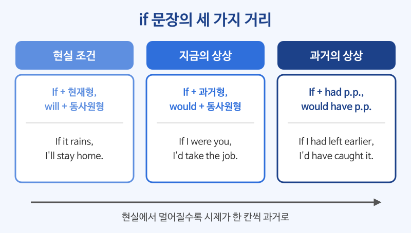

# 가정법 기초 (if 조건문)

## 이번 강의에서 배울 것

- 실제로 일어날 수 있는 일을 말하는 조건문 (If it rains, I'll stay home.)
- 현재 사실과 반대되는 일을 상상하는 가정법 과거 (If I were you, ...)
- 과거 사실과 반대되는 일을 상상하는 가정법 과거완료와 I wish

## 핵심 설명

if 문장은 "얼마나 현실적인가"에 따라 세 가지로 나뉩니다. 핵심은 **현실에서 한 걸음 멀어질 때마다 시제도 한 칸 과거로 물러난다**는 것입니다.

| 종류 | if절 | 주절 | 뜻 |
|---|---|---|---|
| 현실 조건 | 현재형 | will + 동사원형 | (실제로) ~하면 ~할 것이다 |
| 가정법 과거 | 과거형 (be는 were) | would + 동사원형 | (지금) ~라면 ~할 텐데 |
| 가정법 과거완료 | had + p.p. | would have + p.p. | (그때) ~했더라면 ~했을 텐데 |

### 1) 현실 조건: 일어날 수 있는 일

if절이 미래 일이라도 **현재형**으로 씁니다.

| 영어 | 한국어 | 듣기 |
|---|---|---|
| If it rains tomorrow, we'll cancel the picnic. | 내일 비가 오면 소풍을 취소할 것이다. | [🔊](audio/03-conditionals-01.mp3) |
| If you need help, just let me know. | 도움이 필요하면 그냥 말해 줘. | [🔊](audio/03-conditionals-02.mp3) |
| If you heat ice, it melts. | 얼음을 가열하면 녹는다. | [🔊](audio/03-conditionals-03.mp3) |
| I'll call you if I'm late. | 늦으면 전화할게. | [🔊](audio/03-conditionals-04.mp3) |

### 2) 가정법 과거: 지금 사실과 반대되는 상상

모양은 과거형이지만 뜻은 **지금**입니다. be동사는 주어와 상관없이 were를 쓰는 것이 기본입니다.

| 영어 | 한국어 | 듣기 |
|---|---|---|
| If I had more time, I would learn to cook. | 시간이 더 있다면 요리를 배울 텐데. | [🔊](audio/03-conditionals-05.mp3) |
| If I were you, I would take the job. | 내가 너라면 그 일을 맡겠어. | [🔊](audio/03-conditionals-06.mp3) |
| What would you do if you won the lottery? | 복권에 당첨되면 뭘 하겠어요? | [🔊](audio/03-conditionals-07.mp3) |
| If she lived closer, we could meet more often. | 그녀가 더 가까이 산다면 더 자주 만날 수 있을 텐데. | [🔊](audio/03-conditionals-08.mp3) |

> 💡 If I were you, I would ... 는 조언할 때 아주 자주 쓰는 표현입니다. 줄여서 I'd ... 라고도 합니다.

### 3) 가정법 과거완료: 과거 사실과 반대되는 상상

| 영어 | 한국어 | 듣기 |
|---|---|---|
| If I had left earlier, I wouldn't have missed the train. | 더 일찍 나왔더라면 기차를 놓치지 않았을 텐데. | [🔊](audio/03-conditionals-09.mp3) |
| If you had told me, I would have helped you. | 네가 말해 줬더라면 내가 도와줬을 텐데. | [🔊](audio/03-conditionals-10.mp3) |
| We would have won if we had played better. | 경기를 더 잘했더라면 우리가 이겼을 텐데. | [🔊](audio/03-conditionals-11.mp3) |

### 4) I wish: ~라면 좋을 텐데

| 영어 | 한국어 | 듣기 |
|---|---|---|
| I wish I spoke English fluently. | 영어를 유창하게 하면 좋을 텐데. (지금) | [🔊](audio/03-conditionals-12.mp3) |
| I wish I were taller. | 키가 더 크면 좋을 텐데. (지금) | [🔊](audio/03-conditionals-13.mp3) |
| I wish I had studied harder in school. | 학교 다닐 때 공부를 더 열심히 했더라면 좋았을 텐데. (과거) | [🔊](audio/03-conditionals-14.mp3) |

## 자주 하는 실수

- ❌ If it will rain, I'll stay home. → ✅ If it rains, I'll stay home.
  - 조건을 나타내는 if절에는 will을 쓰지 않고 현재형을 씁니다.
- ❌ If I am you, I will take it. → ✅ If I were you, I would take it.
  - 내가 너일 수는 없으니 현실과 반대되는 상상입니다. 가정법 과거로 씁니다.
- ❌ If I knew it, I would have told you. (어제 일) → ✅ If I had known it, I would have told you.
  - 과거 일을 반대로 상상할 때는 if절도 had p.p.로 씁니다.

## 연습 문제

괄호 안의 동사를 알맞은 형태로 바꾸세요.

1. If you ___ (press) this button, the door opens.
2. If I ___ (be) rich, I would travel around the world.
3. If he ___ (study) harder, he would have passed the test.
4. If we take a taxi, we ___ (arrive) on time.
5. I wish I ___ (have) a car right now.

## 정답과 해설

1. **press**: 늘 그렇게 되는 일반적 사실이므로 현재형입니다.
2. **were**: 지금 부자가 아닌 현실과 반대되는 가정법 과거입니다.
3. **had studied**: 과거에 공부를 덜 한 사실과 반대이므로 가정법 과거완료입니다.
4. **will arrive**: 실제로 택시를 탈 수 있는 현실 조건입니다.
5. **had**: 지금 차가 없는 현실과 반대되는 소망이라 과거형을 씁니다.

## 오늘의 단어

| 단어 | 뜻 | 예문 | 듣기 |
|---|---|---|---|
| cancel | 취소하다 | The flight was canceled. | [🔊](audio/03-conditionals-w01.mp3) |
| melt | 녹다 | The snow melted quickly. | [🔊](audio/03-conditionals-w02.mp3) |
| lottery | 복권 | He won the lottery. | [🔊](audio/03-conditionals-w03.mp3) |
| miss | 놓치다 | Hurry, or you'll miss the bus. | [🔊](audio/03-conditionals-w04.mp3) |
| fluently | 유창하게 | She speaks Spanish fluently. | [🔊](audio/03-conditionals-w05.mp3) |
