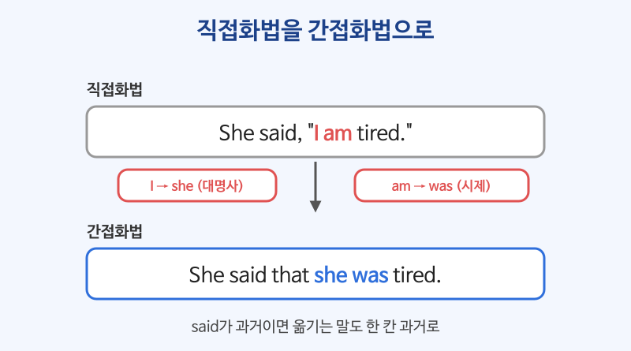

# 간접화법 (said that, asked if, told me to)

## 이번 강의에서 배울 것

- 다른 사람의 말을 옮길 때 시제를 한 칸 과거로 바꾸는 규칙
- 대명사, 시간·장소 표현을 바꾸는 방법
- 질문(asked if / asked where)과 부탁·명령(told me to)을 옮기는 방법

## 핵심 설명

직접화법은 남의 말을 따옴표 그대로 옮기고, 간접화법은 **내 입장에서 다시 말합니다**. 말한 때가 과거(said, told)이면 옮기는 내용의 시제도 **한 칸 과거**로 물러납니다.

| 직접화법 | 간접화법 |
|---|---|
| 현재형 (am, work) | 과거형 (was, worked) |
| 현재진행 (am working) | 과거진행 (was working) |
| 과거형, 현재완료 (worked, have worked) | 과거완료 (had worked) |
| will, can | would, could |
| today, tomorrow, yesterday | that day, the next day, the day before |
| here, this | there, that |

### 1) 평서문: say (that) / tell + 사람 (that)

| 영어 | 한국어 | 듣기 |
|---|---|---|
| She said that she was tired. | 그녀는 피곤하다고 말했다. | [🔊](audio/04-reported-speech-01.mp3) |
| He told me he would be late. | 그는 나에게 늦을 거라고 말했다. | [🔊](audio/04-reported-speech-02.mp3) |
| They said they had already booked the hotel. | 그들은 이미 호텔을 예약했다고 했다. | [🔊](audio/04-reported-speech-03.mp3) |
| My boss said I could leave early. | 상사가 일찍 퇴근해도 된다고 했다. | [🔊](audio/04-reported-speech-04.mp3) |
| She said she was working from home that day. | 그녀는 그날 재택근무 중이라고 말했다. | [🔊](audio/04-reported-speech-05.mp3) |

> 💡 say 뒤에는 사람이 바로 오지 않고, tell 뒤에는 사람이 꼭 옵니다. He **said** (to me) that ... / He **told me** that ...

### 2) 지금도 사실인 내용은 시제를 그대로 둘 수 있다

| 영어 | 한국어 | 듣기 |
|---|---|---|
| He said the store opens at ten. | 그는 그 가게가 10시에 연다고 말했다. | [🔊](audio/04-reported-speech-06.mp3) |
| She told me she lives in Incheon. | 그녀는 인천에 산다고 했다. | [🔊](audio/04-reported-speech-07.mp3) |

### 3) 의문문: asked if / asked + 의문사

간접 질문은 **평서문 어순(주어 + 동사)** 으로 씁니다. 물음표도 붙이지 않습니다.

| 영어 | 한국어 | 듣기 |
|---|---|---|
| She asked if I was free on Friday. | 그녀는 내가 금요일에 시간이 있는지 물었다. | [🔊](audio/04-reported-speech-08.mp3) |
| He asked whether we had any questions. | 그는 우리에게 질문이 있는지 물었다. | [🔊](audio/04-reported-speech-09.mp3) |
| The officer asked where I was staying. | 직원은 내가 어디에 묵는지 물었다. | [🔊](audio/04-reported-speech-10.mp3) |
| I asked him what time the meeting started. | 나는 그에게 회의가 몇 시에 시작하는지 물었다. | [🔊](audio/04-reported-speech-11.mp3) |

### 4) 부탁·명령: tell / ask + 사람 + to 동사원형

| 영어 | 한국어 | 듣기 |
|---|---|---|
| The doctor told me to drink more water. | 의사가 나에게 물을 더 마시라고 했다. | [🔊](audio/04-reported-speech-12.mp3) |
| She asked me to call her back. | 그녀가 나에게 다시 전화해 달라고 했다. | [🔊](audio/04-reported-speech-13.mp3) |
| He told us not to worry. | 그는 우리에게 걱정하지 말라고 했다. | [🔊](audio/04-reported-speech-14.mp3) |

### 직접화법 → 간접화법 예

| 직접화법 | 간접화법 |
|---|---|
| "I **will** call you **tomorrow**," he said. | He said he **would** call me **the next day**. |
| "**Are** you OK?" she asked. | She asked **if I was** OK. |
| "**Please wait here**," he said to me. | He asked me **to wait there**. |

## 자주 하는 실수

- ❌ She said me that she was busy. → ✅ She told me that she was busy.
  - 사람을 바로 뒤에 두려면 said가 아니라 told를 씁니다.
- ❌ He asked me where was the station. → ✅ He asked me where the station was.
  - 간접 질문은 의문문 어순이 아니라 "주어 + 동사" 순서입니다.
- ❌ She told me don't be late. → ✅ She told me not to be late.
  - 부정 명령은 not to + 동사원형으로 옮깁니다.

## 연습 문제

다음 직접화법을 간접화법으로 바꾸세요.

1. Tom said, "I'm hungry."
2. She said, "I can't come to the party."
3. He asked me, "Do you like jazz?"
4. My mother said to me, "Turn off the TV."
5. The clerk asked, "Where are you from?"

## 정답과 해설

1. **Tom said (that) he was hungry.** I → he, am → was.
2. **She said (that) she couldn't come to the party.** can't → couldn't.
3. **He asked me if (whether) I liked jazz.** Yes/No 질문은 if나 whether를 쓰고 평서문 어순으로 씁니다.
4. **My mother told me to turn off the TV.** 명령은 tell + 사람 + to 동사원형.
5. **The clerk asked where I was from.** 의문사 + 주어 + 동사 순서입니다.

## 오늘의 단어

| 단어 | 뜻 | 예문 | 듣기 |
|---|---|---|---|
| book | 예약하다 | I booked a table for four. | [🔊](audio/04-reported-speech-w01.mp3) |
| work from home | 재택근무하다 | I work from home on Fridays. | [🔊](audio/04-reported-speech-w02.mp3) |
| whether | ~인지 아닌지 | I'm not sure whether he's coming. | [🔊](audio/04-reported-speech-w03.mp3) |
| call back | 다시 전화하다 | Can I call you back later? | [🔊](audio/04-reported-speech-w04.mp3) |
| clerk | 직원, 점원 | The clerk was very helpful. | [🔊](audio/04-reported-speech-w05.mp3) |
