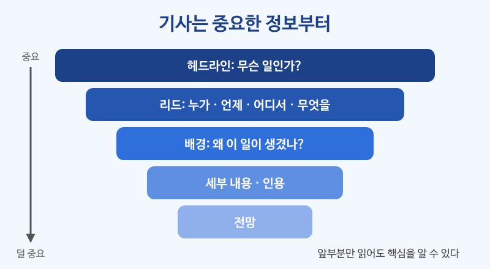

# 짧은 기사 읽기

## 이번 강의에서 배울 것

- 영어 기사의 기본 구조: 헤드라인 → 첫 문단(리드) → 세부 내용 → 인용 → 앞으로의 전망
- 헤드라인만의 독특한 문법 (현재형, 관사 생략)
- 기사 속에서 수동태, 관계대명사, 간접화법이 쓰이는 모습

## 핵심 설명

영어 기사는 **가장 중요한 정보를 맨 앞에** 둡니다. 첫 문단만 읽어도 "누가, 언제, 어디서, 무엇을" 했는지 알 수 있고, 뒤로 갈수록 세부 내용과 사람들의 말(인용)이 붙습니다. 그래서 기사를 읽을 때는 먼저 헤드라인과 첫 문단으로 큰 그림을 잡고, 나머지는 필요한 정보를 찾듯이 읽으면 됩니다.

### 지문 읽기

먼저 사전 없이 끝까지 한 번 읽어 보세요. 모르는 단어가 있어도 멈추지 말고 전체 흐름을 잡는 것이 목표입니다.

> **Riverside Opens First 24-Hour Library**
>
> Riverside opened its first 24-hour library on Monday, giving residents a quiet place to study and work at any time of day. The new library, which is located next to Central Station, was built inside an old post office.
>
> The project was announced two years ago after a city survey showed that many young people had no space to study at home. "Students and workers who share small apartments often can't concentrate," Mayor Linda Park said at the opening ceremony. "We wanted to change that."
>
> The library has 300 seats, free Wi-Fi, and private meeting rooms that can be booked online. Visitors need a library card to enter after 10 p.m., and security guards will be on duty all night.
>
> More than 2,000 people visited on the first day. Lee Su-jin, a 27-year-old nurse, said she had been waiting for a place like this for years. "I finish work at midnight, so I could never use the library before," she said.
>
> City officials say they will open two more 24-hour libraries by 2028 if the first one is successful.

### 핵심 문장 다시 듣기

지문에서 중요한 문장을 골라 한 문장씩 들어 봅니다. 듣고 바로 따라 말해 보세요.

| 영어 | 한국어 | 듣기 |
|---|---|---|
| Riverside opens first 24-hour library. | 리버사이드, 첫 24시간 도서관 문 열어 | [🔊](audio/01-news-01.mp3) |
| Riverside opened its first 24-hour library on Monday. | 리버사이드시가 월요일에 첫 24시간 도서관을 열었다. | [🔊](audio/01-news-02.mp3) |
| It gives residents a quiet place to study and work at any time of day. | 도서관은 주민들에게 하루 중 언제든 공부하고 일할 수 있는 조용한 공간을 준다. | [🔊](audio/01-news-03.mp3) |
| The new library is located next to Central Station. | 새 도서관은 중앙역 옆에 있다. | [🔊](audio/01-news-04.mp3) |
| It was built inside an old post office. | 도서관은 옛 우체국 건물 안에 지어졌다. | [🔊](audio/01-news-05.mp3) |
| The project was announced two years ago. | 이 사업은 2년 전에 발표되었다. | [🔊](audio/01-news-06.mp3) |
| Many young people had no space to study at home. | 많은 젊은이들이 집에 공부할 공간이 없었다. | [🔊](audio/01-news-07.mp3) |
| Students and workers who share small apartments often can't concentrate. | 작은 집을 함께 쓰는 학생과 직장인들은 집중하기 어려운 경우가 많습니다. | [🔊](audio/01-news-08.mp3) |
| We wanted to change that. | 우리는 그것을 바꾸고 싶었습니다. | [🔊](audio/01-news-09.mp3) |
| Private meeting rooms can be booked online. | 개인 회의실은 온라인으로 예약할 수 있다. | [🔊](audio/01-news-10.mp3) |
| Security guards will be on duty all night. | 경비원이 밤새 근무할 예정이다. | [🔊](audio/01-news-11.mp3) |
| More than 2,000 people visited on the first day. | 첫날 2,000명이 넘게 방문했다. | [🔊](audio/01-news-12.mp3) |
| She said she had been waiting for a place like this for years. | 그녀는 이런 곳을 몇 년째 기다려 왔다고 말했다. | [🔊](audio/01-news-13.mp3) |
| I finish work at midnight, so I could never use the library before. | 저는 자정에 일이 끝나서 예전에는 도서관을 전혀 이용할 수 없었어요. | [🔊](audio/01-news-14.mp3) |
| They will open two more libraries if the first one is successful. | 첫 도서관이 성공하면 두 곳을 더 열 것이다. | [🔊](audio/01-news-15.mp3) |

### 기사 읽기 포인트

| 구조 | 이 기사에서 | 확인할 것 |
|---|---|---|
| 헤드라인 | Riverside Opens First 24-Hour Library | 무슨 일인가? |
| 리드 (첫 문단) | 월요일, 중앙역 옆, 24시간 도서관 개관 | 누가, 언제, 어디서, 무엇을 |
| 배경 | 2년 전 설문 조사 결과 | 왜 이 일이 생겼나? |
| 세부 내용 | 좌석 300석, 와이파이, 회의실, 경비원 | 구체적인 숫자와 사실 |
| 인용 | 시장과 간호사의 말 | 사람들의 생각과 반응 |
| 전망 | 2028년까지 두 곳 더 | 앞으로 어떻게 되나? |

> 💡 헤드라인은 짧게 쓰려고 **지난 일도 현재형**으로 쓰고(Opens), **관사와 be동사를 자주 뺍니다**(First 24-Hour Library). 본문 첫 문장에서는 다시 과거형(opened)으로 씁니다.

### 지문 속 문법

- **관계대명사**: The new library, **which** is located next to Central Station, ... / workers **who** share small apartments
- **수동태**: was built, was announced, can be booked
- **간접화법과 과거완료진행**: She said she **had been waiting** for a place like this.
- **조건문**: if the first one **is** successful (미래 일이지만 if절은 현재형)

## 자주 하는 실수

- ❌ 헤드라인의 Opens를 보고 "앞으로 열 예정"이라고 이해한다. → ✅ 헤드라인의 현재형은 대개 "이미 일어난 일"입니다.
  - 앞으로 일어날 일은 헤드라인에서 보통 to + 동사원형으로 씁니다. (Riverside to Open New Library = 열 예정)
- ❌ 모르는 단어마다 멈춰서 사전을 찾는다. → ✅ 처음에는 끝까지 읽고, 두 번째 읽을 때 꼭 필요한 단어만 찾습니다.
  - concentrate, survey 같은 단어는 앞뒤 문장만 보고도 뜻을 짐작할 수 있습니다.
- ❌ 따옴표 안의 말을 기자의 의견으로 읽는다. → ✅ 따옴표 안은 그 사람의 말이고, 기자는 사실만 전합니다.
  - said, according to 뒤의 이름을 확인해 누구의 말인지 구분하세요.

## 연습 문제

지문을 읽고 답하세요.

1. 도서관은 어디에 있고, 원래 무슨 건물이었나요?
2. 이 도서관을 만들게 된 이유는 무엇인가요?
3. 밤 10시 이후에 들어가려면 무엇이 필요한가요?
4. 간호사 이수진 씨는 왜 전에는 도서관을 이용할 수 없었나요?
5. 다음 문장이 맞으면 T, 틀리면 F를 쓰세요. "The city has already opened three 24-hour libraries."

## 정답과 해설

1. **중앙역 옆에 있고, 옛 우체국 건물이었습니다.** located next to Central Station, built inside an old post office.
2. **설문 조사에서 많은 젊은이들이 집에 공부할 공간이 없다는 결과가 나왔기 때문입니다.** after a city survey showed that ...
3. **도서관 카드(library card)가 필요합니다.** Visitors need a library card to enter after 10 p.m.
4. **자정에 일이 끝나서 도서관이 이미 문을 닫았기 때문입니다.** I finish work at midnight.
5. **F**: 이번이 첫 번째(first) 도서관이고, 두 곳은 앞으로 2028년까지 더 열 계획입니다.

## 오늘의 단어

| 단어 | 뜻 | 예문 | 듣기 |
|---|---|---|---|
| resident | 주민 | Residents complained about the noise. | [🔊](audio/01-news-w01.mp3) |
| survey | 설문 조사 | We did a survey of our customers. | [🔊](audio/01-news-w02.mp3) |
| concentrate | 집중하다 | I can't concentrate with the TV on. | [🔊](audio/01-news-w03.mp3) |
| mayor | 시장 | The mayor gave a short speech. | [🔊](audio/01-news-w04.mp3) |
| official | 공무원, 관계자 | Officials expect more visitors next year. | [🔊](audio/01-news-w05.mp3) |
