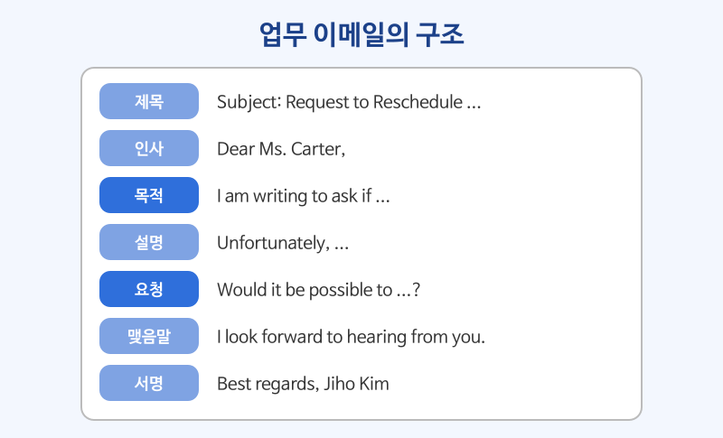

# 이메일 읽고 쓰기

## 이번 강의에서 배울 것

- 업무 이메일의 기본 구조: 제목 → 인사 → 목적 → 설명 → 요청 → 맺음말 → 서명
- 일정 변경을 부탁하는 이메일을 읽고 핵심 표현 익히기
- 같은 틀로 짧은 답장을 직접 써 보기

## 핵심 설명

업무 이메일은 **첫 두 줄 안에 목적을 밝히는 것**이 가장 중요합니다. 받는 사람이 바쁘다고 생각하고, "왜 이 메일을 보내는지 → 무엇이 필요한지 → 언제까지인지"를 순서대로 씁니다. 문장은 짧고 공손하게, 문단은 하나에 한 가지 내용만 담습니다.

### 지문 읽기

영업 담당 김지호 씨가 거래처 담당자에게 보낸 이메일입니다. 어느 문단이 목적, 설명, 요청인지 생각하며 읽어 보세요.

> **Subject: Request to Reschedule Thursday's Meeting**
>
> Dear Ms. Carter,
>
> I hope you are doing well. I am writing to ask if we could reschedule our meeting on Thursday.
>
> Unfortunately, I have been asked to attend a training session at our head office that day, and I won't be back until Friday afternoon. I am very sorry for the short notice.
>
> Would it be possible to meet next Monday instead? I am free all morning, and I could also do a video call if that is more convenient for you. I would also like to discuss the delivery schedule for next year, so the meeting might take about an hour.
>
> In the meantime, I have attached the updated price list that you asked for last week. Please let me know if you have any questions about it.
>
> Thank you for your understanding. I look forward to hearing from you.
>
> Best regards,
>
> Jiho Kim
> Sales Manager, Hanbit Electronics

### 핵심 문장 다시 듣기

| 영어 | 한국어 | 듣기 |
|---|---|---|
| I hope you are doing well. | 잘 지내고 계시길 바랍니다. | [🔊](audio/02-email-01.mp3) |
| I am writing to ask if we could reschedule our meeting on Thursday. | 목요일 회의 일정을 바꿀 수 있을지 여쭤보려고 메일 드립니다. | [🔊](audio/02-email-02.mp3) |
| I have been asked to attend a training session at our head office that day. | 그날 본사 교육에 참석하라는 요청을 받았습니다. | [🔊](audio/02-email-03.mp3) |
| I won't be back until Friday afternoon. | 금요일 오후가 되어야 돌아옵니다. | [🔊](audio/02-email-04.mp3) |
| I am very sorry for the short notice. | 급하게 연락드려 정말 죄송합니다. | [🔊](audio/02-email-05.mp3) |
| Would it be possible to meet next Monday instead? | 대신 다음 주 월요일에 만날 수 있을까요? | [🔊](audio/02-email-06.mp3) |
| I could also do a video call if that is more convenient for you. | 더 편하시다면 화상 통화도 가능합니다. | [🔊](audio/02-email-07.mp3) |
| The meeting might take about an hour. | 회의는 한 시간 정도 걸릴 수도 있습니다. | [🔊](audio/02-email-08.mp3) |
| I have attached the updated price list that you asked for last week. | 지난주에 요청하신 최신 가격표를 첨부했습니다. | [🔊](audio/02-email-09.mp3) |
| Please let me know if you have any questions about it. | 궁금한 점이 있으면 알려 주세요. | [🔊](audio/02-email-10.mp3) |
| Thank you for your understanding. | 양해해 주셔서 감사합니다. | [🔊](audio/02-email-11.mp3) |
| I look forward to hearing from you. | 답장 기다리겠습니다. | [🔊](audio/02-email-12.mp3) |

### 이메일 구조와 쓸 수 있는 표현

| 구조 | 이 이메일에서 | 바꿔 쓸 수 있는 표현 |
|---|---|---|
| 제목 | Request to Reschedule Thursday's Meeting | Question about ..., Update on ... |
| 인사 | Dear Ms. Carter, | Hi Sarah, (친한 사이) |
| 안부 | I hope you are doing well. | I hope you had a great weekend. |
| 목적 | I am writing to ask if ... | I'm writing to let you know that ... |
| 설명 | Unfortunately, ... | Due to ..., ... |
| 요청 | Would it be possible to ...? | Could you please ...? |
| 첨부 | I have attached ... | Please find attached ... |
| 맺음말 | I look forward to hearing from you. | Please let me know if ... |
| 서명 | Best regards, | Kind regards, / Thanks, |

### 답장 예시

카터 씨가 보낸 짧은 답장입니다. 같은 틀을 그대로 따릅니다.

| 영어 | 한국어 | 듣기 |
|---|---|---|
| Thank you for letting me know. | 알려 주셔서 감사합니다. | [🔊](audio/02-email-13.mp3) |
| Monday at ten works for me. | 월요일 10시 괜찮습니다. | [🔊](audio/02-email-14.mp3) |
| I'll send you a video call link on Friday. | 금요일에 화상 통화 링크를 보내 드리겠습니다. | [🔊](audio/02-email-15.mp3) |

> 💡 영어 이메일에서는 사과를 길게 하지 않습니다. I'm sorry for the short notice. 한 문장이면 충분하고, 바로 대안을 제시하는 편이 더 공손하게 느껴집니다.

## 자주 하는 실수

- ❌ I'm looking forward to hear from you. → ✅ I'm looking forward to hearing from you.
  - look forward to의 to는 전치사라서 뒤에 동명사가 옵니다.
- ❌ Please find the attached file. Please check. Please reply. → ✅ I've attached the file. Could you check it and let me know what you think?
  - Please를 반복하면 명령처럼 들립니다. Could you ...? 를 섞어 부드럽게 씁니다.
- ❌ 첫 문장부터 자기소개와 배경을 길게 쓴다. → ✅ 인사 다음 문장에서 바로 목적을 밝힙니다.
  - I'm writing to ... 로 시작하면 목적이 금방 드러납니다.

## 연습 문제

1. 김지호 씨가 이메일을 보낸 목적은 무엇인가요?
2. 목요일에 만날 수 없는 이유는 무엇인가요?
3. 이메일에 함께 보낸 것은 무엇인가요?
4. 우리말을 영어로 바꾸세요: "금요일까지 보고서를 보내 주실 수 있을까요?" (Would it be possible to ...?)
5. 다음 상황으로 2~3문장짜리 이메일 본문을 쓰세요: 내일 회의에 10분 늦을 것 같다. 사과하고, 먼저 시작해 달라고 부탁한다.

## 정답과 해설

1. **목요일 회의 일정을 바꾸기 위해서입니다.** I am writing to ask if we could reschedule our meeting.
2. **그날 본사 교육에 참석해야 하기 때문입니다.** I have been asked to attend a training session at our head office.
3. **최신 가격표(the updated price list)입니다.** 지난주에 카터 씨가 요청한 자료입니다.
4. **Would it be possible to send me the report by Friday?** Could you send me the report by Friday? 도 좋습니다.
5. 예시: **I'm writing to let you know that I'll be about ten minutes late for tomorrow's meeting. I'm sorry for the inconvenience. Could you please start without me?** 목적 → 사과 → 요청 순서를 지켰는지 확인하세요.

## 오늘의 단어

| 단어 | 뜻 | 예문 | 듣기 |
|---|---|---|---|
| reschedule | 일정을 바꾸다 | Can we reschedule the call? | [🔊](audio/02-email-w01.mp3) |
| head office | 본사 | Our head office is in Seoul. | [🔊](audio/02-email-w02.mp3) |
| short notice | 갑작스러운 통보 | Sorry for the short notice. | [🔊](audio/02-email-w03.mp3) |
| convenient | 편리한, 형편이 좋은 | What time is convenient for you? | [🔊](audio/02-email-w04.mp3) |
| attach | 첨부하다 | I've attached the contract. | [🔊](audio/02-email-w05.mp3) |
