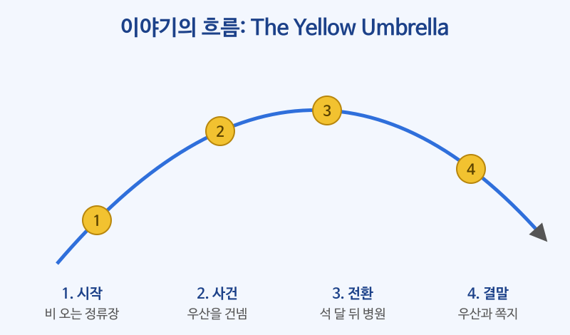

# 이야기 읽기

## 이번 강의에서 배울 것

- 이야기의 흐름(시작 → 사건 → 전환 → 결말)을 따라가며 읽는 법
- 이야기 속에서 과거형과 과거완료가 시간 순서를 만드는 방식
- 인물의 마음을 직접 말하지 않아도 행동에서 읽어 내는 법

## 핵심 설명

이야기는 대부분 **과거형**으로 쓰고, 그보다 더 앞선 일을 말할 때 **과거완료(had p.p.)** 를 씁니다. 따옴표 안의 대화는 인물이 그 순간에 한 말이라 현재형이 많습니다. 시제만 잘 따라가도 사건의 순서가 또렷하게 보입니다.

### 지문 읽기

> **The Yellow Umbrella**
>
> It was raining hard when Mina got off the bus. She had just finished a long day at work, and all she wanted was to get home. At the bus stop, she noticed an old man standing without an umbrella. He was holding a paper bag that was getting wetter and wetter.
>
> "Where are you going?" she asked.
>
> "Just to the hospital across the street," he said. "My wife is there."
>
> Mina had only one umbrella, a bright yellow one that her mother had given her. Without thinking, she handed it to him. "Take it. I live very close," she said, although her apartment was twenty minutes away.
>
> She arrived home soaked, and the next day she caught a cold. Still, she didn't regret it.
>
> Three months later, Mina went to the same hospital to visit a friend. In the lobby, she saw something bright and yellow by the front desk. It was her umbrella, with a small note tied to the handle: "To the young woman who lent me this. My wife is well now. Thank you for your kindness."
>
> The nurse at the desk smiled. "He came here every week and asked if you had come back," she said. "He wanted to thank you in person."
>
> Mina held the umbrella close and walked out into the sunshine, smiling.

### 핵심 문장 다시 듣기

| 영어 | 한국어 | 듣기 |
|---|---|---|
| It was raining hard when Mina got off the bus. | 미나가 버스에서 내렸을 때 비가 세차게 내리고 있었다. | [🔊](audio/03-story-01.mp3) |
| She had just finished a long day at work. | 그녀는 회사에서 긴 하루를 막 마친 참이었다. | [🔊](audio/03-story-02.mp3) |
| All she wanted was to get home. | 그녀가 바란 건 집에 가는 것뿐이었다. | [🔊](audio/03-story-03.mp3) |
| She noticed an old man standing without an umbrella. | 그녀는 우산 없이 서 있는 노인을 보았다. | [🔊](audio/03-story-04.mp3) |
| He was holding a paper bag that was getting wetter and wetter. | 그는 점점 더 젖어 가는 종이봉투를 들고 있었다. | [🔊](audio/03-story-05.mp3) |
| Just to the hospital across the street. | 길 건너 병원까지만요. | [🔊](audio/03-story-06.mp3) |
| It was a bright yellow umbrella that her mother had given her. | 그것은 어머니가 준 밝은 노란색 우산이었다. | [🔊](audio/03-story-07.mp3) |
| Without thinking, she handed it to him. | 그녀는 생각할 겨를도 없이 그것을 그에게 건넸다. | [🔊](audio/03-story-08.mp3) |
| Take it. I live very close. | 가져가세요. 저는 아주 가까이 살아요. | [🔊](audio/03-story-09.mp3) |
| She arrived home soaked. | 그녀는 흠뻑 젖은 채로 집에 도착했다. | [🔊](audio/03-story-10.mp3) |
| Still, she didn't regret it. | 그래도 그녀는 후회하지 않았다. | [🔊](audio/03-story-11.mp3) |
| She saw something bright and yellow by the front desk. | 그녀는 안내 데스크 옆에서 밝은 노란색 무언가를 보았다. | [🔊](audio/03-story-12.mp3) |
| Thank you for your kindness. | 친절을 베풀어 주셔서 고맙습니다. | [🔊](audio/03-story-13.mp3) |
| He came here every week and asked if you had come back. | 그분은 매주 와서 당신이 다시 왔는지 물었어요. | [🔊](audio/03-story-14.mp3) |
| Mina held the umbrella close and walked out into the sunshine. | 미나는 우산을 꼭 껴안고 햇살 속으로 걸어 나갔다. | [🔊](audio/03-story-15.mp3) |

### 이야기의 흐름

| 단계 | 내용 | 시제 단서 |
|---|---|---|
| 시작 | 비 오는 저녁, 지친 미나가 버스에서 내린다 | It was raining (과거진행: 배경) |
| 사건 | 우산 없는 노인에게 하나뿐인 우산을 건넨다 | handed, said (과거: 사건) |
| 전환 | 석 달 뒤, 병원에서 자기 우산을 발견한다 | Three months later (시간 이동) |
| 결말 | 쪽지와 간호사의 말로 노인의 마음을 알게 된다 | had come back (과거완료: 더 앞선 일) |

### 행동에서 마음 읽기

글쓴이는 "미나는 친절했다"라고 직접 쓰지 않습니다. 대신 행동으로 보여 줍니다.

- "I live very close," she said, **although her apartment was twenty minutes away.** → 노인이 미안해하지 않도록 거짓말을 했습니다.
- **Still, she didn't regret it.** → 감기에 걸렸지만 자기 선택을 후회하지 않습니다.
- **He came here every week** → 노인도 고마운 마음을 잊지 않았습니다.

> 💡 이야기를 읽을 때 although, still, but, without thinking 같은 말에 밑줄을 그어 보세요. 인물의 마음이 드러나는 곳에는 이런 말이 자주 붙어 있습니다.

## 자주 하는 실수

- ❌ "Mina had only one umbrella"를 "미나는 우산을 하나 가졌었다(과거완료)"로 읽는다. → ✅ 여기서 had는 "가지고 있었다"라는 뜻의 일반동사 과거형입니다.
  - had 뒤에 과거분사가 오면 과거완료(had given), 명사가 오면 have의 과거형(had one umbrella)입니다.
- ❌ the next day를 "다음 날 아침"처럼 지금 기준의 tomorrow로 읽는다. → ✅ 이야기 속 그날의 다음 날입니다.
  - 이야기에서는 tomorrow 대신 the next day, yesterday 대신 the day before를 씁니다.
- ❌ 대화문의 현재형(My wife is there.)을 보고 시점이 바뀌었다고 생각한다. → ✅ 따옴표 안은 인물이 그때 한 말을 그대로 옮긴 것입니다.
  - 이야기 전체의 시점은 여전히 과거입니다.

## 연습 문제

지문을 읽고 답하세요.

1. 노인은 어디에 가는 중이었고, 왜 그곳에 갔나요?
2. 미나의 우산은 원래 누가 준 것인가요?
3. 미나는 왜 "I live very close."라고 말했을까요?
4. 석 달 뒤 미나가 병원에 간 이유는 무엇인가요?
5. 지문에서 과거완료(had p.p.) 문장을 두 개 찾아 쓰세요.

## 정답과 해설

1. **길 건너 병원에 가는 중이었고, 아내가 입원해 있었기 때문입니다.** My wife is there.
2. **미나의 어머니입니다.** a bright yellow one that her mother had given her.
3. **노인이 부담 없이 우산을 받게 하려고요.** 실제로 미나의 집은 20분 거리(twenty minutes away)였습니다.
4. **친구를 문병하러 갔습니다.** to visit a friend.
5. **She had just finished a long day at work. / ... that her mother had given her. / ... asked if you had come back.** 중 두 개. 모두 이야기 속 시점보다 더 먼저 일어난 일입니다.

## 오늘의 단어

| 단어 | 뜻 | 예문 | 듣기 |
|---|---|---|---|
| notice | 알아차리다 | Did you notice anything strange? | [🔊](audio/03-story-w01.mp3) |
| hand | 건네주다 | She handed me the keys. | [🔊](audio/03-story-w02.mp3) |
| soaked | 흠뻑 젖은 | My shoes are soaked. | [🔊](audio/03-story-w03.mp3) |
| regret | 후회하다 | I don't regret my decision. | [🔊](audio/03-story-w04.mp3) |
| kindness | 친절 | Thank you for your kindness. | [🔊](audio/03-story-w05.mp3) |
