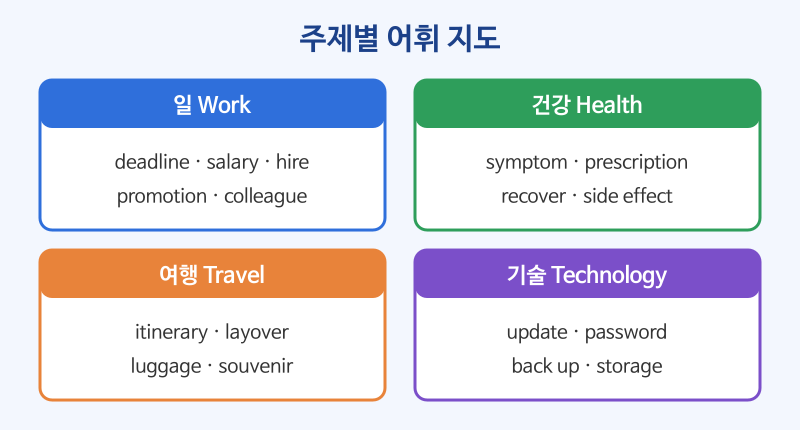

# 주제별 어휘 (일·건강·여행·기술)

## 이번 강의에서 배울 것

- 성인이 가장 자주 이야기하는 네 가지 주제의 중급 어휘
- 단어를 낱개가 아니라 예문 속에서 함께 익히는 방법
- 같은 주제 안에서 짝을 이루는 단어 (apply for / hire, symptom / prescription)

## 핵심 설명

중급 단계에서는 단어를 많이 아는 것보다 **아는 단어로 문장을 만들 수 있는 것**이 중요합니다. 이 강의에서는 주제마다 핵심 단어 여덟 개를 고르고, 그 단어들이 실제로 쓰이는 예문을 함께 익힙니다.

### 1) 일 (Work)

| 단어 | 뜻 | 단어 | 뜻 |
|---|---|---|---|
| apply for | ~에 지원하다 | deadline | 마감일 |
| hire | 고용하다 | salary | 월급, 연봉 |
| colleague | 동료 | promotion | 승진 |
| resign | 사직하다 | workload | 업무량 |

| 영어 | 한국어 | 듣기 |
|---|---|---|
| I applied for a job at a bank. | 은행 일자리에 지원했다. | [🔊](audio/01-topic-words-01.mp3) |
| The deadline for the project is next Friday. | 그 프로젝트의 마감일은 다음 주 금요일이다. | [🔊](audio/01-topic-words-02.mp3) |
| My workload has doubled since my colleague resigned. | 동료가 그만둔 뒤로 내 업무량이 두 배가 됐다. | [🔊](audio/01-topic-words-03.mp3) |
| She got a promotion and a higher salary. | 그녀는 승진해서 연봉도 올랐다. | [🔊](audio/01-topic-words-04.mp3) |

### 2) 건강 (Health)

| 단어 | 뜻 | 단어 | 뜻 |
|---|---|---|---|
| symptom | 증상 | prescription | 처방전 |
| sore throat | 목이 아픔 | side effect | 부작용 |
| recover | 회복하다 | check-up | 건강 검진 |
| allergy | 알레르기 | exercise regularly | 꾸준히 운동하다 |

| 영어 | 한국어 | 듣기 |
|---|---|---|
| I have a sore throat and a slight fever. | 목이 아프고 열이 조금 있다. | [🔊](audio/01-topic-words-05.mp3) |
| The doctor gave me a prescription for antibiotics. | 의사가 항생제 처방전을 써 주었다. | [🔊](audio/01-topic-words-06.mp3) |
| This medicine may have some side effects. | 이 약은 부작용이 있을 수 있다. | [🔊](audio/01-topic-words-07.mp3) |
| It took me two weeks to fully recover. | 완전히 회복하는 데 2주가 걸렸다. | [🔊](audio/01-topic-words-08.mp3) |

### 3) 여행 (Travel)

| 단어 | 뜻 | 단어 | 뜻 |
|---|---|---|---|
| itinerary | 여행 일정표 | delay | 지연 |
| book in advance | 미리 예약하다 | layover | (비행기) 경유, 환승 대기 |
| sightseeing | 관광 | local | 현지의, 현지인 |
| luggage | 짐, 수하물 | souvenir | 기념품 |

| 영어 | 한국어 | 듣기 |
|---|---|---|
| It's cheaper to book flights in advance. | 비행기표는 미리 예약하는 게 더 싸다. | [🔊](audio/01-topic-words-09.mp3) |
| Our flight was delayed for three hours. | 비행기가 세 시간 지연되었다. | [🔊](audio/01-topic-words-10.mp3) |
| We have a two-hour layover in Tokyo. | 도쿄에서 두 시간 환승 대기가 있다. | [🔊](audio/01-topic-words-11.mp3) |
| Let's ask a local for a good restaurant. | 현지인에게 괜찮은 식당을 물어보자. | [🔊](audio/01-topic-words-12.mp3) |

### 4) 기술 (Technology)

| 단어 | 뜻 | 단어 | 뜻 |
|---|---|---|---|
| update | 업데이트(하다) | password | 비밀번호 |
| download | 내려받다 | device | 기기 |
| back up | 백업하다 | storage | 저장 공간 |
| sign in | 로그인하다 | battery life | 배터리 수명 |

| 영어 | 한국어 | 듣기 |
|---|---|---|
| You need to update the app to use this feature. | 이 기능을 쓰려면 앱을 업데이트해야 한다. | [🔊](audio/01-topic-words-13.mp3) |
| Always back up your files before you reset the device. | 기기를 초기화하기 전에 항상 파일을 백업하세요. | [🔊](audio/01-topic-words-14.mp3) |
| I can't sign in because I forgot my password. | 비밀번호를 잊어버려서 로그인할 수 없다. | [🔊](audio/01-topic-words-15.mp3) |
| My phone is running out of storage. | 휴대폰 저장 공간이 부족해지고 있다. | [🔊](audio/01-topic-words-16.mp3) |

> 💡 새 단어는 혼자 외우지 말고 **나에 대한 문장**을 하나씩 만들어 보세요. "My workload is heavy this month." 처럼 내 이야기로 만든 문장이 가장 오래 기억에 남습니다.

## 자주 하는 실수

- ❌ I applied a new job. → ✅ I applied for a new job.
  - 일자리나 비자에 "지원하다, 신청하다"는 apply for입니다.
- ❌ I have many luggages. → ✅ I have a lot of luggage.
  - luggage는 셀 수 없는 명사입니다. 개수를 말할 때는 two pieces of luggage, two bags라고 합니다.
- ❌ My salary is expensive. → ✅ My salary is high.
  - 월급, 가격, 비용처럼 숫자의 크기를 말할 때는 high/low를 씁니다. expensive는 "물건이 비싼"입니다.

## 연습 문제

빈칸에 알맞은 단어를 보기에서 고르세요.

보기: deadline, prescription, layover, back up, recover

1. You can't buy this medicine without a ___.
2. Please ___ your data regularly.
3. We had a long ___ in Dubai on the way to Paris.
4. The ___ is tomorrow, so I have to work late tonight.
5. Get some rest. You need time to ___.

## 정답과 해설

1. **prescription**: 처방전 없이는 살 수 없는 약입니다.
2. **back up**: 자료를 정기적으로 백업하라는 뜻입니다.
3. **layover**: 파리로 가는 길에 두바이에서 오래 환승 대기를 했습니다.
4. **deadline**: 마감이 내일이라 야근을 해야 합니다.
5. **recover**: 회복할 시간이 필요합니다.

## 오늘의 단어

| 단어 | 뜻 | 예문 | 듣기 |
|---|---|---|---|
| double | 두 배가 되다 | Prices have doubled in ten years. | [🔊](audio/01-topic-words-w01.mp3) |
| slight | 약간의, 가벼운 | I have a slight headache. | [🔊](audio/01-topic-words-w02.mp3) |
| antibiotics | 항생제 | Take the antibiotics for five days. | [🔊](audio/01-topic-words-w03.mp3) |
| feature | 기능, 특징 | This phone has a new camera feature. | [🔊](audio/01-topic-words-w04.mp3) |
| run out of | ~이 다 떨어지다 | We've run out of milk. | [🔊](audio/01-topic-words-w05.mp3) |
