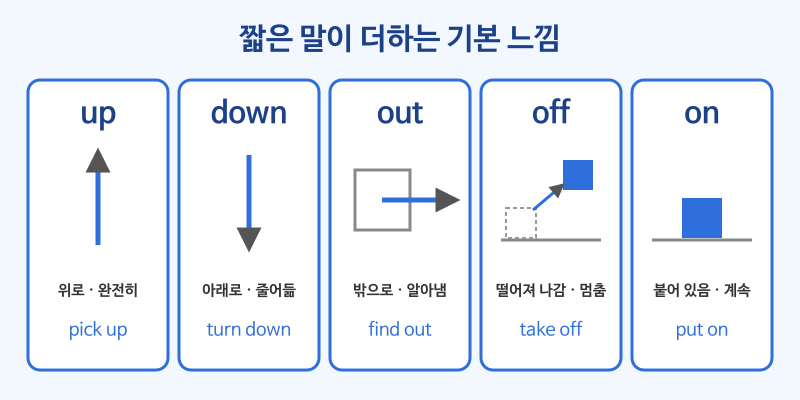

# 구동사 기초 (phrasal verbs)

## 이번 강의에서 배울 것

- 구동사가 "동사 + 짧은 부사(up, out, off, on ...)"로 새로운 뜻을 만든다는 것
- up, out, off, on, down이 더하는 기본 느낌
- 목적어를 사이에 넣을 수 있는 구동사와 넣을 수 없는 구동사

## 핵심 설명

원어민은 일상 대화에서 어려운 한 단어 동사보다 **쉬운 동사 + 짧은 말** 을 훨씬 많이 씁니다. continue 대신 go on, cancel 대신 call off, discover 대신 find out을 쓰는 식입니다. 뒤에 붙는 짧은 말마다 기본 느낌이 있어서, 그 느낌을 알면 처음 보는 구동사도 뜻을 짐작할 수 있습니다.

| 짧은 말 | 기본 느낌 | 예 |
|---|---|---|
| up | 위로, 완전히 끝까지 | get up, pick up, use up |
| down | 아래로, 줄어듦 | sit down, turn down, slow down |
| out | 밖으로, 찾아냄, 끝까지 | find out, work out, run out |
| off | 떨어져 나감, 멈춤 | take off, turn off, call off |
| on | 붙어 있음, 계속 | put on, turn on, go on |

### 1) up과 down

| 영어 | 한국어 | 듣기 |
|---|---|---|
| Can you pick me up at the station? | 역으로 나 좀 데리러 와 줄래? | [🔊](audio/02-phrasal-verbs-01.mp3) |
| I'll look up the word in the dictionary. | 사전에서 그 단어를 찾아볼게. | [🔊](audio/02-phrasal-verbs-02.mp3) |
| Could you turn down the music a little? | 음악 소리 좀 줄여 줄래요? | [🔊](audio/02-phrasal-verbs-03.mp3) |
| She turned down the job offer. | 그녀는 그 일자리 제안을 거절했다. | [🔊](audio/02-phrasal-verbs-04.mp3) |

### 2) out

| 영어 | 한국어 | 듣기 |
|---|---|---|
| I found out the truth yesterday. | 어제 진실을 알아냈다. | [🔊](audio/02-phrasal-verbs-05.mp3) |
| We ran out of coffee. | 커피가 다 떨어졌다. | [🔊](audio/02-phrasal-verbs-06.mp3) |
| Don't worry. We'll work it out. | 걱정 마. 우리가 해결할 거야. | [🔊](audio/02-phrasal-verbs-07.mp3) |
| Please fill out this form. | 이 양식을 작성해 주세요. | [🔊](audio/02-phrasal-verbs-08.mp3) |

### 3) off와 on

| 영어 | 한국어 | 듣기 |
|---|---|---|
| The plane took off on time. | 비행기가 제시간에 이륙했다. | [🔊](audio/02-phrasal-verbs-09.mp3) |
| They called off the meeting because of the storm. | 폭풍 때문에 회의가 취소됐다. | [🔊](audio/02-phrasal-verbs-10.mp3) |
| Please turn off your phones. | 휴대폰을 꺼 주세요. | [🔊](audio/02-phrasal-verbs-11.mp3) |
| Put on your coat. It's cold outside. | 코트 입어. 밖에 추워. | [🔊](audio/02-phrasal-verbs-12.mp3) |
| Sorry, please go on. | 죄송해요, 계속 말씀하세요. | [🔊](audio/02-phrasal-verbs-13.mp3) |

### 4) 목적어의 자리: 사이에 넣을 수 있는 구동사

turn off, pick up, put on, call off 같은 구동사는 목적어를 **사이에 넣어도, 뒤에 두어도** 됩니다. 단, 목적어가 **대명사(it, them, me)** 이면 반드시 사이에 넣습니다.

| 영어 | 한국어 | 듣기 |
|---|---|---|
| Turn off the light. | 불 꺼. | [🔊](audio/02-phrasal-verbs-14.mp3) |
| Turn the light off. | 불 꺼. | [🔊](audio/02-phrasal-verbs-15.mp3) |
| Turn it off. | 그거 꺼. | [🔊](audio/02-phrasal-verbs-16.mp3) |

> 💡 look after(돌보다), get on(타다), run into(우연히 만나다) 같은 구동사는 목적어를 사이에 넣지 않습니다. look after the kids (O) / look the kids after (X)

## 자주 하는 실수

- ❌ Turn off it. → ✅ Turn it off.
  - 목적어가 대명사이면 동사와 짧은 말 사이에 넣습니다.
- ❌ I'll look the children after. → ✅ I'll look after the children.
  - look after는 목적어를 사이에 넣을 수 없는 구동사입니다.
- ❌ We ran out coffee. → ✅ We ran out of coffee.
  - run out 뒤에 다 떨어진 물건을 쓰려면 of가 필요합니다. 물건 없이 말할 때는 The coffee ran out. 처럼 씁니다.

## 연습 문제

빈칸에 알맞은 짧은 말(up, down, out, off, on)을 넣으세요.

1. The game was called ___ because of the rain.
2. Can you turn ___ the heater? It's freezing.
3. I need to find ___ what time the store closes.
4. She picked ___ her kids from school.
5. The volume is too loud. Please turn it ___.

## 정답과 해설

1. **off**: call off는 "취소하다"입니다.
2. **on**: 히터를 켜 달라는 말입니다. turn on은 "켜다"입니다.
3. **out**: find out은 "알아내다"입니다.
4. **up**: pick up은 "(차로) 데리러 가다"입니다.
5. **down**: 소리를 줄이는 것은 turn down입니다. turn it off는 "아예 끄다"라는 뜻이 됩니다.

## 오늘의 단어

| 단어 | 뜻 | 예문 | 듣기 |
|---|---|---|---|
| look after | 돌보다 | Can you look after my dog this weekend? | [🔊](audio/02-phrasal-verbs-w01.mp3) |
| run into | 우연히 만나다 | I ran into my old teacher at the mall. | [🔊](audio/02-phrasal-verbs-w02.mp3) |
| give back | 돌려주다 | I'll give it back tomorrow. | [🔊](audio/02-phrasal-verbs-w03.mp3) |
| set up | 설치하다, 준비하다 | Can you help me set up the projector? | [🔊](audio/02-phrasal-verbs-w04.mp3) |
| figure out | 이해하다, 알아내다 | I can't figure out this problem. | [🔊](audio/02-phrasal-verbs-w05.mp3) |
