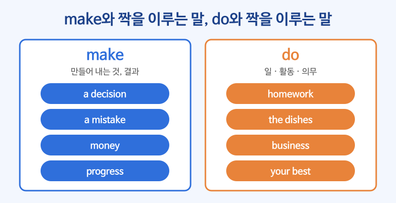

# 콜로케이션 (자연스럽게 어울리는 단어 짝)

## 이번 강의에서 배울 것

- 콜로케이션이 "원어민이 습관처럼 함께 쓰는 단어 짝"이라는 것
- 한국인이 자주 헷갈리는 make와 do, take와 have의 짝
- 형용사 + 명사 짝 (heavy rain, strong coffee)과 동사 + 명사 짝

## 핵심 설명

문법이 맞아도 어색한 영어가 있습니다. "결정을 하다"를 do a decision이라고 하면 뜻은 통하지만 원어민에게는 낯설게 들립니다. 영어에서는 **make** a decision이라고 합니다. 이렇게 습관처럼 붙어 다니는 단어 짝을 **콜로케이션** 이라고 합니다. 규칙으로 외우기보다 **덩어리째** 익히는 것이 가장 빠릅니다.

### 1) make vs. do

**make** 는 새로 만들어 내는 것, 결과가 생기는 것에, **do** 는 일·활동·의무를 하는 것에 주로 씁니다.

| make | do |
|---|---|
| make a decision 결정하다 | do homework 숙제하다 |
| make a mistake 실수하다 | do the dishes 설거지하다 |
| make money 돈을 벌다 | do business 사업하다, 거래하다 |
| make a phone call 전화하다 | do your best 최선을 다하다 |
| make progress 발전하다 | do someone a favor 부탁을 들어주다 |

| 영어 | 한국어 | 듣기 |
|---|---|---|
| We need to make a decision by Friday. | 금요일까지 결정을 내려야 한다. | [🔊](audio/03-collocations-01.mp3) |
| Everyone makes mistakes. | 누구나 실수를 한다. | [🔊](audio/03-collocations-02.mp3) |
| You've made a lot of progress this year. | 올해 많이 늘었네요. | [🔊](audio/03-collocations-03.mp3) |
| I'll do the dishes after dinner. | 저녁 먹고 내가 설거지할게. | [🔊](audio/03-collocations-04.mp3) |
| Could you do me a favor? | 부탁 하나 들어줄 수 있어요? | [🔊](audio/03-collocations-05.mp3) |

### 2) take와 have

| 영어 | 한국어 | 듣기 |
|---|---|---|
| Let's take a break for ten minutes. | 10분 쉬자. | [🔊](audio/03-collocations-06.mp3) |
| It takes time to learn a new skill. | 새로운 기술을 배우는 데는 시간이 걸린다. | [🔊](audio/03-collocations-07.mp3) |
| Please take a seat. | 앉으세요. | [🔊](audio/03-collocations-08.mp3) |
| We had a great time at the party. | 우리는 파티에서 즐거운 시간을 보냈다. | [🔊](audio/03-collocations-09.mp3) |
| Let's have a quick meeting. | 짧게 회의 한번 하죠. | [🔊](audio/03-collocations-10.mp3) |

### 3) 형용사 + 명사

한국어로는 같은 "센, 많은"이라도 영어에서는 명사마다 어울리는 형용사가 다릅니다.

| 한국어식 (어색함) | 자연스러운 짝 | 뜻 |
|---|---|---|
| strong rain | **heavy** rain | 폭우 |
| thick coffee | **strong** coffee | 진한 커피 |
| big traffic | **heavy** traffic | 교통 체증 |
| hard illness | **serious** illness | 중병 |
| big wind | **strong** wind | 강풍 |

| 영어 | 한국어 | 듣기 |
|---|---|---|
| There was heavy rain all night. | 밤새 폭우가 내렸다. | [🔊](audio/03-collocations-11.mp3) |
| I need a cup of strong coffee. | 진한 커피 한 잔이 필요하다. | [🔊](audio/03-collocations-12.mp3) |
| We got stuck in heavy traffic. | 우리는 심한 교통 체증에 갇혔다. | [🔊](audio/03-collocations-13.mp3) |

### 4) 동사 + 명사

| 영어 | 한국어 | 듣기 |
|---|---|---|
| Please pay attention to the safety rules. | 안전 수칙에 주의를 기울여 주세요. | [🔊](audio/03-collocations-14.mp3) |
| He always keeps his promises. | 그는 언제나 약속을 지킨다. | [🔊](audio/03-collocations-15.mp3) |
| Can I ask you a question? | 질문 하나 해도 될까요? | [🔊](audio/03-collocations-16.mp3) |

> 💡 새로운 명사를 배울 때는 "이 명사 앞에 어떤 동사가 오지?"를 함께 확인하세요. 영영사전의 예문을 보거나, 검색창에 make a decision과 do a decision을 따옴표로 묶어 각각 검색해 보면 어느 쪽이 자연스러운지 금방 알 수 있습니다.

## 자주 하는 실수

- ❌ I did a mistake. → ✅ I made a mistake.
  - mistake는 make와 짝을 이룹니다.
- ❌ Let's make a break. → ✅ Let's take a break.
  - "쉬다"는 take a break입니다. 같은 뜻으로 have a break도 씁니다.
- ❌ There was strong rain yesterday. → ✅ There was heavy rain yesterday.
  - 비, 눈, 교통량이 많을 때는 heavy를 씁니다.

## 연습 문제

빈칸에 make, do, take, have 중 알맞은 것을 알맞은 형태로 넣으세요.

1. I ___ my homework every evening.
2. He ___ a lot of money last year.
3. Can I ___ a photo of you?
4. We ___ a wonderful time in Jeju.
5. Don't worry. Just ___ your best.

## 정답과 해설

1. **do**: 숙제는 do homework입니다.
2. **made**: 돈을 버는 것은 make money입니다.
3. **take**: 사진을 찍는 것은 take a photo입니다.
4. **had**: 즐거운 시간을 보내는 것은 have a good time입니다.
5. **do**: 최선을 다하는 것은 do your best입니다.

## 오늘의 단어

| 단어 | 뜻 | 예문 | 듣기 |
|---|---|---|---|
| progress | 발전, 진전 | We're making good progress. | [🔊](audio/03-collocations-w01.mp3) |
| favor | 부탁, 호의 | Can I ask you a favor? | [🔊](audio/03-collocations-w02.mp3) |
| skill | 기술, 능력 | Communication is an important skill. | [🔊](audio/03-collocations-w03.mp3) |
| attention | 주의, 관심 | Thank you for your attention. | [🔊](audio/03-collocations-w04.mp3) |
| serious | 심각한, 진지한 | It's a serious problem. | [🔊](audio/03-collocations-w05.mp3) |
